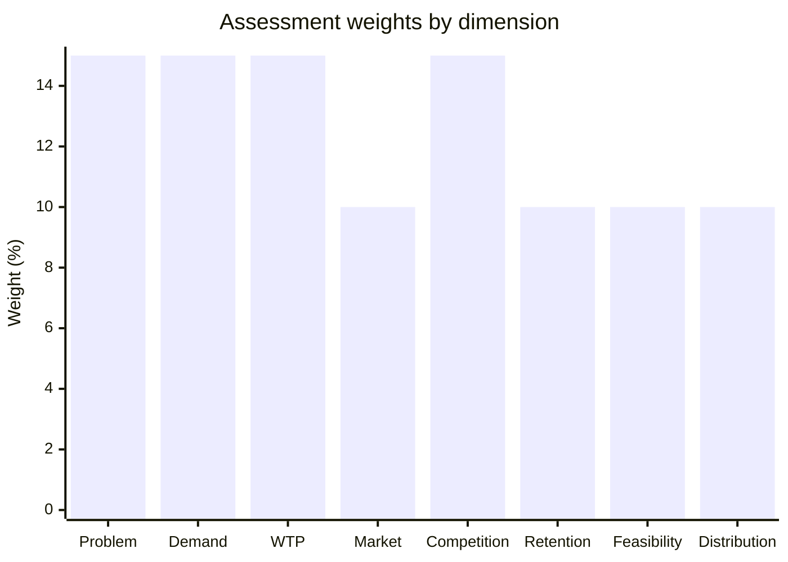
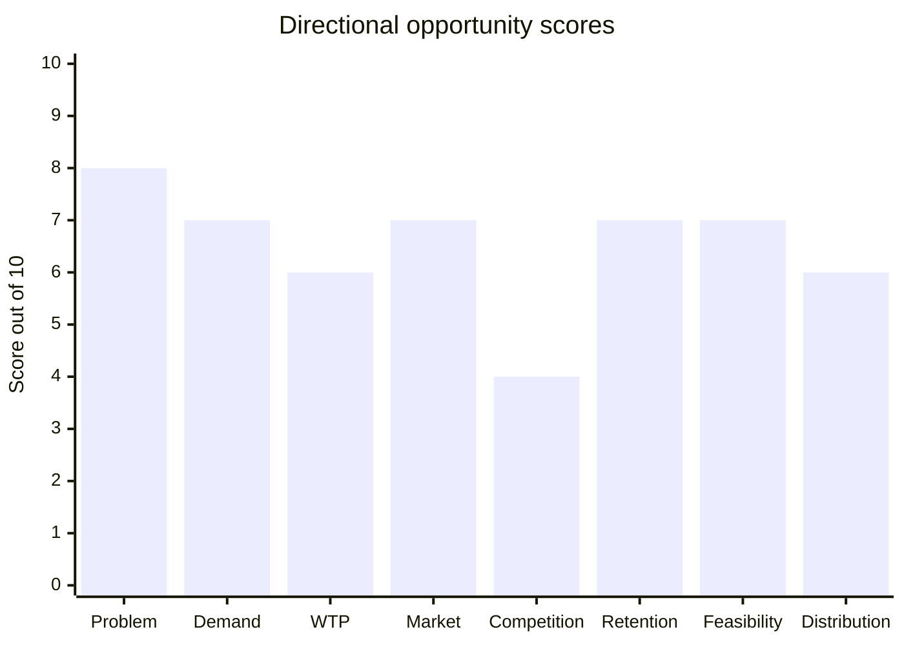
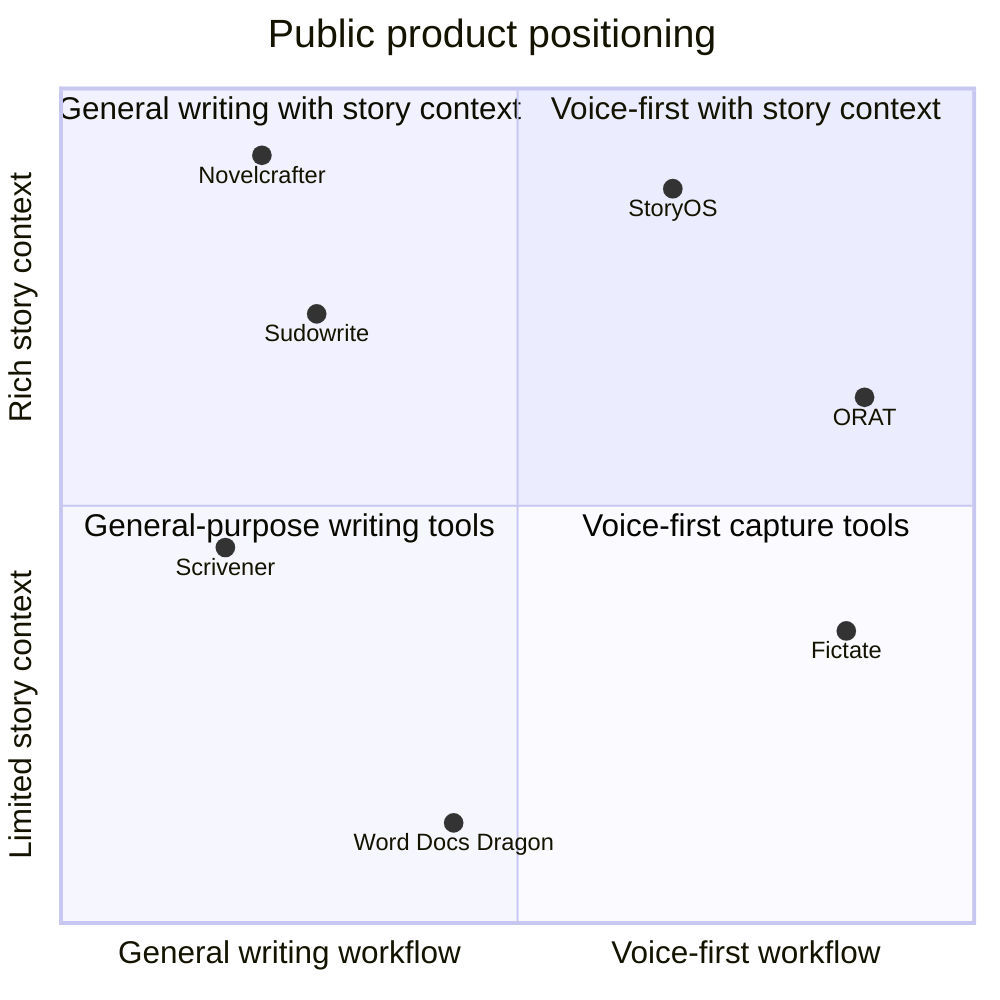
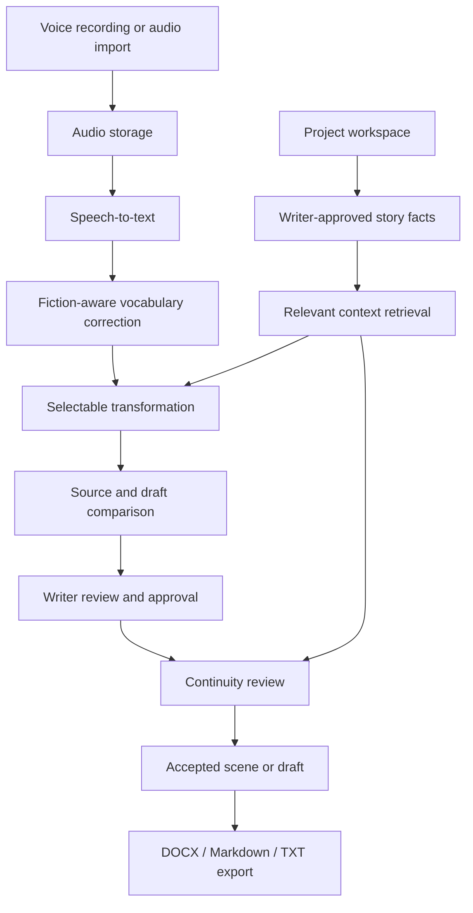
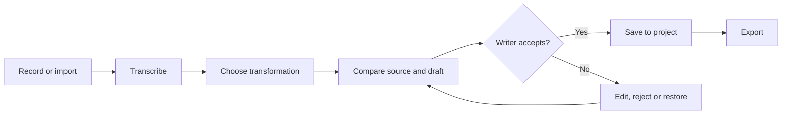
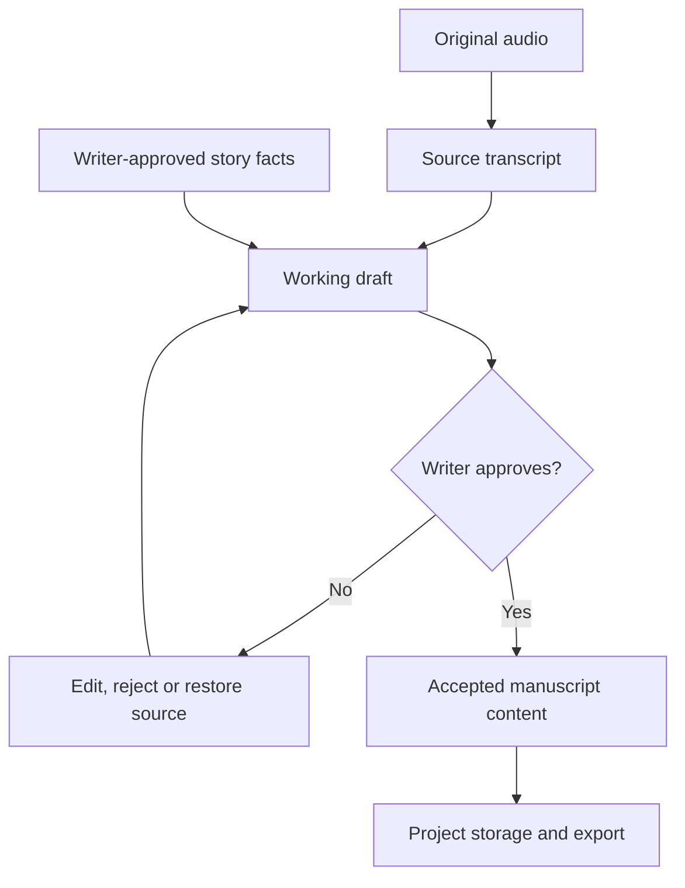

# StoryVoice: Phase 1: Problem Discovery & Research

## Why This Phase Exists

Before building StoryVoice, I need to establish whether there is a sufficiently important writing problem to solve, who experiences it most intensely, what alternatives already exist, and whether a new product can create a meaningful advantage. A compelling product idea is not the same as a validated opportunity. The purpose of this phase is to separate the original intuition from what public evidence supports, identify the strongest product direction, and make an explicit decision about what deserves further investment.

StoryVoice began with a simple observation: some writers think and compose more naturally by speaking than by typing. They may dictate a scene while walking, record dialogue before it disappears, or narrate a rough sequence of events before shaping it into a manuscript. A recording preserves the thought, but it does not necessarily produce a useful piece of writing. The writer may still need to remove repetition, repair incomplete sentences, organise fragments, restore fictional names and check whether the material fits the larger story.

The initial thesis was that StoryVoice could connect those activities in one voice-first writing environment. The research now shows that this broad idea is **already being pursued by several products**. Fictate, ORAT and StoryOS publicly position themselves around fiction dictation, voice-to-manuscript creation or recording directly inside an author workspace. Novelcrafter, Sudowrite and Scrivener cover adjacent parts of the workflow. That changes the opportunity: StoryVoice cannot win simply by being another application that converts speech into prose.

The more defensible question is whether StoryVoice can deliver a better **trusted path from spoken intent to accepted manuscript text**. That means measuring the quality of the transformed draft, the amount of correction required, the preservation of authorial decisions, the handling of project context and the time required to reach a usable result. It also means understanding whether writers consider this improvement valuable enough to adopt and pay for.

This document is based on public product pages, published author surveys and desk research available at the time of review. It is not a substitute for direct customer interviews, hands-on product testing or a paid conversion experiment. I distinguish observed facts, product claims, analytical interpretations and unverified hypotheses throughout.

The phase is organised around five questions:

1. **Problem:** What is difficult about turning spoken ideas into finished writing?
2. **Alternatives:** What can writers already do with existing products and combinations of tools?
3. **Customer:** Which writer segment is most likely to experience this problem frequently and intensely?
4. **Opportunity:** What specific product advantage remains worth testing?
5. **Decision:** Is the evidence strong enough to proceed into product strategy, and what must remain unproven?

---

## Research Charts and Product Flows

The charts summarise the opportunity assessment and competitor landscape. The flows show the proposed product process and the points at which the writer retains control.

### Opportunity assessment weights

These percentages are the weights used in the internal assessment. They do not represent market share or the distribution of writers.

### Opportunity scores

The scores are analytical judgements, not measured market data. The competitive-gap score is lower because direct products already overlap with the original proposition.

### Competitive capability comparison

The values below are qualitative readings of publicly described product emphasis on a 1–5 scale. They are not independent product-quality ratings.

| Product | Voice-first emphasis | Story-context emphasis | Writing-workflow emphasis |
|---|---:|---:|---:|
| Fictate | 5 | 2 | 3 |
| ORAT | 5 | 4 | 4 |
| StoryOS | 4 | 5 | 5 |
| Sudowrite | 1 | 4 | 3 |
| Novelcrafter | 1 | 5 | 4 |
| Scrivener | 1 | 3 | 5 |
| Word / Docs / Dragon | 4 | 1 | 3 |

### Competitive positioning

This is a qualitative map of public product positioning, not a benchmark of product quality.

### Conceptual product architecture

This describes logical responsibilities, not a committed technology stack.

## 1. The Starting Idea

StoryVoice starts from the belief that the first expression of a story does not always happen at a keyboard. A writer may have a complete scene in mind but only a few minutes to capture it. They may speak more fluidly than they type, especially when exploring dialogue, action, emotional beats or a sequence of events. Voice can reduce the friction of getting an idea out of the writer's head.

However, **speech capture is only the first part of the job**. A raw recording may contain false starts, repetitions, corrections, unfinished sentences and changes of direction. A literal transcript preserves many of those characteristics. A heavily rewritten AI output may read more smoothly but introduce details the writer never intended, flatten their voice or alter the meaning of a scene. Neither outcome necessarily gives the writer a manuscript-ready passage.

The original idea included long-form recording, transcription, fiction-aware cleanup, author-voice preservation, scene and chapter organisation, character and location memory, plot continuity checks and export to common manuscript formats. These remain possible capabilities, but they should not be treated as a committed feature list. The research suggests that several competitors already cover substantial portions of this territory. A large feature set would therefore create cost and complexity without automatically producing differentiation.

### The problem as a workflow gap

The opportunity is not simply a gap between speaking and typing. It is the gap between **what the writer intended to say** and **what they can confidently accept into their manuscript**.

| Stage | Writer's input or need | Potential failure | What a better system should do |
|---|---|---|---|
| Capture | A spoken thought, scene or rough chapter | The idea is lost, fragmented or difficult to retrieve | Preserve the recording and its project association |
| Transcription | Spoken words converted into text | Names, punctuation, dialogue and invented terms are misrecognised | Produce an accurate, editable transcript |
| Transformation | Rough speech shaped into readable prose | Meaning, tone or creative intent changes | Offer controlled transformations with visible edits |
| Context | New material related to an existing story | Character, setting or timeline details conflict | Retrieve relevant project facts and flag uncertainty |
| Review | Writer decides what belongs in the manuscript | AI output is accepted without adequate inspection | Keep the writer in control and make changes reversible |
| Organisation | Accepted material placed into a project | Notes and drafts remain scattered | Organise approved content into scenes and chapters |

### Initial problem statement

> Fiction writers who prefer speaking to typing need a reliable way to turn spoken ideas and rough narration into editable manuscript material without losing their intended meaning, authorial voice or control over the story.

This statement is deliberately narrower than “AI writing for everyone”. It focuses on a recognisable user, a recurring workflow and a specific outcome. It is still a **problem hypothesis**, not a conclusion established through interviews.

### The core product hypothesis

If StoryVoice can reduce the effort between recording a thought and accepting it as manuscript text while preserving the writer's intent better than a generic transcription-plus-rewriting workflow, then active fiction writers may adopt it as a recurring part of their drafting process.

The hypothesis contains four assumptions that must be tested separately:

- **Workflow frequency:** the target writer speaks or would prefer to speak during a meaningful portion of their drafting process.
- **Current friction:** existing recording, dictation and writing tools leave enough cleanup or organisation work to be frustrating.
- **Quality advantage:** StoryVoice can reduce that work without making the prose less faithful to the writer's intent.
- **Commercial value:** the improvement is important enough to justify a new subscription or a paid upgrade from an existing tool.

A failure in any one of these assumptions weakens the business case. For example, excellent transcription is not sufficient if the target user rarely dictates. Frequent dictation is not sufficient if existing products already solve the problem well. A better workflow is not sufficient if users do not value it enough to pay.

---

## 2. What Already Exists

The competitive landscape is more developed than the original idea assumed. It includes direct products built around fiction dictation and voice-to-manuscript workflows, broader author workspaces with recording capabilities, AI fiction tools, novel-planning systems and established manuscript applications.

I treat a product as a competitor when it can solve all or part of the same job, not only when its headline feature matches StoryVoice. A writer can assemble a substitute workflow from a voice recorder, transcription service, general-purpose AI assistant and manuscript editor. That combination is part of the real competitive environment.

### 2.1 Direct and near-direct competitors

#### Fictate: fiction-focused dictation

[Fictate](https://fictateapp.com/) positions itself as a dictation product for fiction authors. Its public pricing page lists plans with monthly word or recording allowances, a cleanup tool, story outlines and deleted-recording recovery. The page also describes cross-device availability and states that user writing is not used to train AI models.

The important strategic point is that **fiction-specific dictation is already a defined product proposition**. StoryVoice cannot claim that fiction writers have no purpose-built dictation alternative. Fictate's pricing also gives an observable market reference: the page lists annual-billing equivalents of approximately US$5, US$15 and US$35 per month across its displayed tiers. These are vendor-listed prices, not proof of willingness to pay across the market.

What remains to investigate is the actual output quality on long, messy recordings; how much editing is required; how well fictional names and dialogue are handled; how its cleanup behaves; and whether authors need deeper manuscript context than the product currently provides. Those are test questions, not claims that Fictate performs poorly.

#### ORAT: voice-to-manuscript

[ORAT](https://orat.dev/) is a particularly close competitor because its public product and pricing pages explicitly describe shaping spoken drafts into clean prose, saving material into projects, chapters and sessions, and supporting continuity checks across chapters on its paid plan.

Its published pricing page lists a free tier with three hours of recording or uploaded transcription per month, up to two active manuscripts and basic text/Markdown export. Its Pro tier is listed at US$79 per year and includes a larger recording allowance, unlimited projects, continuity checks, deeper review and DOCX, PDF and EPUB export. Pricing and feature availability can change, so the linked page should be treated as the live source of truth.

ORAT overlaps with several original StoryVoice assumptions: voice capture, prose transformation, manuscript organisation and continuity assistance. That is a material competitive signal. StoryVoice must be more specific than “speak your book into existence”. It needs a demonstrable advantage in the quality, control, reliability or integration of the voice-to-manuscript process.

#### StoryOS: author workspace with recording

[StoryOS](https://www.storyosapp.com/en) describes an author workspace covering planning, writing, development, editing and publishing. Its public page includes recording and speech transcription, project structures such as chapters and scenes, story intelligence, and exports including DOCX, PDF, EPUB, Markdown and TXT. The page displays Author and Pro subscriptions, with a promotional first-year price and a higher stated regular price.

StoryOS is important because it combines voice input with a wider author environment. It challenges the assumption that voice capture and manuscript organisation must be separate products. It also shows why StoryVoice should resist expanding into every part of the authoring stack before it has proven the core workflow.

### 2.2 Adjacent competitors and substitutes

#### Sudowrite: AI-assisted fiction creation

[Sudowrite](https://sudowrite.com/) is an AI fiction-writing product focused on helping writers develop, expand and revise creative work. Its documentation lists subscription tiers with different monthly credit allowances. The published pricing article, updated January 2026, lists Hobby & Student at US$10 per month on annual billing or US$19 monthly; Professional at US$22 annually billed or US$29 monthly; and Max at US$44 annually billed or US$59 monthly.

Sudowrite does not need to be a voice-first tool to compete for the same budget. A writer may use it to transform or develop prose after dictating elsewhere. StoryVoice should not attempt to match every fiction-generation feature. Its strongest possible position is to help the writer express and preserve their own material, rather than compete as a general-purpose story-generation suite.

#### Novelcrafter: novel planning and story context

[Novelcrafter](https://www.novelcrafter.com/) offers a structured writing environment with a Codex for characters, locations and other story elements. Its public feature page describes automatic detection of mentions and navigation across a manuscript and Codex entries. Its pricing page lists monthly plans from US$4 to US$20, with AI integration available on higher tiers using the writer's own model key.

Novelcrafter demonstrates that story context, searchable story bibles and project-aware writing are established expectations in the category. A StoryVoice continuity feature would not be unique simply because it tracks characters or locations. The differentiating question is whether context can improve spoken-draft transformation and review without introducing incorrect assumptions.

#### Scrivener: long-form manuscript management

[Scrivener](https://www.literatureandlatte.com/scrivener/overview) is an established manuscript application. Its public feature page describes a Binder, corkboard, outliner, metadata, collections, writing targets, snapshots, backups and export options including Word-compatible formats, PDF and EPUB.

Scrivener is a strong substitute for manuscript organisation. It also creates a practical adoption constraint: writers who already have established projects may not want to migrate their entire writing process. StoryVoice should initially behave as a **companion workflow that exports cleanly**, rather than assume it can replace a mature writing environment.

#### General-purpose dictation and document tools

[Microsoft Word](https://www.microsoft.com/microsoft-365/word), [Google Docs](https://docs.google.com/) and [Dragon](https://www.nuance.com/dragon.html) are relevant substitutes for speech input and document creation. They reduce the value of basic transcription as a standalone proposition. A writer can dictate into a document, edit the result and move on.

The product opportunity therefore needs to be measured against the whole workaround, not against the absence of a single feature.

### 2.3 Competitive comparison

The following comparison is based on publicly described capabilities, not hands-on product testing. “Publicly described” does not guarantee feature quality, reliability or equal availability across plans.

| Product | Primary positioning | Voice / dictation | Fiction or story context | Manuscript organisation | Continuity / story intelligence | Strategic implication |
|---|---|---:|---:|---:|---:|---|
| Fictate | Fiction dictation | Yes | Fiction-focused | Some workflow support | Not established by reviewed page | Direct competition on fiction-specific voice input |
| ORAT | Voice-to-manuscript | Yes | Manuscript-aware positioning | Projects, chapters, sessions | Continuity checks listed on Pro | Direct overlap with the original thesis |
| StoryOS | Author operating workspace | Yes | Story workspace | Chapters, scenes, planning | Story Intelligence listed | Direct/near-direct overlap across a broad workflow |
| Sudowrite | AI fiction writing | Not its central positioning | Yes | Writing projects | Story-aware AI features | Competes for AI writing budget and transformation jobs |
| Novelcrafter | Novel planning and writing | Not its central positioning | Strong Codex / story bible | Books, series and Codex | Mention tracking and story context | Sets expectations for structured story memory |
| Scrivener | Manuscript organisation | Not its central positioning | Writer-managed project material | Strong | Manual/project-managed | Established destination and integration target |
| Word / Docs / Dragon | General dictation and documents | Yes, depending on tool | Limited or user-managed | General documents | Limited or external | Low-friction substitutes and bundled alternatives |

### 2.4 What the competition means

The market is not empty. The original feature list overlaps with products that already advertise fiction dictation, voice-to-book workflows, story context and manuscript management. A new entrant would face both direct competitors and a collection of familiar tools that writers already know how to combine.

That does not automatically invalidate StoryVoice. It changes the standard of proof. The product needs to demonstrate a meaningful improvement in a specific workflow. A better-looking interface, more AI buttons or a longer feature list would not be enough.

The most promising area to investigate is **transformation quality with author control**:

- Does the output preserve the meaning and details of the recording?
- Does it retain the writer's distinctive phrasing and dialogue?
- Can the writer choose between transcript, light cleanup, prose shaping and structural organisation?
- Can every meaningful change be inspected and reversed?
- Can the system use story context without inventing facts?
- Does it reduce the total time and effort required to reach accepted manuscript text?

### 2.5 Competitive positioning map

The map below is a qualitative interpretation of public positioning. The axes are not measured performance scores. They help distinguish product emphasis and should not be read as a benchmark of product quality.

The public positioning suggests three broad groups. Fictate and ORAT put voice capture close to the centre of the product. StoryOS combines recording with a broader author workspace. Novelcrafter and Sudowrite focus more heavily on story context or AI-assisted fiction, while Scrivener and general document tools serve as established writing environments. These are differences in stated product emphasis, not measured performance.

*Interpretation note: positions are qualitative readings of public product positioning, not measured product performance.*

The strategic whitespace is not “voice plus AI” by itself. Several products already claim that territory. The hypothesis worth testing is a more disciplined experience that prioritises **faithful transformation, transparent review and project-aware drafting**.

---

## 3. The Direction Worth Exploring

The strongest direction is a **voice-first manuscript drafting environment for active independent fiction writers**, with author-controlled transformation as its central product principle.

This direction is narrower than building an all-in-one AI writing platform. It starts with a recurring behaviour: capturing and developing spoken material, and aims to make the result useful inside an existing manuscript workflow.

### 3.1 Proposed product promise

> Turn spoken ideas into manuscript-ready drafts while keeping the writer in control of every meaningful change.

This promise has three parts:

1. **Turn spoken ideas into drafts:** capture, transcribe and shape material into readable writing.
2. **Manuscript-ready:** organise accepted material so it can be used in a real writing project, not merely stored as a transcript.
3. **Writer in control:** preserve the source, explain transformations and let the writer accept, reject or revise changes.

The promise avoids claiming that StoryVoice writes a better novel, replaces an editor or guarantees publication outcomes.

### 3.2 The potential wedge

The first version should concentrate on a compact workflow:

- Record or import a spoken draft.
- Produce a faithful transcript.
- Offer selectable transformation levels.
- Compare the original with the transformed text.
- Let the writer accept or edit the result.
- Save accepted material into a project and scene.
- Export clean text to an established writing application.

The product should not silently convert a writer's rough idea into a fully invented scene. The system should distinguish what the writer said from what the model inferred or suggested.

### 3.3 Transformation levels

| Mode | Intended behaviour | What it must not do |
|---|---|---|
| Verbatim transcript | Preserve spoken words with minimal formatting | Rewrite or reinterpret the writer's meaning |
| Clean transcript | Remove obvious disfluencies and repair punctuation | Delete meaningful repetition or alter dialogue |
| Readable draft | Improve sentence flow while preserving events and intent | Add new plot facts or emotional beats without permission |
| Scene structure | Organise material into paragraphs, beats or scene sections | Decide story direction or invent missing events |
| Creative suggestion | Offer optional alternatives or expansions | Replace the writer's original text automatically |

The separation between modes is a product trust requirement. A writer should know whether the system is transcribing, editing or generating. The same output should not be labelled “transcription” when it contains substantive rewriting.

### 3.4 The trust model

StoryVoice should preserve three layers of information:

- **Source layer:** original audio and the first transcript.
- **Working layer:** transformed draft, with changes visible and reversible.
- **Story layer:** approved facts and manuscript content that the writer has confirmed.

This distinction prevents an AI-generated guess from becoming an unquestioned story fact. It also gives the writer a way to audit how a passage changed from speech to prose.

### 3.5 Workflow architecture

**Workflow:** Capture or import audio → transcribe → choose a transformation level → review changes → accept or revise → organise the passage → export.

The key product metric should not be minutes of audio processed or words generated. It should be the proportion of captured material that becomes **writer-accepted manuscript content**, and the effort required to reach that outcome.

### 3.6 What would make StoryVoice meaningfully different?

The product needs evidence of advantage on one or more of these dimensions:

| Potential advantage | How to measure it | Why it matters |
|---|---|---|
| Lower correction burden | Editing minutes per 1,000 accepted words | Shows whether transformation saves real work |
| Better intent preservation | Human-rated meaning fidelity against source audio | Protects authorial intent |
| Better voice preservation | Writer rating of style similarity and unwanted rewriting | Builds trust with authors |
| Better fiction vocabulary handling | Error rate on character names, invented terms and dialogue | Addresses fiction-specific language |
| Faster manuscript insertion | Time from end of recording to accepted, organised passage | Measures end-to-end workflow improvement |
| Better project continuity | Precision of surfaced continuity issues and false-positive rate | Prevents unreliable “intelligence” from damaging trust |

These are proposed evaluation dimensions. No performance advantage has yet been demonstrated.

---

## 4. Who Might Use StoryVoice

The initial customer should not be defined as “anyone who writes”. That market is too broad and includes people with very different motivations, workflows and willingness to pay.

The strongest initial segment hypothesis is **prolific independent fiction authors who are actively drafting a novel or series and already use, or are open to using, voice as part of their writing process**.

This segment is attractive as a starting point because its members may have a repeated need to capture scenes, develop chapters and maintain project context. Writers producing a series may also have recurring story facts to manage. However, the segment is still a hypothesis; it has not been validated through interviews or usage research.

### 4.1 Primary segment hypothesis

| Attribute | Working hypothesis |
|---|---|
| Writer type | Independent fiction author |
| Project stage | Actively drafting or revising a novel or series |
| Writing frequency | Regular writing sessions, not occasional journaling |
| Voice behaviour | Dictates, records ideas or is willing to test voice drafting |
| Current tools | Uses one or more of Word, Scrivener, Google Docs, dictation or AI writing tools |
| Pain | Cleaning, organising and integrating spoken material takes too much effort |
| Desired outcome | More usable manuscript material with less friction |
| Purchase motivation | Saves time, helps maintain momentum and fits an ongoing writing process |

### 4.2 Secondary segments

- **Fanfiction writers:** may produce serialised long-form work and maintain extensive character or world context. Their willingness to pay and preferred tools require validation.
- **Screenwriters:** may benefit from voice capture and dialogue preservation, but screenplay formatting and collaboration create a distinct workflow.
- **Memoir and non-fiction authors:** may have strong voice-capture needs, but factual accuracy, citation and source management introduce different product requirements.
- **Long-form content creators:** may value speech-to-draft workflows but are less likely to need fictional continuity features.

These segments should not be combined into the first product definition. Each has different workflow expectations and success criteria.

### 4.3 Jobs to be done

| Situation | Desired progress | Existing friction to investigate |
|---|---|---|
| A scene comes to mind away from the desk | Capture the idea before it is forgotten | Recordings can become scattered and difficult to convert into manuscript material |
| The writer thinks faster by speaking | Produce a rough draft without typing every sentence | Literal dictation may create substantial cleanup |
| The writer is continuing a long manuscript | Use established story facts while drafting | Context is spread across chapters, notes and memory |
| The writer has many unfinished fragments | Turn useful fragments into organised project material | Notes and recordings may remain disconnected |
| The writer wants AI assistance but values their style | Improve readability without surrendering authorship | Generic rewriting may alter tone, dialogue or meaning |

### 4.4 Evidence about the author market

Published author surveys help describe the economic and behavioural context, but they do not directly measure demand for StoryVoice.

The [**2025 Written Word Media Indie Author Survey**](https://www.writtenwordmedia.com/2025-indie-author-survey-results-insights-into-self-publishing-for-authors/) reports 1,346 responses from authors around the world. The publisher states that 96% of respondents were already published and 4% were actively working towards publication. It also explicitly warns that its audience skews towards serious, prolific indie authors and that income data is self-reported. This makes it useful for understanding a commercially active indie-author audience, but not representative of all people who write fiction.

The [**Authors Guild 2023 Author Income Survey**](https://authorsguild.org/news/2023-author-income-survey/) reports responses from 5,699 published authors. It found that the median book income for all respondents in 2022 was US$2,000 and median total author-related income was US$5,000. For full-time self-published authors, median book income was US$12,800 and total author-related income was US$15,000. These figures reinforce an important commercial constraint: many authors operate with limited income from writing, so the product cannot assume broad willingness to pay for another subscription.

The [**2024 Written Word Media survey**](https://www.writtenwordmedia.com/2024-indie-author-survey-results-insights-into-self-publishing-for-authors/) reported that 76.2% of its respondents identified as self-published and 16% as hybrid authors. It also reported that the average respondent had published eight books. This supports investigating prolific independent authors as a segment, while the 2025 survey is the more recent source for the current author-audience profile.

### 4.5 What the market evidence does and does not establish

| Evidence | What it supports | What it does not prove |
|---|---|---|
| 2025 Written Word Media survey, n=1,346 | A sizeable respondent group of active, published indie authors exists within that survey | Total global market size or StoryVoice demand |
| 96% already published in that survey | The survey audience is largely experienced/published | That unpublished writers are unimportant |
| Authors Guild survey, n=5,699 | Author income is uneven and many authors have modest book-related earnings | Exact software budgets or subscription willingness |
| Competitor pricing pages | Several products charge for related workflows | That users are converting, retaining or satisfied |
| Public product feature pages | The category has meaningful existing capability | Actual quality or comparative performance |

### 4.6 Initial customer priority

I would prioritise the active independent fiction author over the broad “aspiring writer” audience. The former is more likely to have an ongoing manuscript, a repeated workflow and a concrete reason to compare tools. This is a prioritisation decision for research, not a claim that this segment is already proven to be the largest or most profitable.

---

## 5. The Experience to Build Around

StoryVoice should feel like a writing environment that happens to begin with voice, rather than a transcription utility with an AI rewrite button.

The writer should be able to begin with an unfinished thought and move towards an accepted manuscript passage. The product should not force every recording into a chapter. Some recordings may be reminders, research notes, alternate dialogue, discarded scenes or ideas that should remain separate.

### 5.1 End-to-end experience

| Step | Product responsibility | Writer control |
|---|---|---|
| 1. Capture | Record or import audio and attach it to a project | Start, pause, resume, label or discard |
| 2. Transcribe | Convert audio into editable text | Review uncertain words and names |
| 3. Classify | Suggest whether material is a scene, dialogue, note or idea | Confirm or change the classification |
| 4. Transform | Apply the selected editing level | Choose transformation mode and compare changes |
| 5. Review | Present source and transformed versions | Accept, reject, edit or restore |
| 6. Organise | Save approved material to a project location | Choose project, chapter and scene |
| 7. Contextualise | Retrieve relevant story facts | Confirm facts before they become canonical |
| 8. Check | Surface possible continuity issues | Decide whether a warning is valid |
| 9. Export | Produce clean manuscript files | Choose format and destination |

### 5.2 Experience principles

**The original must never disappear.** The audio and first transcript should remain available, even after several rounds of rewriting. This gives the writer a reliable reference and makes transformations reversible.

**AI changes must be inspectable.** A writer should be able to see what was removed, added or rewritten. If a transformation introduces new material, that material should be clearly marked as a suggestion rather than silently blended into the manuscript.

**Story facts need provenance.** A fact explicitly confirmed by the writer should be distinguished from a detail inferred by a model. Continuity checks should cite the relevant manuscript passage or story note that triggered the warning.

**The writer decides what becomes canonical.** A generated suggestion should not automatically update a character profile, timeline or story bible. The writer must approve that change.

**Export must be reliable.** The product should not require authors to abandon their current writing application before it has earned that trust. Clean DOCX, Markdown and plain-text export are more important initially than building a complete publishing suite.

### 5.3 Proposed MVP boundary

| Include in the first testable product | Defer until evidence supports it |
|---|---|
| Voice recording and audio import | Full publishing and distribution suite |
| Speech-to-text transcription | Advanced multi-book universe management |
| Fiction-aware vocabulary correction | Automated plot generation |
| Selectable cleanup and prose-shaping modes | Autonomous chapter writing |
| Original-versus-edited comparison | Collaboration and writing communities |
| Project and basic scene organisation | Complex timeline visualisation |
| Manual approval of story facts | Automatic canonical story updates |
| DOCX, Markdown and TXT export | Deep analytics and author monetisation tools |

The MVP is not a miniature version of every competitor. It is a focused test of whether the voice-to-accepted-draft workflow creates enough value to become part of a writer's routine.

### Workflow at a glance

### Manuscript acceptance decision path

1. The writer records or imports audio.
2. StoryVoice creates a source transcript.
3. The writer corrects uncertain words or names if needed.
4. The writer chooses a transformation level.
5. StoryVoice produces an editable draft and shows the changes.
6. The writer accepts, edits, rejects or restores the source.
7. Accepted text is saved to a project or scene and can be exported.

### Data and approval flow

The original audio and source transcript remain available throughout the process. Transformed prose stays a working draft until the writer approves it. Story context can inform a transformation or flag a possible continuity issue, but it must not silently change the project's established facts. Any proposed update to character, setting or timeline information requires the writer's approval.

### 5.4 Product workflow quality measures

The following metrics should be instrumented from the first prototype:

- **Time to accepted draft:** elapsed time between the end of a recording and the writer accepting a usable passage.
- **Correction burden:** time spent correcting the transformed output.
- **Acceptance rate:** share of transformed words or passages retained by the writer.
- **Meaning fidelity:** human assessment of whether the transformed text preserves the source's facts, actions and intent.
- **Voice satisfaction:** writer assessment of whether the output still sounds like their writing.
- **Repeat usage:** whether the writer returns to capture and transform more material in subsequent sessions.

A high transcription accuracy score alone would not establish product success. The output can be accurate at the word level and still be unusable as prose.

---

## 6. What Not to Build Yet

It would be easy to turn StoryVoice into a large AI author platform. The product could include plot generation, character creation, world-building, automated editing, publishing, collaboration, analytics and a marketplace. Some of those capabilities may eventually be useful, but they do not prove the central opportunity.

Building too broadly would increase engineering effort, AI processing costs, data complexity and product surface area before the voice-to-manuscript workflow has demonstrated value. It would also place StoryVoice in direct competition with mature tools across several categories at once.

For the first product, I would avoid:

- **A general-purpose AI story generator.** This shifts the proposition away from helping writers express their own ideas.
- **A full Scrivener replacement.** Manuscript management is a mature category and not the initial wedge.
- **An autonomous continuity engine.** False positives and incorrect story facts can damage trust.
- **A publishing platform.** Distribution and royalties are separate problems.
- **A social network for writers.** Community does not validate the core drafting workflow.
- **A complex multi-agent architecture.** Model orchestration should follow demonstrated product needs, not become the product.
- **A large template and prompt library.** The first challenge is reliable transformation, not adding more ways to prompt a model.

The first product should answer one question well:

> Does StoryVoice help an active fiction writer turn spoken material into accepted manuscript text with measurably less effort and without sacrificing creative control?

---

## 7. Risks to Keep in Mind

The opportunity has enough substance to investigate, but several risks could invalidate the current direction.

| Risk | Why it matters | Early signal to monitor |
|---|---|---|
| Direct competition | Fictate, ORAT and StoryOS already overlap with voice-first author workflows | Writers see no meaningful reason to switch |
| Weak differentiation | A feature checklist can be copied and is not a durable advantage | Users describe StoryVoice as “another dictation app” |
| Transcription errors | Fiction contains unusual names, invented words and dialogue | High correction time per recording |
| Loss of author voice | Heavy rewriting can make output feel generic | Low acceptance and voice-satisfaction scores |
| Intent drift | AI may add, remove or reinterpret story details | Writers repeatedly restore source text |
| Context hallucination | Incorrect story facts can create misleading continuity warnings | High false-positive rate |
| Low usage frequency | Some writers may only dictate occasionally | Low repeat recording activity |
| Subscription fatigue | Many authors earn modest income and already pay for writing tools | Trial users resist paid conversion |
| Variable AI cost | Long recordings and repeated transformations increase processing cost | Cost per accepted word rises with usage |
| Retention by project cycle | A writer may stop using the tool after finishing one manuscript | Churn after project completion |
| Platform dependence | Speech and language model providers can change prices, quality or limits | Margin or quality becomes externally constrained |
| Privacy and ownership | Unpublished manuscripts are sensitive intellectual property | Writers hesitate to upload work |

### 7.1 The most important product risk: becoming an unnecessary layer

The largest product risk is that StoryVoice becomes an extra application between a recording tool and an existing writing environment.

A writer may already be able to record audio, transcribe it, use a general AI assistant to clean it up and paste the result into Scrivener or Word. If StoryVoice does not reduce the total effort or improve the result enough to justify another tool, an integrated interface will not be a sufficient reason to switch.

The right comparison is therefore not “StoryVoice versus typing”. It is:

**Current workaround:** capture → transcribe → clean → reorganise → paste into manuscript → review.

**Proposed StoryVoice workflow:** capture/import → transcribe → controlled transformation → review/accept → organise/export.

The product must show that the second workflow is faster, more faithful or more convenient in a way the target writer notices.

### 7.2 The most important commercial risk: author economics

The Authors Guild survey indicates that many authors earn modest amounts from book sales and related work. The 2025 Written Word Media survey focuses on a more commercially active indie-author audience, but it explicitly notes that its respondents skew towards serious and prolific authors.

These findings argue against treating a high subscription price as an obvious starting point. A pricing hypothesis should be based on demonstrated time saved, usage frequency and the cost of serving each user. Competitor prices are useful anchors, but they are not proof that StoryVoice can charge the same amount.

### 7.3 The most important trust risk: silent rewriting

For a fiction writer, a sentence can contain deliberate rhythm, ambiguity, repetition or an unusual word choice. A system that automatically “improves” such writing may damage the work while appearing helpful.

StoryVoice should make transformation intensity explicit and preserve the source. A writer must be able to distinguish transcription from editing and editing from creative generation. This is not merely a UX preference; it is central to the product's credibility.

### 7.4 Unit economics to validate

A simplified contribution-margin formula is:

\[
\text{Contribution Margin \%} =
\frac{\text{Net Revenue} - \text{Variable Cost}}{\text{Net Revenue}} \times 100
\]

For StoryVoice, variable cost may include speech recognition, language-model processing, storage, audio transfer, background jobs, payment fees and customer support directly attributable to usage.

A useful operational measure is:

\[
\text{Cost per Accepted 1,000 Words} =
\frac{\text{Total Variable Processing Cost}}{\text{Accepted Words}} \times 1{,}000
\]

This is more meaningful than cost per generated word. A system that generates 10,000 words but only 2,000 are accepted may be less efficient than a system that generates 3,000 words with 2,700 accepted.

---

## 8. What We Still Don't Know

Desk research has established that the category exists, identified direct competitors and clarified a narrower product hypothesis. It has not established product-market fit, demand, retention or willingness to pay.

The following questions remain open.

### 8.1 Customer and behaviour questions

- How many active fiction writers regularly dictate or record story material?
- What proportion of their drafting time could realistically move to voice?
- Do they record full scenes, rough notes, dialogue or chapter-length narration?
- What tools do they currently combine, and what does that workflow cost them in time?
- Which genres and author profiles experience the strongest problem?
- Is the pain strong enough to trigger a tool change?

### 8.2 Product quality questions

- Can the system handle long recordings without losing context?
- How accurately does it recognise character names, invented terms and unusual dialogue?
- Which transformation level do writers prefer?
- How much editing is required before a writer accepts the output?
- Does the output preserve voice, tone and intended meaning?
- Do writers trust project memory and continuity warnings?
- How often are continuity warnings correct and useful?

### 8.3 Commercial questions

- Which users are willing to pay: hobbyists, serious independent authors or commercially successful authors?
- Is the preferred model a monthly subscription, annual plan, usage allowance or hybrid?
- What price feels reasonable relative to current alternatives?
- How sensitive are writers to recording limits and AI credits?
- Does usage remain high after the first manuscript is completed?
- What is the cost to serve a heavy user?

### 8.4 Distribution questions

- Can StoryVoice reach active authors through writing communities, author newsletters, creator partnerships or writing educators?
- Which communities allow product research and transparent participation?
- Can writers demonstrate the value of the workflow through before-and-after examples?
- Is a creator-led distribution strategy viable without relying on paid acquisition?

### 8.5 Validation plan

The next step should be a small, evidence-led validation programme rather than immediate full-scale engineering.

| Validation activity | Method | Evidence to collect | Decision it informs |
|---|---|---|---|
| Problem interviews | Interview active fiction writers about their last real drafting sessions | Current workflow, frequency, workarounds, time and frustration | Is the problem real and recurring? |
| Workflow observation | Ask participants to complete a real voice-to-draft task using their current tools | Steps, time, interruptions and correction burden | Where is the strongest friction? |
| Competitor task testing | Run the same sample recording through selected products | Output quality, editing effort, controls and export | Is there a measurable competitive gap? |
| Concierge prototype | Manually process recordings using a consistent transformation protocol | Writer acceptance, edits, feedback and repeat intent | Does the proposed outcome matter? |
| Prototype usability test | Test capture, transformation, review and export | Task completion, errors, time and trust | Can the workflow be understood and used? |
| Pricing test | Present transparent plans or run a paid pilot | Actual payment or deposit behaviour | Is there willingness to pay? |
| Repeat-use test | Observe usage over several weeks | Repeat sessions, accepted drafts and churn reasons | Is the workflow habitual? |

### 8.6 Suggested research sample

A practical first round would include approximately 12–15 qualitative interviews, deliberately split between active indie fiction authors who already dictate, active authors who do not currently dictate, and writers who have tried voice tools but abandoned them. This is a discovery sample, not a statistically representative survey.

The interviews should focus on recent behaviour rather than hypothetical enthusiasm. “Tell me about the last time you captured a scene away from your desk” is more useful than “Would you use an AI writing app?” The objective is to uncover what people actually do, where work accumulates and what they have already tried.

### 8.7 Proposed validation gates

The following are proposed decision thresholds, not industry benchmarks. They should be reviewed after the first research round.

| Gate | Evidence required to proceed | Why this gate exists |
|---|---|---|
| Problem confirmation | A clear majority of interviewed target users can describe a recent, recurring voice-to-draft friction | Avoid building around a rare or imagined problem |
| Workflow advantage | Prototype users show a measurable reduction in time or correction burden versus their current workflow | Establish a reason to switch |
| Output trust | Writers accept transformed passages without frequent restoration of source text | Protect authorial control |
| Repeat behaviour | Participants return to use the workflow across multiple writing sessions | Test whether value is recurring |
| Commercial signal | Some target users make a real payment or commit to a paid pilot | Move beyond stated willingness to pay |

The thresholds should not be gamed by selecting only enthusiastic participants. Results should include negative feedback, failed tasks and users who prefer their current workflow.

### 8.8 Research limitations

This phase uses public product descriptions, published survey results and secondary research. I have not completed direct customer interviews, controlled competitor testing, a prototype usability study, a paid pricing experiment or a retention study. Public pricing pages can change. Competitor feature descriptions are vendor claims and do not independently establish product quality. Survey samples have their own audience and response biases.

For those reasons, the opportunity score and product direction below are **directional judgements**. They should guide the next phase, not be treated as proof of market demand.

---

## 9. Phase 1 Decision

The original StoryVoice idea is worth exploring, but the broad version is not sufficiently differentiated. The market already contains products that advertise fiction dictation, voice-to-manuscript transformation and author workspaces with recording. A new product cannot rely on voice input, AI prose cleanup, story memory or export as standalone differentiators.

I would proceed with a narrower thesis:

> **StoryVoice is a voice-first drafting environment that helps active fiction writers turn spoken material into accepted manuscript text through faithful transformation, transparent review and writer-controlled story context.**

The first product should focus on the path from recording to accepted draft. The core test is whether StoryVoice can reduce the time and correction effort required to create usable manuscript material while preserving the writer's meaning and voice.

### 9.1 Opportunity scorecard

I have reassessed the opportunity using eight dimensions. The scores are analytical judgements based on the available desk research, not measured market statistics. The weights reflect the importance of solving a real problem, demonstrating demand and differentiating against existing products.

| Dimension | Weight | Score / 10 | Weighted points | Current interpretation |
|---|---:|---:|---:|---|
| Problem intensity | 15% | 8.0 | 1.20 | The workflow can involve repeated capture, cleanup and organisation work |
| Demand evidence | 15% | 7.0 | 1.05 | An active author market exists, but demand for this specific product remains unverified |
| Willingness to pay | 15% | 6.0 | 0.90 | Competitor pricing exists, but author income data suggests price sensitivity |
| Market potential | 10% | 7.0 | 0.70 | Multiple author segments exist; the reachable niche is not yet sized |
| Competitive gap | 15% | 4.0 | 0.60 | Direct competitors already cover much of the original proposition |
| Retention potential | 10% | 7.0 | 0.70 | Active manuscripts create recurring workflow opportunities, but usage must be observed |
| Solo-founder feasibility | 10% | 7.0 | 0.70 | A narrow workflow prototype is feasible; reliable long-form context and audio processing add complexity |
| Distribution potential | 10% | 6.0 | 0.60 | Author communities are identifiable, but acquisition channels and conversion are untested |
| **Total** | **100%** |  | **6.45 / 10** | **Promising enough to validate; not yet proven** |

The weighted score is calculated as:

\[
\text{Opportunity Score} = \sum_{i=1}^{n} \left(\text{Dimension Score}_i \times \text{Weight}_i\right)
\]

Using the scores above:

\[
(8 \times 0.15) + (7 \times 0.15) + (6 \times 0.15) + (7 \times 0.10) +
(4 \times 0.15) + (7 \times 0.10) + (7 \times 0.10) + (6 \times 0.10)
= 6.45
\]

The score is lower than the original 8.6/10 assessment because the competitive research surfaced direct products that already overlap with the original feature set. The most important weakness is competitive differentiation, followed by the lack of direct evidence on willingness to pay. The opportunity remains worth validating because the underlying workflow may still be painful and because the product could compete on the quality and trustworthiness of the complete drafting process.

### 9.2 Decision

**Decision: Proceed to Phase 2 with validation gates.**

I would proceed to **Product Strategy, Vision, Definition & Brand Identity**, but I would not treat that as approval for full-scale engineering. Phase 2 should convert the narrowed thesis into a clear product strategy, define the initial user and use case, establish product principles, set measurable success criteria and decide what the first testable product must prove.

The following decisions should carry forward:

- **Primary audience:** active independent fiction writers working on a novel or series.
- **Core job:** turn spoken material into accepted manuscript text.
- **Primary product advantage to test:** faithful transformation with transparent, reversible writer control.
- **Initial workflow:** capture/import, transcribe, transform, compare, accept, organise and export.
- **Trust principle:** original audio and source transcript remain available; AI inference is never silently treated as confirmed story fact.
- **MVP boundary:** do not build a full novel-planning, publishing or autonomous story-generation platform.
- **Validation requirement:** interview target writers and test the same real recording across current alternatives before committing to a larger build.

### 9.3 What would change the decision?

I would reconsider or stop the direction if interviews show that active fiction writers rarely dictate, if existing products already solve the workflow to their satisfaction, if the prototype does not reduce editing effort, if writers do not trust transformed output, or if repeat usage and payment signals are weak.

I would strengthen the opportunity if target writers repeatedly describe the same unmet need, the prototype produces a measurable improvement over their current workflow, writers accept the output with limited correction, and at least some users pay to continue using it.

---

## Phase 1 Completion Record

| Area | Outcome |
|---|---|
| Starting problem | Defined as the gap between spoken intent and accepted manuscript text |
| Market landscape | Direct, adjacent and substitute products identified |
| Competitive reality | Fiction dictation and voice-to-manuscript are already active product propositions |
| Initial customer | Active independent fiction writer drafting a novel or series |
| Product direction | Voice-first manuscript drafting with faithful transformation and writer control |
| MVP boundary | Capture, transcription, controlled transformation, review, basic organisation and export |
| Key risks | Direct competition, output trust, correction burden, pricing sensitivity and retention |
| Opportunity score | 6.45/10, directional and weighted |
| Validation status | Desk research completed; customer and product validation remain open |
| Phase decision | Proceed to Phase 2 with explicit validation gates |

**Phase outcome:** I have narrowed StoryVoice from a broad AI writing platform into a focused voice-to-manuscript workflow. The market evidence justifies further investigation, but not an assumption of product-market fit. The next phase should define the product around the measurable outcome of turning spoken material into trusted, accepted manuscript text.

---

## Research References

The following links are the primary public sources used for this phase. Product pages are vendor-authored and are used to understand stated positioning, features and pricing, not to independently verify quality or customer outcomes. Pricing and feature availability are dynamic and should be rechecked before commercial decisions.

### Competitor product and pricing references

1. [Fictate: Product and pricing](https://fictateapp.com/)
2. [ORAT: Product and pricing](https://orat.dev/pricing)
3. [StoryOS: Author workspace and product features](https://www.storyosapp.com/en)
4. [Sudowrite: Plans and pricing documentation](https://docs.sudowrite.com/plans--account/wBnmhtSyMcWtk2BLzifGkz/what-plans-are-available/mwfVvj2rGcKYs1BQy4Pdcb)
5. [Novelcrafter: Pricing](https://www.novelcrafter.com/pricing)
6. [Novelcrafter: Codex and story bible](https://www.novelcrafter.com/features/codex)
7. [Scrivener: Product overview](https://www.literatureandlatte.com/scrivener/overview)
8. [Scrivener: Official store and licences](https://www.literatureandlatte.com/store/scrivener)
9. [Microsoft Word](https://www.microsoft.com/microsoft-365/word)
10. [Google Docs](https://docs.google.com/)
11. [Dragon](https://www.nuance.com/dragon.html)

### Author-market references

12. [Written Word Media: 2025 Indie Author Survey Results](https://www.writtenwordmedia.com/2025-indie-author-survey-results-insights-into-self-publishing-for-authors/)
13. [Written Word Media: 2024 Indie Author Survey Results](https://www.writtenwordmedia.com/2024-indie-author-survey-results-insights-into-self-publishing-for-authors/)
14. [The Authors Guild: Key Takeaways from the 2023 Author Income Survey](https://authorsguild.org/news/2023-author-income-survey/)

### Interpretation notes

- The Written Word Media 2025 survey reports 1,346 respondents and explicitly describes its audience as skewing towards serious, prolific indie authors. Its findings should not be generalised to every writer.
- The Authors Guild 2023 survey reports 5,699 published-author respondents and provides income context. It does not measure demand for StoryVoice or software spending.
- Competitor feature descriptions and pricing are taken from public vendor pages. They are not independent product evaluations.
- The opportunity score is a weighted internal assessment. It is not a market statistic, investor rating or validated probability of success.
- No direct interviews, hands-on competitor benchmark, prototype test, paid conversion test or retention study has been completed as part of this phase.
