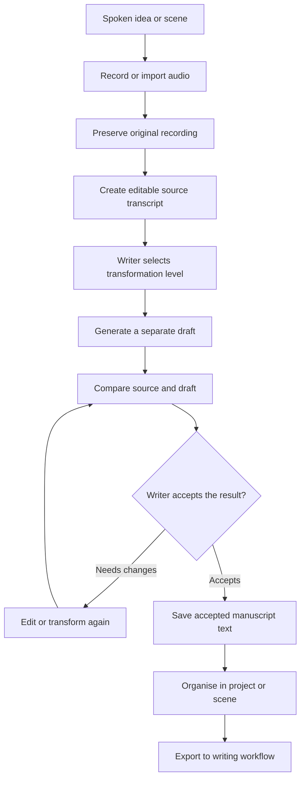
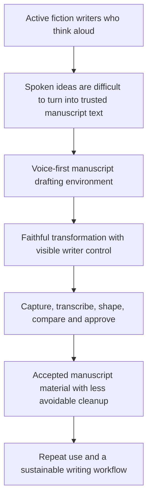
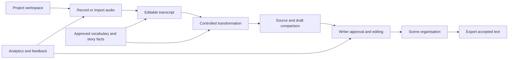
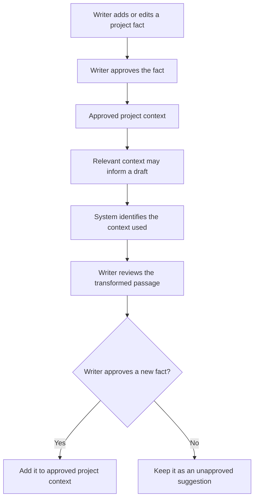
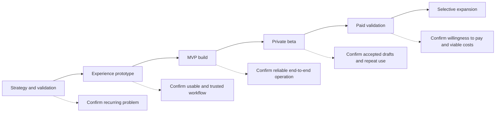
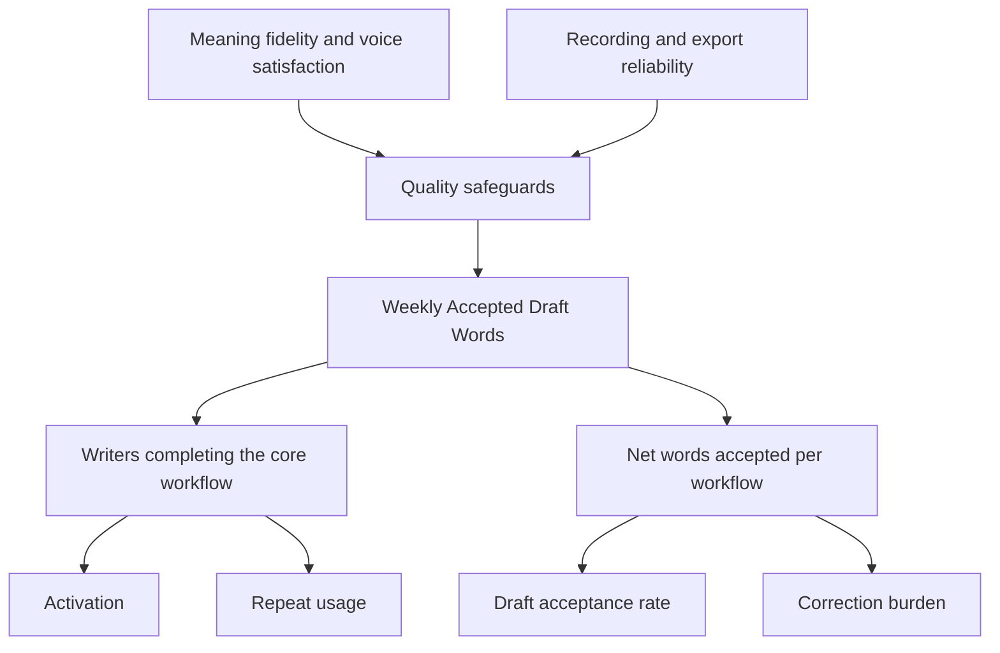
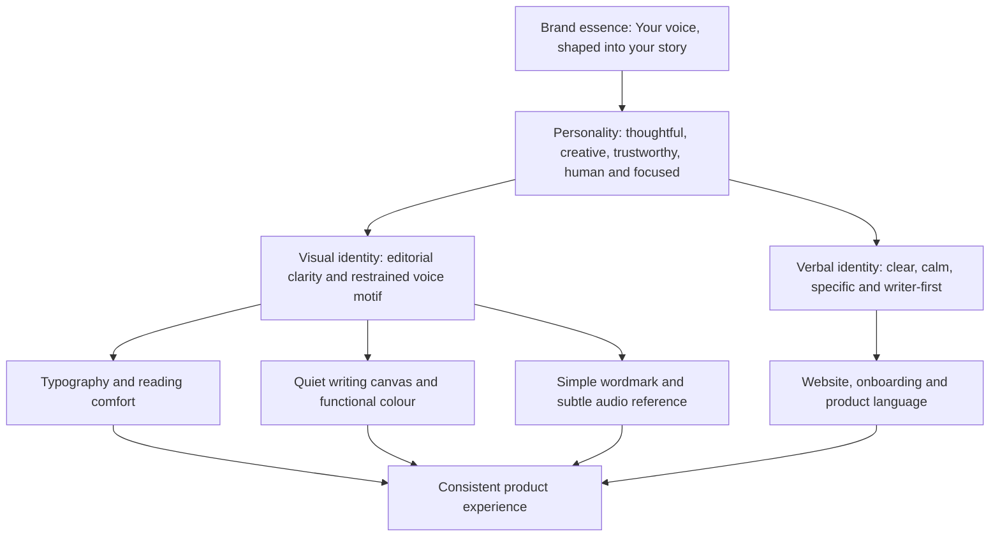

# StoryVoice: Phase 2: Product Strategy, Vision, Definition & Brand Identity

## Why This Phase Exists

Phase 1 established the problem StoryVoice should investigate: fiction writers who prefer speaking to typing need a dependable way to turn spoken ideas and rough narration into editable manuscript material without losing their intended meaning, authorial voice or control over the story. It also established an important competitive reality. Fiction dictation, voice-to-manuscript workflows and author workspaces with recording already exist. StoryVoice cannot build a business simply by combining a microphone, transcription and an AI rewrite button.

The purpose of Phase 2 is to turn that research into a coherent product strategy. I need to define what StoryVoice is, who it serves first, what outcome it promises, what makes its approach distinct, what the first version must include, what should remain outside its scope, and how success will be measured. I also need to establish a brand direction that communicates the product's value without making it sound like an autonomous AI novelist.

This phase is a strategy and definition document, not a claim that the product has already been validated. The product direction, positioning, feature priorities, brand system and commercial model below are proposed decisions based on Phase 1 research and product reasoning. They should be tested with target writers before they are treated as permanent commitments. Where evidence is unavailable, I identify the assumption and the validation required.

The central strategic choice is to make StoryVoice a **voice-first drafting environment**, not a general-purpose AI fiction generator or a replacement for every tool in an author's writing stack. The product should help a writer move from spoken material to a passage they are willing to accept into their manuscript. The writer remains the author and final decision-maker throughout that process.

## Product Flow and Control Model

The product should be organised around one complete outcome: a writer moves from spoken material to an accepted passage that can be used in a manuscript. Each stage must preserve the source and make the writer's decision visible.

The diagram represents the intended product behaviour, not a completed implementation. A generated draft is never treated as accepted manuscript content until the writer explicitly approves it.

## 1. Product Strategy

### 1.1 Product definition

**StoryVoice is a voice-first manuscript drafting environment that helps fiction writers turn spoken ideas into accepted, organised manuscript text through faithful transcription, controlled transformation and writer-approved story context.**

This definition describes the user, the workflow and the intended outcome. It deliberately avoids broad claims such as “write a novel with AI” or “your AI co-author”. Those claims would place StoryVoice in a crowded category and could imply that the product is expected to invent or take ownership of creative work.

StoryVoice begins with the writer's own material. The system captures speech, converts it into text, helps shape that text into a readable draft, and makes the changes inspectable before the writer accepts them. Project context can support the process, but the system must distinguish confirmed story facts from suggestions or model inferences.

### 1.2 Product vision

> A writing process in which every story idea can move naturally from the writer's voice into a manuscript they recognise as their own.

The vision describes the long-term experience rather than a feature list. It gives StoryVoice room to expand into project context, scene organisation and continuity support while keeping the writer's authorship at the centre.

### 1.3 Product mission

> Help fiction writers capture, shape and organise spoken ideas into trusted manuscript material, without taking creative control away from them.

The mission is operational. It should guide decisions about product behaviour, AI features, data handling, onboarding, messaging and prioritisation.

### 1.4 Product promise

> Turn spoken ideas into manuscript-ready drafts while keeping you in control of every meaningful change.

The promise contains three commitments:

| Commitment | What it means in the product | What the product must avoid |
|---|---|---|
| Turn spoken ideas into drafts | Capture speech, transcribe it and help shape it into readable text | Treating audio capture as the complete product outcome |
| Manuscript-ready | Make accepted material easy to organise and move into a writing project | Claiming that every generated passage is publication-ready |
| Keep the writer in control | Preserve source material and make transformations visible, editable and reversible | Silent rewriting, unapproved story facts or automatic replacement of original text |

The promise should be used as a standard for product decisions. If a feature does not help the writer move from speech to accepted manuscript material, or does not strengthen trust in that process, it should not be a priority in the first release.

### 1.5 Strategic positioning

StoryVoice should occupy the space between basic dictation tools and broad AI writing suites. Basic dictation can capture words but may leave the writer with substantial cleanup and organisation work. Broad AI writing tools can generate or rewrite prose but may not prioritise preserving the exact intent and voice contained in a writer's recording. StoryVoice should focus on the quality and trustworthiness of the transition between those stages.

| Alternative | What it primarily helps the writer do | StoryVoice's strategic response |
|---|---|---|
| General dictation and transcription | Convert speech into text | Continue beyond transcription into controlled draft preparation and manuscript acceptance |
| General-purpose AI assistant | Rewrite, summarise or generate text | Make the source-to-draft relationship explicit and keep changes reviewable |
| AI fiction-writing suite | Develop, expand or revise creative material | Prioritise the writer's own spoken material rather than autonomous story generation |
| Novel planning and manuscript software | Organise a book, scenes and story information | Start with the voice-to-draft workflow and integrate through reliable export |
| Manual recording plus document editing | Preserve ideas and assemble a writing workflow from several tools | Reduce handoffs, repeated copying and avoidable correction work |

This positioning is a strategic hypothesis. Competitor products must be tested hands-on before StoryVoice can claim a measurable advantage over them.

### 1.6 The initial strategic wedge

The initial wedge is **faithful voice-to-manuscript transformation with writer control**. It is narrower than a complete author workspace and more meaningful than transcription alone.

The wedge has five parts:

1. Preserve the original recording and source transcript.
2. Offer clearly differentiated transformation modes, from faithful cleanup to readable draft shaping.
3. Show what changed between the source and the transformed draft.
4. Let the writer accept, reject, edit or restore the material.
5. Save only writer-approved content as accepted manuscript material.

The product should earn the right to expand into deeper story memory and continuity support by first proving that it can handle the basic drafting workflow reliably.

### 1.7 Product objectives

The first product strategy should be judged against four objectives:

1. **Reduce the distance between speaking and drafting.** A writer should be able to capture a thought and reach an editable draft without manually moving through several disconnected tools.
2. **Preserve meaning and authorial control.** The system must make it easier to shape spoken language without silently changing the events, intent, dialogue or creative decisions.
3. **Fit into an existing writing practice.** A writer should be able to organise and export accepted material without being forced to migrate an entire manuscript into StoryVoice.
4. **Prove recurring value before expanding.** The product must demonstrate repeated use, accepted output and a credible cost-to-value relationship before deeper story intelligence or collaboration is prioritised.

### 1.8 Intended business outcomes

The business objective is to earn a recurring place in the writing workflow of a clearly defined group of active fiction writers. That requires evidence of a recurring problem, repeat use across writing sessions, willingness to pay and sustainable processing costs. Downloads, recordings processed and words generated are not sufficient business outcomes on their own.

### Product strategy at a glance

The strategy should read as one connected chain. Each layer exists to deliver the outcome above it; the MVP is not a collection of independent features.

This is the strategic logic to test, not a claim that each link has already been validated.

## 2. Target Customer and Initial Use Case

### 2.1 Primary customer

The initial target customer is an **active independent fiction writer who is drafting a novel or series and either already dictates or is willing to use voice as part of the writing process**.

This is a starting segment, not a claim that all independent authors are suitable customers. The best early users are likely to have an active manuscript, frequent drafting sessions, a meaningful amount of spoken material and a current workaround involving recordings, dictation software or manual transcription and editing.

### 2.2 Customer characteristics to prioritise

| Characteristic | Priority signal | Why it matters |
|---|---|---|
| Active project | Currently drafting a novel, novella or series | The need is immediate rather than hypothetical |
| Recurring writing behaviour | Writes or captures ideas several times a week | Creates an opportunity for repeat usage |
| Voice willingness | Already dictates, records ideas or expresses interest in speaking drafts | Reduces behaviour-change friction |
| Existing workaround | Uses a recorder, phone dictation, transcription or AI cleanup | Makes the current workflow and its limitations observable |
| Editing burden | Spends meaningful time correcting transcripts or restructuring spoken material | Gives StoryVoice a measurable problem to solve |
| Manuscript commitment | Intends to complete and revise the current project | Makes accepted draft quality more valuable than novelty |

These are qualification criteria for discovery and early testing. They are not yet a verified demographic profile.

### 2.3 Secondary customer segments

| Segment | Potential use | Initial priority | Reason |
|---|---|---:|---|
| Non-fiction authors | Dictate chapters, explanations and long-form drafts | Later | May value the workflow, but terminology and editing needs differ from fiction |
| Screenwriters and playwrights | Capture dialogue, scenes and spoken story ideas | Later | Could require screenplay-specific structure and formatting |
| Fan-fiction writers | Capture and organise frequent story drafts | Explore | May have high writing frequency, but willingness to pay needs testing |
| Students and casual writers | Capture essays, stories and ideas | Low initially | Usage may be episodic and less connected to a sustained manuscript workflow |
| Professional authors with established systems | Add voice drafting to an existing process | Selective | Potentially valuable, but migration and integration expectations may be higher |

The first release should not attempt to serve all these groups equally. Fiction-specific language, dialogue and story context are central to the initial product definition.

### 2.4 Jobs to be done

**Core job:** When I have a scene, sequence or story idea in my head, I want to speak it and turn it into a draft I can trust, so I can keep writing without losing the original thought or spending too much time cleaning it up.

Supporting jobs:

- When an idea arrives away from my desk, I want to record it quickly and find it later in the correct project.
- When I dictate a rough passage, I want the transcript to preserve what I meant rather than mechanically reproduce every verbal hesitation.
- When I want cleaner prose, I want to choose how much editing the system performs.
- When the system changes my words, I want to inspect those changes and restore the original if necessary.
- When I work on a long story, I want relevant approved character, setting and timeline information to be available without the system inventing facts.
- When a passage is ready, I want to move it into my existing manuscript application without losing its formatting or structure.

### 2.5 Initial use case

The first use case should be deliberately specific:

> A fiction writer opens an active project, records or imports a rough scene, reviews the transcript, chooses a transformation level, compares the result with the source, accepts or edits the draft, saves it to a scene and exports it when needed.

This use case gives the product a clear beginning and end. It also creates a testable unit for measuring time, correction burden, acceptance and repeat usage.

### 2.6 User roles and permissions

The initial product is designed for an individual author. It does not need a complex team permission system.

| Role | Permissions | First-release status |
|---|---|---|
| Writer / project owner | Create projects, record audio, edit drafts, approve content, manage story facts and export | Required |
| Collaborator / editor | Review or comment on shared manuscript material | Deferred |
| Administrator / support | Resolve account and technical issues through controlled internal access | Operational requirement, not a customer-facing role |

## 3. Value Proposition and Messaging

### 3.1 Core value proposition

**For fiction writers who think aloud, StoryVoice turns spoken scenes and ideas into organised manuscript drafts while preserving the writer's intent and control.**

Unlike a basic transcription tool, StoryVoice is designed to support the full journey from spoken material to accepted draft. Unlike an autonomous AI writing product, it treats the writer's source material as the authority and makes meaningful changes visible before they become part of the manuscript.

### 3.2 Supporting value pillars

| Value pillar | User benefit | Product proof required |
|---|---|---|
| Capture without friction | Get ideas out of the writer's head before they disappear | Reliable recording, upload and recovery behaviour |
| Faithful transformation | Turn rough speech into readable text without changing the intended scene | Strong meaning fidelity and low correction burden |
| Authorial control | Decide what is accepted into the manuscript | Source preservation, comparison, undo and explicit approval |
| Story-aware drafting | Use confirmed project context when it is relevant | Accurate retrieval, source references and low false-positive rates |
| Manuscript continuity | Keep accepted material organised and portable | Project structure and dependable export |

Each pillar must eventually be supported by product evidence. Marketing should not claim “perfect voice preservation”, “zero editing” or “automatic continuity” until those outcomes have been measured and demonstrated.

### 3.3 Message hierarchy

| Level | Message | Purpose |
|---|---|---|
| Primary headline | Your voice. Your story. A draft you can trust. | Communicate voice, authorship and trust in one line |
| Supporting statement | Turn spoken scenes and story ideas into organised drafts, with every meaningful change in your hands. | Explain the product outcome and control model |
| Functional explanation | Record or import audio, shape the transcript into readable prose, review changes and save the passages you approve. | Make the workflow concrete |
| Trust statement | Your original recording and source text remain available. You decide what becomes part of your manuscript. | Address the central adoption concern |
| Primary CTA | Start your first draft | Invite the user into the core workflow |
| Secondary CTA | See how it works | Support users who need to understand the process first |

These are proposed messaging options for testing. The headline and CTA should be evaluated with target writers rather than assumed to be final brand copy.

### 3.4 What StoryVoice should not say

| Avoid | Why | Prefer |
|---|---|---|
| “AI writes your novel” | Suggests autonomous authorship and competes directly with generation suites | “Turn spoken ideas into drafts you control” |
| “Write a book in minutes” | Implies an unrealistic speed or completion promise | “Move from spoken scene to editable draft” |
| “Never edit again” | Contradicts the reality of manuscript revision | “Spend less time cleaning up dictated drafts” only when validated |
| “Perfectly captures your voice” | Absolute claim that cannot be guaranteed | “Designed to preserve your wording, intent and style” |
| “Your AI co-author” | Blurs authorship and decision rights | “A drafting environment built around your voice” |
| “Automatic story continuity” | Implies certainty where context and interpretation may be imperfect | “Surface possible continuity issues for your review” |

### 3.5 Tone of voice

StoryVoice should sound like a thoughtful writing tool: clear, calm, respectful of creative work and confident without making exaggerated promises.

- **Writer-first:** speak to the person creating the story, not to the capabilities of the model.
- **Specific:** explain what happens to audio, text and drafts rather than relying on vague AI language.
- **Respectful:** never imply that rough speech or unfinished prose is a failure; it is part of the creative process.
- **Transparent:** explain when the system is transcribing, editing, suggesting or inferring.
- **Unintrusive:** avoid gamification, pressure language and excessive prompts that interrupt writing.

## 4. Product Principles

The following principles should act as decision rules across product design, engineering, AI behaviour and customer communication.

### 4.1 The writer remains the author

StoryVoice can assist with transcription, editing and organisation, but it must not present generated material as the writer's confirmed intention. The writer controls acceptance, story decisions and final manuscript content.

### 4.2 Preserve the source

Original audio and the initial transcript should remain recoverable. A transformation must create a new working version rather than destructively overwrite the source. The product should make it possible to return to an earlier version.

### 4.3 Make the level of intervention explicit

The interface must distinguish transcription, cleanup, prose shaping and creative suggestions. The user should know what type of operation is being applied before it runs and should be able to inspect the result afterwards.

### 4.4 Context informs; it does not dictate

Approved project information can help resolve names, references and continuity. It should not silently override the current recording or create new canonical facts. When context is uncertain or conflicting, StoryVoice should ask or flag the uncertainty rather than guess.

### 4.5 Optimise for accepted writing, not generated volume

The product should measure whether writers keep and use the output. Audio minutes processed, words generated and number of AI actions are diagnostic metrics, not the definition of value.

### 4.6 Fit into the writer's existing process

StoryVoice should initially complement established manuscript applications. Reliable export is a strategic requirement. Replacing an author's entire writing environment is not necessary to prove the core value proposition.

### 4.7 Reliability is part of the writing experience

Recording failures, lost audio, unclear processing states and broken exports damage trust disproportionately. The product should prioritise durable capture, clear processing status, recoverability and predictable output over decorative features.

## 5. Functional Product Requirements

The requirements below define the intended first product boundary. They are product requirements, not a technical architecture or final implementation specification. Detailed system design, vendor selection, data models and engineering decisions belong in later phases.

### 5.1 Product modules

| Module | Responsibility | First-release priority |
|---|---|---:|
| Account and onboarding | Create an account, explain the workflow and guide the first project setup | Must have |
| Project workspace | Create and manage a writing project | Must have |
| Audio capture and import | Record audio or upload an existing recording | Must have |
| Transcription | Convert speech into editable source text | Must have |
| Fiction vocabulary handling | Allow correction and reuse of character names and invented terms | Should have |
| Transformation controls | Apply faithful cleanup or readable draft shaping | Must have |
| Source comparison | Show original transcript and transformed draft | Must have |
| Draft editing and approval | Edit, accept, reject or restore a version | Must have |
| Scene organisation | Save accepted content to a project and basic scene structure | Must have |
| Story facts | Store writer-approved character, place and terminology details | Should have, limited scope |
| Continuity review | Surface possible conflicts with approved story facts | Later validation / limited experiment |
| Export | Export accepted text to DOCX, Markdown and TXT | Must have |
| Billing and usage controls | Explain plan limits and manage paid access if monetisation is enabled | Required before paid launch |
| Analytics and feedback | Measure workflow outcomes and collect user feedback | Must have for testing |

### How the first-release modules work together

The modules should support one continuous writer journey. Project context and billing are supporting capabilities; they must not interrupt or obscure the central drafting path.

The diagram describes product-level relationships only. It is not a backend architecture or a final screen sequence.

### 5.2 Core user stories and acceptance criteria

| ID | User story | Acceptance criteria |
|---|---|---|
| US-01 | As a writer, I want to create a project so my recordings and drafts have a clear home. | I can create, name, reopen and archive a project. New recordings can be associated with a project. |
| US-02 | As a writer, I want to record a spoken draft so I can capture a scene without typing. | I can start, pause, resume and stop a recording. The product shows recording state and confirms when the audio has been saved. |
| US-03 | As a writer, I want to import an audio file so I can use recordings made elsewhere. | Supported file types and size limits are explained before upload. Upload progress and failure states are visible. |
| US-04 | As a writer, I want a transcript of my recording so I can inspect the words before editing. | The transcript is editable, linked to its source audio and retained as the original transcript version. |
| US-05 | As a writer, I want to correct fictional names and terms so the transcript reflects my story vocabulary. | I can correct a term and reuse the approved spelling within the project. The system does not silently change unrelated words. |
| US-06 | As a writer, I want to choose how much the text is transformed so I can control the result. | Available modes have clear descriptions. The selected mode is visible before processing. |
| US-07 | As a writer, I want to compare the transcript and transformed draft so I can understand what changed. | Both versions are accessible. Additions, removals and rewrites can be inspected without losing the source. |
| US-08 | As a writer, I want to accept, edit, reject or restore a draft so I decide what enters my manuscript. | Each action has a clear result. Rejected or replaced content remains recoverable according to the version history policy. |
| US-09 | As a writer, I want to save accepted material to a scene so I can find it within my project. | I can create or select a basic scene location and move accepted text into it. |
| US-10 | As a writer, I want to export my accepted writing so I can continue in my preferred editor. | Exported files contain accepted text, preserve basic headings and paragraphs, and can be opened in the declared supported formats. |
| US-11 | As a writer, I want to know whether my recording is saved or still processing so I do not lose work. | The interface shows distinct states for recording, upload, processing, ready and failed. Recovery guidance is provided for failures. |
| US-12 | As a writer, I want to know what story information the system used so I can judge its suggestions. | When project context materially influences an output, the relevant approved source is identifiable. |

### 5.3 Non-functional requirements

| Area | Requirement | Why it matters |
|---|---|---|
| Data durability | Confirm successful audio save and protect source recordings from destructive edits | A lost recording can mean lost creative work |
| Privacy | Explain storage, processing, retention and deletion practices in plain language | Manuscripts may contain unpublished intellectual property |
| Security | Protect accounts, recordings, manuscripts and project facts with appropriate access controls | Writing material is private and commercially sensitive to its author |
| Performance | Provide clear progress states and avoid blocking the writer without feedback | Long recordings and AI processing may take time |
| Recoverability | Preserve versions and communicate failures without discarding source material | Writers need confidence to experiment with transformations |
| Accessibility | Support keyboard navigation, readable contrast, clear labels and usable controls | Writing tools should not depend on one interaction style |
| Portability | Allow writers to export their accepted work in usable formats | Avoid lock-in and reduce switching risk |
| Transparency | Distinguish model-generated suggestions from writer-approved facts | Prevent accidental changes to story canon |

Specific latency, uptime, file-size and retention targets should be set after the technical design and prototype tests establish realistic baselines. I should not invent service-level commitments before those decisions are made.

### 5.4 Transformation modes

The first release should expose a small number of understandable modes rather than a long list of AI actions.

| Mode | Intended operation | Boundaries |
|---|---|---|
| Faithful transcript | Convert speech to text with punctuation and minimal formatting | Do not rewrite sentences or add story details |
| Clean transcript | Remove obvious verbal disfluencies and improve readability | Preserve meaningful repetition, dialogue and intentional fragments |
| Readable draft | Reshape rough spoken language into readable prose while preserving events and intent | Do not invent actions, motivations, descriptions or plot facts |
| Creative suggestions | Offer optional alternatives for a selected passage | Keep suggestions separate from accepted manuscript text |

Scene structuring can initially be a user-controlled organisation action rather than an autonomous transformation. A recording may contain multiple ideas or unfinished material; the product should not assume that every recording is a complete scene.

### 5.5 Story context requirements

Story context is strategically valuable but creates trust and correctness risks. The first implementation should be modest.

- Let the writer add or correct character names, locations and recurring terms.
- Keep project facts explicitly writer-approved.
- Show which project information was used when it materially affects a transformation or warning.
- Treat inferred facts as suggestions until the writer approves them.
- Do not automatically rewrite a manuscript because a stored fact appears to conflict with it.
- Allow the writer to edit or remove stored facts.

Advanced plot graphs, relationship maps, timeline engines and automated canon management should remain outside the first release until the core voice-to-draft workflow is proven.

### 5.6 AI capability requirements

The first release should use AI to support a controlled drafting workflow, not to take over story creation. The capability sequence should be:

| Capability | First-release role | Control requirement |
|---|---|---|
| Speech recognition | Convert audio into a source transcript | Keep the transcript linked to the original recording and editable by the writer |
| Fiction vocabulary support | Improve recognition of names and invented terms | Use writer-corrected terms as project-level vocabulary only after approval |
| Faithful cleanup | Remove non-meaningful disfluencies and repair obvious speech-to-text issues | Preserve meaningful repetition, dialogue, events and intent |
| Readable draft shaping | Turn rough spoken language into readable prose | Do not invent plot facts, actions, motivations or descriptive details |
| Context-assisted drafting | Use selected, approved project facts where relevant | Identify the context used and avoid silent canon updates |
| Creative alternatives | Offer optional rewrites or suggestions | Keep suggestions separate from the accepted manuscript |

Model choice, orchestration, prompt design, retrieval architecture and provider benchmarking belong to technical and AI research in Phase 4. Phase 2 defines the product behaviour and boundaries those later decisions must support.

### 5.7 Data requirements and ownership

The product needs enough structured information to preserve provenance and support the core workflow. This is a product-level data requirement, not a final database design.

| Data group | Required information | Ownership and handling principle |
|---|---|---|
| Source audio | Original file, duration, format, project association and save status | User content; preserve the source and provide clear retention and deletion controls |
| Source transcript | Transcript text, timestamps where available, language and correction history | Retain as a distinct source version; never silently replace it with a transformed draft |
| Draft versions | Transformation mode, output text, version relationship and processing status | Keep each transformation traceable to its source and recoverable according to the version policy |
| Approval record | Accept, reject, edit, restore and export actions | Record the writer's decision without treating generation as approval |
| Project structure | Project, scene and manuscript organisation | User-controlled and exportable |
| Story context | Approved character names, locations, terms and selected facts | Writer-approved facts must be distinguishable from suggestions and model inferences |
| Product analytics | Workflow events, durations, error categories and aggregate usage | Do not place manuscript text or raw audio in routine analytics payloads |

The writer should be able to understand what is stored, why it is used, how long it is retained and how to export or delete it. The exact retention schedule, encryption approach, access controls and legal wording must be established during technical, security and privacy work.

The context approval boundary should remain explicit:

A model inference, a sentence in a rough transcript or a possible continuity issue must not become canonical story information automatically. The writer remains the source of truth.

## 6. MVP Scope and Prioritisation

### 6.1 MVP objective

The MVP should answer one question:

> Can StoryVoice help an active fiction writer turn a real spoken draft into accepted manuscript text with less correction effort and without reducing trust in the writer's own voice and intent?

The MVP is a learning instrument. Its scope should be judged by how effectively it tests that question, not by how many features it contains.

### 6.2 Must-have scope

1. Account creation and a simple first-use explanation.
2. Project creation and a basic project workspace.
3. Audio recording and audio import.
4. Transcription with an editable source transcript.
5. Basic project vocabulary corrections for names and invented terms.
6. Faithful transcript cleanup and readable draft transformation.
7. Comparison between source and transformed text.
8. Accept, edit, reject and restore actions.
9. Basic project and scene organisation.
10. DOCX, Markdown and TXT export.
11. Product analytics for the core workflow and a feedback mechanism.
12. Clear privacy, storage and processing information.

### 6.3 Explicitly out of scope

- Autonomous chapter or novel generation.
- Full story bible automation and automatic canon updates.
- Advanced plot, character relationship and timeline visualisation.
- Collaborative editing, public sharing and author communities.
- Publishing distribution, book sales and royalty management.
- Marketplace, coaching or editorial services.
- Complex formatting for every genre and publishing standard.
- Mobile-native applications before the core workflow and device needs are validated.

These exclusions are not statements that the capabilities are unimportant. They are sequencing decisions intended to protect the initial product from becoming too broad.

### 6.4 Prioritisation method

I will use a lightweight RICE-style model to make prioritisation explicit:

\[
\text{Priority Score} = \frac{\text{Reach} \times \text{Impact} \times \text{Confidence}}{\text{Effort}}
\]

Where:

- **Reach** is the estimated number of target users affected during the evaluation period.
- **Impact** is the expected effect on the core user outcome.
- **Confidence** is the strength of evidence behind the estimate.
- **Effort** is the relative implementation cost.

Scores should be assigned only when the team has enough information to make a useful estimate. At this stage, the priority labels below are more honest than invented numerical RICE scores.

| Capability | Priority | Rationale |
|---|---|---|
| Reliable recording and import | Must have | No source material means the core workflow cannot begin |
| Accurate, editable transcription | Must have | Every later stage depends on the transcript |
| Controlled transformation | Must have | Central to the product's differentiation hypothesis |
| Source comparison and version recovery | Must have | Required for trust and writer control |
| Project and scene organisation | Must have | Converts isolated outputs into manuscript material |
| Basic vocabulary memory | Should have | Fiction names and invented terms are recurring transcription risks |
| Writer-approved story facts | Should have, limited | Useful context, but must not delay testing the core workflow |
| Continuity warnings | Later | Requires evidence on accuracy and false positives |
| Advanced story intelligence | Later | Expensive and not necessary to test the first product promise |
| Collaboration and publishing | Not in MVP | Does not test the initial problem hypothesis |

### 6.5 MVP release gate

The MVP should not be considered ready merely because the main screens work. It should pass the following gates:

- A writer can record or import audio without losing the source.
- A transcript is produced and can be corrected.
- The writer can select a transformation mode and understand what it does.
- The transformed draft can be compared with the source.
- The writer can accept, edit, reject or restore the result.
- Accepted content can be saved to a project and exported.
- Failures are visible and do not silently discard work.
- Core workflow events are instrumented so the product can be evaluated with real users.

## 7. Product Roadmap

The roadmap is organised around learning and risk reduction rather than a fixed calendar. Timelines should be assigned after technical discovery, prototype complexity and available capacity are understood.

| Stage | Focus | Main work | Exit condition |
|---|---|---|---|
| Strategy and validation | Confirm user, problem and product promise | Interviews, workflow observation, competitor hands-on testing, concept and message tests | Repeated evidence of a painful workflow and a credible reason to try StoryVoice |
| Experience prototype | Test the end-to-end interaction | Recording/import flow, transcript review, transformation modes, comparison and approval prototype | Target writers can complete the workflow and understand the control model |
| MVP build | Deliver the narrow product | Projects, audio, transcription, transformation, review, organisation, export and analytics | End-to-end workflow works reliably for a small test cohort |
| Private beta | Measure real usage and quality | Onboard target writers, observe sessions, collect corrections and track repeat behaviour | Evidence of accepted drafts, manageable correction burden and repeat use |
| Paid validation | Test commercial value | Pricing tests, paid plans or paid pilot, usage limits and support process | Users demonstrate willingness to pay and sustainable usage economics |
| Expansion | Add capabilities only where justified | Deeper story context, continuity assistance, integrations and broader formats | Core workflow has retention and users request the expansion for recurring jobs |

### Roadmap sequence and decision gates

Progression is conditional, not calendar-driven. If a gate fails, the next step is to investigate and improve the relevant part of the product rather than advance automatically.

### 7.1 What must be learned before expanding

Before building advanced story intelligence, I need to know whether users consistently organise accepted drafts into projects and whether approved context improves transformation quality. Before adding collaboration, I need evidence that writers want to work with editors or co-writers inside StoryVoice rather than use their existing tools. Before building a mobile application, I need to understand where recording actually happens and whether the web experience creates meaningful friction.

### 7.2 Product dependencies

The core workflow has a clear dependency order. Later capabilities should not be built on top of unreliable earlier stages.

| Dependency | Depends on | Why it must come first |
|---|---|---|
| Reliable transcription | Durable audio capture and supported audio import | Transformation quality cannot exceed the usefulness of its source transcript |
| Controlled transformation | Editable source transcript and defined transformation modes | The system needs a stable source and explicit instruction about the level of intervention |
| Source comparison and recovery | Version relationships and persistent source storage | Review and reversibility require the original and each draft version to remain identifiable |
| Project and scene organisation | Accepted-draft state and a basic project structure | Only approved content should become part of the writer's organised manuscript |
| Story context | Project structure, writer-approved facts and provenance | Context must be attributable and must not become canonical through inference |
| Export | Accepted content and stable document structure | Export must carry the writer's approved material, not intermediate suggestions |
| Paid plans | Usage measurement, provider costs and billing controls | Pricing cannot be responsibly packaged before cost and usage are understood |

### 7.3 Resource and capability requirements

I am defining the capabilities required to deliver the strategy, not assuming a particular team size or making an unsupported staffing estimate.

| Capability | Responsibility | When it is needed |
|---|---|---|
| Product ownership | Maintain the product thesis, scope, priorities and decision log | Throughout |
| User research | Recruit writers, observe workflows and synthesise evidence | Before and during prototype validation |
| UX and content design | Define the recording, review, approval and export experience | Prototype and MVP definition |
| Application engineering | Build project management, capture, editing, versioning and export workflows | Prototype through MVP |
| Speech and AI engineering | Evaluate transcription and transformation quality, reliability and cost | Technical discovery and MVP |
| Quality evaluation | Create representative test passages and assess fidelity, vocabulary and critical errors | Before and throughout beta |
| Security and privacy | Define access, storage, retention, deletion and consent requirements | Before handling real unpublished manuscripts at scale |
| Commercial and operations | Test packaging, billing, support and usage economics | Before paid validation |

The same person may cover more than one capability in an early build. The strategy does not assume that every capability requires a separate hire. Detailed staffing, vendor selection and cost estimates belong after technical feasibility and delivery scope are understood.

### 7.4 AI capability roadmap

The AI roadmap should follow increasing levels of intervention and risk:

| Stage | Capability | Product condition for progression |
|---|---|---|
| Foundation | Speech recognition and editable transcript | Reliable source capture, recoverable transcript and clear processing failures |
| Core value | Faithful cleanup and readable draft shaping | Writers report acceptable meaning fidelity and manageable correction effort |
| Context support | Approved vocabulary and selected project facts | Writers can inspect and control the context used |
| Assisted review | Optional continuity or terminology flags | Evaluation shows useful precision and manageable false positives |
| Personalisation | Writer-approved style preferences and repeatable transformation settings | Writers understand, control and can reset stored preferences |
| Advanced assistance | More complex story intelligence and optional creative suggestions | The core workflow demonstrates repeat use and users request these capabilities for recurring jobs |

This is a capability sequence, not a commitment to build every stage. More autonomy is not automatically more value. Each expansion must improve the writer's accepted-draft outcome without weakening authorship or trust.

### 7.5 Long-term product direction

If the core workflow proves valuable, StoryVoice can expand from a voice-to-draft tool into a broader manuscript companion. The plausible sequence is deeper project context, better scene and chapter organisation, dependable integrations with established writing tools, and carefully evaluated continuity assistance. Collaboration, publishing workflows and autonomous story generation remain separate strategic choices, not inevitable stages of the roadmap.

The long-term direction should be governed by one rule: **expand the writer's control over a growing body of work, not the system's control over the story.**

## 8. Success Metrics and Measurement Framework

### 8.1 North Star metric

The proposed North Star metric is **Weekly Accepted Draft Words (WADW)**: the number of words in passages that writers explicitly accept into their project during a week.

For measurement, count the net words in newly accepted manuscript material. Do not count repeated exports, duplicate copies, rejected suggestions or words that were merely transcribed or generated but never accepted. Revisions to an existing accepted passage should be tracked separately so that editing activity does not inflate the metric.

This is closer to the product's intended value than total transcribed words or generated words. It still needs safeguards: a large number of accepted words does not necessarily mean high quality, so it must be interpreted alongside correction burden, fidelity, trust and repeat usage.

### North Star metric relationship

The supporting measures are safeguards and diagnostic signals, not additional North Star metrics. Growth in accepted words is meaningful only when quality, trust and reliability remain acceptable.

### 8.2 Supporting metrics

| Metric | Definition | What it tells us |
|---|---|---|
| Activation rate | Share of new users who complete their first recording-to-accepted-draft workflow | Whether onboarding gets users to the core value |
| Time to first accepted draft | Time from first project or recording start to first accepted passage | How quickly users experience value |
| Weekly accepted draft words | Total words explicitly accepted into projects per active user or cohort | Whether the product creates manuscript material |
| Draft acceptance rate | Accepted transformed words divided by transformed words presented for review | Whether outputs are useful enough to keep |
| Correction burden | Editing time or edits required per 1,000 accepted words | Whether StoryVoice reduces cleanup effort |
| Meaning fidelity | Human rating of whether facts, actions and intent are preserved | Whether transformation is trustworthy |
| Voice satisfaction | Writer rating of whether the output retains their intended voice | Whether the product respects authorial style |
| Recording success rate | Successful saved recordings divided by recording attempts | Whether capture is dependable |
| Export success rate | Successful exports divided by export attempts | Whether accepted work can leave the product reliably |
| Week-four repeat usage | Share of activated users returning and completing a core workflow in week four | Whether the workflow becomes habitual |
| Paid conversion | Share of eligible active users who become paying customers | Whether perceived value supports monetisation |

### 8.3 Metric definitions and formulas

**Activation rate**

\[
\text{Activation Rate} = \frac{\text{New users completing first accepted draft}}{\text{New users who started onboarding}} \times 100
\]

**Draft acceptance rate**

\[
\text{Acceptance Rate} = \frac{\text{Words accepted}}{\text{Words presented in transformed drafts}} \times 100
\]

**Correction burden**

\[
\text{Correction Burden} = \frac{\text{Minutes spent editing}}{\text{Accepted words}} \times 1{,}000
\]

**Recording success rate**

\[
\text{Recording Success Rate} = \frac{\text{Recordings saved successfully}}{\text{Recording attempts}} \times 100
\]

These formulas define the measurement approach. Numeric targets should be set after baseline testing with real writers; setting arbitrary targets before observing a prototype would create false precision.

### 8.4 Quality evaluation rubric

A sample of transformed passages should be reviewed against a consistent rubric. The writer's own assessment should remain central, supported by structured review where possible.

| Dimension | Evaluation question | Suggested scale |
|---|---|---|
| Meaning fidelity | Does the draft preserve the events, facts and intent in the recording? | 1–5 |
| Voice preservation | Does the draft still feel like the writer's intended voice? | 1–5 |
| Readability | Is the draft easier to read without becoming generic? | 1–5 |
| Fiction vocabulary | Are names, places and invented terms handled correctly? | Error count and 1–5 rating |
| Correction effort | How much work was needed before acceptance? | Minutes and edit count |
| Trust | Does the writer understand and feel in control of the changes? | 1–5 |

A high average score should not conceal severe failures. Meaning changes, invented plot facts, lost dialogue or missing source material should be recorded as critical errors separately.

### 8.5 Event instrumentation

The first testable product should record a minimal set of product events:

| Event | When it occurs | Useful properties |
|---|---|---|
| `project_created` | A writer creates a project | Project type, onboarding source |
| `recording_started` | Recording begins | Project ID, device category |
| `recording_saved` | Audio is successfully saved | Duration, file size, save status |
| `audio_imported` | An audio file is uploaded | Duration, format, upload status |
| `transcription_completed` | Source transcript is ready | Duration, processing status, error category |
| `transcript_edited` | Writer changes source transcript | Edit count, correction category where feasible |
| `transformation_started` | Writer selects a transformation mode | Mode, source length |
| `transformation_completed` | Draft is generated | Mode, output length, processing status |
| `draft_compared` | Writer opens comparison | Comparison type |
| `draft_accepted` | Writer accepts transformed content | Accepted word count, mode |
| `draft_rejected` | Writer rejects transformed content | Optional reason |
| `draft_restored` | Writer restores an earlier version | Version identifier |
| `scene_saved` | Accepted content is saved to a scene | Project and scene identifiers |
| `export_completed` | An export succeeds | Format, output size, status |
| `subscription_started` | User begins a paid plan | Plan, billing interval |

Analytics must respect privacy and should not collect manuscript text or audio content as ordinary event properties. Sensitive content should be excluded from analytics payloads unless the writer has explicitly consented to a clearly explained research process.

### 8.6 Initial product OKRs

These are validation-stage objectives. They define what the next product work must establish; they do not pretend that performance targets or baselines already exist.

| Objective | Key results / evidence required | Why it matters |
|---|---|---|
| Validate a recurring voice-to-draft problem | Complete the planned 12–15 interviews; document current workflows, frequency, correction effort and reasons for switching or not switching | Confirms whether the target problem is frequent and important enough |
| Prove that the core workflow is understandable | Observe writers completing the recording/import, transcript, transformation, comparison and approval journey; record points of confusion and failed tasks | Establishes whether the product experience is usable |
| Establish acceptable transformation quality | Measure meaning fidelity, voice satisfaction, correction burden, acceptance and critical errors on representative passages | Prevents fluent but inaccurate output from being treated as success |
| Establish trust in writer control | Verify that writers can identify the source, understand changes, restore earlier material and distinguish approved facts from suggestions | Protects the product's central trust promise |
| Establish commercial viability signals | Measure real usage patterns and processing costs, then test a real paid offer with qualified users | Connects willingness to pay with sustainable unit economics |

Numerical performance thresholds should be set after baseline data exists. The first OKR cycle should produce reliable evidence and expose failure modes, not manufacture impressive percentages.

## 9. Business Model and Commercial Strategy

### 9.1 Business model hypothesis

The initial business model should be a subscription for individual writers, with usage limits that reflect the variable cost of audio processing and AI transformation. A free or limited trial can help writers experience the core workflow before paying. A one-time lifetime plan is not recommended at the beginning because ongoing transcription, storage and model costs may create a mismatch between revenue and usage.

This is a model hypothesis, not a validated pricing decision. Phase 1 identified competitor pricing references, but those prices do not establish StoryVoice's willingness-to-pay level.

### 9.2 Potential packaging structure

| Plan concept | Intended user | Possible limits / value | Status |
|---|---|---|---|
| Free trial | Curious writers evaluating the workflow | Small allowance of recording/transcription and access to core review experience | Test |
| Writer | Individual author with one active project or regular drafting needs | Higher monthly usage, projects, transformations and export | Test |
| Pro Writer | High-frequency writer or author managing multiple manuscripts | Larger usage allowance, expanded project context and priority processing | Test |

The exact names, limits, prices and feature gates should be determined through usage-cost modelling and paid validation. Avoid introducing artificial feature restrictions that interrupt the core experience; usage limits should be understandable and tied to real operating costs.

### 9.3 Pricing research requirements

Before committing to a price, I need to understand:

- How many minutes of audio a typical target writer processes each week.
- The transcription and transformation cost per minute and per accepted draft.
- Storage and retention costs for original recordings and manuscript versions.
- The value writers place on saved editing time and reduced workflow friction.
- Whether writers prefer a monthly subscription, annual subscription or usage-based allowance.
- Whether usage varies substantially between casual and prolific authors.
- How competitor plans and free alternatives shape expectations.

### 9.4 Unit economics framework

The basic contribution model should be:

\[
\text{Contribution per User} = \text{Net Revenue per User} - \text{Variable Cost per User}
\]

Variable cost should include transcription, model inference, storage, file transfer and payment processing where applicable. Gross margin should be assessed by plan and usage cohort, not only as an average across all users.

\[
\text{Gross Margin} = \frac{\text{Revenue} - \text{Cost of Service}}{\text{Revenue}} \times 100
\]

No pricing or margin target is set in this phase because provider selection, usage patterns and processing architecture have not yet been validated.

### 9.5 Distribution hypothesis

The first users are likely to be reachable through places where independent fiction writers already exchange writing practices, tools and publishing experiences. Potential channels to investigate include author communities, writing groups, fiction-writing newsletters, creator-led demonstrations, relevant forums and partnerships with writing educators or editors.

The initial distribution strategy should be demonstration-led. A short, transparent example showing the same spoken passage as a source transcript, cleaned draft and accepted result can communicate the product more effectively than a broad AI claim. The demonstration must use a real or clearly disclosed sample and should not imply performance that has not been measured.

## 10. Brand Identity Strategy

### 10.1 Brand role

The StoryVoice brand should make one idea clear: **the writer's voice is the starting point, and the writer remains in control of the story.** The brand should feel like a serious creative tool, not a novelty voice recorder or an AI character that claims to write on the user's behalf.

### 10.2 Brand essence

**Brand essence:** Your voice, shaped into your story.

This captures the connection between spoken expression and manuscript creation. It leaves room for the product to become more capable without shifting the central idea away from the writer.

### 10.3 Brand positioning statement

For fiction writers who think aloud and want to turn spoken ideas into usable manuscript drafts, StoryVoice is a voice-first writing environment that transforms recordings into organised, editable text while keeping the writer in control. Unlike basic dictation tools or autonomous AI writing products, StoryVoice preserves the source, makes changes reviewable and treats writer approval as the boundary between a suggestion and the manuscript.

### 10.4 Brand personality

| Attribute | How it should appear | What to avoid |
|---|---|---|
| Thoughtful | Calm, considered language and useful guidance | Overly clever or noisy copy |
| Creative | Understands scenes, dialogue, characters and the writing process | Generic productivity-tool language |
| Trustworthy | Clear explanations, visible changes and honest limitations | Absolute claims and hidden AI actions |
| Human | Warm and respectful of the writer's process | Pretending to be a human co-author |
| Focused | Simple workflows and purposeful features | Feature overload and distracting gamification |

### 10.5 Naming and descriptor

The product name remains **StoryVoice**. It communicates the relationship between storytelling and spoken expression in a direct, understandable way. The name is descriptive rather than highly abstract, which supports early comprehension. Its distinctiveness, trademark availability, domain availability and potential conflicts have not been legally or commercially cleared in this phase.

**Recommended descriptor:** Voice-first drafting for fiction writers.

This descriptor should accompany the name in early product communication. It clarifies the category without relying on the user to infer what “StoryVoice” does.

### 10.6 Tagline options

| Option | Tagline | Strategic emphasis |
|---|---|---|
| Recommended | Your voice. Your story. | Authorship and identity |
| Alternative | Speak the story. Shape the draft. | Workflow and transformation |
| Alternative | From spoken idea to written scene. | Functional clarity |
| Alternative | Let your ideas find the page. | Creative expression |

The recommended option is memorable and writer-centred, but it is less descriptive. It should be paired with the descriptor and supporting statement. The alternatives can be tested in landing-page messaging research.

### 10.7 Visual identity direction

The visual identity should communicate a writing product with a voice-first interaction model. It should avoid the familiar visual shorthand of generic AI software: glowing gradients, excessive neon, abstract neural networks, robot imagery and decorative waveforms that do not explain the product.

**Recommended direction: editorial clarity with a subtle voice motif.**

- Use a restrained, high-contrast interface that makes long-form text comfortable to read.
- Treat typography and spacing as primary design elements because the main output is manuscript text.
- Use a simple voice or waveform motif only where it helps identify recording, playback or audio-related actions.
- Keep the logo legible at small sizes and in monochrome.
- Use colour to communicate interaction states and hierarchy, not as decoration.
- Make the writing canvas visually quiet so the manuscript remains the centre of attention.

### Brand identity system

The proposed identity should connect the product's promise to its visual and verbal expression. The brand should make the writer and manuscript feel central; voice is the entry point, not a decorative technology motif.

This is a brand-direction map, not a final logo, visual asset or approved design system. Those should be explored and tested during Phase 3.

### 10.8 Proposed colour system

The following is a starting palette for design exploration, not a final approved brand specification. It should be tested for accessibility, contrast and readability in both light and dark interface contexts.

| Token | Proposed value | Intended use |
|---|---|---|
| Ink | `#20242B` | Primary text and high-contrast elements |
| Paper | `#FAF9F6` | Main light surface and reading canvas |
| Slate | `#68717D` | Secondary text and quiet interface elements |
| Voice Blue | `#456B8A` | Primary interactive accent and selected states |
| Soft Blue | `#E8EFF4` | Subtle selected surfaces and supporting backgrounds |
| Success | `#3F765B` | Successful save or completed state |
| Warning | `#A56D2A` | Attention and recoverable warnings |
| Error | `#A34848` | Errors and destructive-action warnings |

Colour usage should remain functional. The product should not use multiple accent colours simply to make the interface appear more “AI-powered”. Text contrast and state clarity take priority over aesthetic novelty.

### 10.9 Typography direction

Typography should support long reading and editing sessions. A practical system should use:

- A highly legible sans-serif for navigation, controls, labels and interface text.
- A readable serif option for the manuscript canvas, if testing shows that writers prefer an editorial reading environment.
- A consistent type scale with clear hierarchy between project titles, scene headings, body text and metadata.
- Comfortable line length and line spacing for long passages.
- Accessible sizing and contrast, with no reliance on small low-contrast labels.

Specific font families should be selected during the design phase after checking licensing, web performance, language coverage and rendering quality. No font family is treated as final in this strategy document.

### 10.10 Logo direction

The logo should be wordmark-led. “StoryVoice” needs to remain readable and recognisable without a complex symbol. A supporting symbol may combine a subtle speech mark, quotation mark or sound-wave reference with a page or writing cue, but it should avoid literal microphone clip-art and generic AI sparkles.

The mark must work in one colour, at small application-icon sizes and alongside the full wordmark. The logo should not be finalised until the product interface and visual identity have been explored together.

### 10.11 Brand application

| Touchpoint | Brand requirement |
|---|---|
| Website | Explain the problem, workflow, trust model and first-use outcome clearly |
| Product interface | Quiet, text-centred and consistent with the editorial visual direction |
| Onboarding | Demonstrate the recording-to-accepted-draft journey in a few steps |
| Processing states | Explain whether audio is uploading, transcribing, transforming or ready for review |
| Error messages | Be specific, calm and recovery-oriented; never imply that source content is safe if save status is unknown |
| Emails and notifications | Useful and infrequent; do not interrupt the writing process unnecessarily |
| Social and launch content | Show real workflow examples and product learning rather than generic AI promises |

## 11. UX and Content Direction

### 11.1 Core navigation model

The first release should have a simple information architecture:

| Area | Purpose | Key content |
|---|---|---|
| Projects | Entry point for the writer's active work | Project list, recent activity, create project |
| Project workspace | Home for one manuscript | Scenes, recordings, drafts and approved story facts |
| Capture | Start or import spoken material | Recorder, upload, recording status and project association |
| Draft review | Inspect and shape one piece of material | Transcript, transformation mode, comparison and approval actions |
| Story context | Manage writer-approved project information | Characters, places and recurring terms in a limited first version |
| Export | Move accepted content to another writing tool | Format selection and export status |
| Settings | Manage account and product preferences | Account, privacy, data and subscription settings |

The navigation should keep the active manuscript and current drafting task prominent. StoryVoice should not require writers to understand a complex knowledge-management system before they can record a scene.

### 11.2 First-time user experience

The first-use journey should lead to a meaningful result as quickly as possible:

1. Explain StoryVoice in one sentence: turn spoken ideas into drafts the writer controls.
2. Ask the writer to create a project or start with a sample project.
3. Offer a short choice between recording and importing audio.
4. Explain the difference between faithful transcript, clean transcript and readable draft.
5. Show the source and transformed result together.
6. Guide the writer to accept, edit or restore the passage.
7. Confirm where the accepted draft has been saved and how to export it.

The onboarding should not ask for extensive character biographies, world-building notes or a full story bible before the writer has experienced the core workflow.

### 11.3 Interface writing principles

- Use action labels that describe the actual operation: “Record”, “Transcribe”, “Clean up”, “Shape into a draft”, “Compare”, “Accept draft” and “Restore original”.
- Avoid ambiguous labels such as “Enhance”, “Magic”, “Humanise” or “Make better”.
- Explain whether an action changes the source transcript or creates a separate draft.
- Show save and processing states in plain language.
- Use confirmation before destructive or irreversible actions.
- Keep error messages actionable and explain whether the original audio is safe.
- Avoid praising or judging the writer's creative output through generic AI-generated feedback.

### 11.4 Example interface copy

| Context | Proposed copy |
|---|---|
| Empty project state | “Your next scene can start with a recording. Create a project, then speak your first draft.” |
| Recording CTA | “Start recording” |
| Upload CTA | “Import audio” |
| Transcript state | “Your transcript is ready to review.” |
| Transformation choice | “Choose how much shaping this draft needs.” |
| Source comparison | “Review what changed before accepting the draft.” |
| Approval CTA | “Accept draft” |
| Restore action | “Restore original transcript” |
| Story context warning | “This detail may differ from an approved project fact. Review before updating your story.” |
| Export success | “Your draft has been exported.” |
| Processing error | “We couldn't finish processing this recording. Your saved audio is still available.” Only show the latter assurance when save completion has been verified. |

## 12. Risks, Assumptions and Validation Gates

### 12.1 Strategic assumptions

| Assumption | Why it matters | How to validate |
|---|---|---|
| Active fiction writers have recurring spoken-draft workflows | Establishes frequency and retention potential | Interview writers and observe real drafting sessions |
| Existing tools leave meaningful correction work | Establishes the problem intensity | Ask users to demonstrate their current workflow and measure editing time |
| Writers value controlled transformation over autonomous generation | Supports differentiation | Test message concepts and prototype modes |
| Writers trust visible, reversible AI changes | Supports adoption | Observe acceptance, rejection and restoration behaviour |
| Project context improves output quality | Supports future story-aware capabilities | Compare outputs with and without writer-approved context |
| Writers will pay for time saved and better workflow quality | Supports commercial viability | Test paid pilots and pricing offers |
| The product can process audio economically | Supports sustainable margins | Benchmark real audio duration, model usage and storage cost |

### 12.2 Main product risks

**The product becomes an unnecessary layer.** If writers can achieve the same result quickly with dictation, an AI assistant and their existing editor, StoryVoice may not earn a place in the workflow. The answer must be demonstrated through lower correction effort, better trust or a materially simpler end-to-end process.

**Transformation changes creative intent.** This is the most serious quality risk. A grammatically polished passage can still be wrong if it changes an action, relationship, setting, emotional beat or dialogue. Evaluation must focus on meaning fidelity, not fluency alone.

**Fiction vocabulary is unreliable.** Character names, invented words and unusual place names may be misrecognised. Project vocabulary and correction controls should be tested early.

**Story context creates false confidence.** A continuity warning that is wrong or a memory that silently overrides a writer's current intention can reduce trust. Context must remain inspectable and writer-controlled.

**Audio processing costs exceed perceived value.** Long recordings and repeated transformations may create high variable costs. Pricing, limits and model selection need usage-based evidence.

**The product is too broad for a first release.** Building a complete author workspace would increase implementation time and delay validation of the core workflow. The MVP boundary should remain strict.

### 12.3 Validation plan before full commitment

| Test | Participants / material | What I need to learn | Decision informed |
|---|---|---|---|
| Problem interviews | 12–15 writers across active dictation, non-dictation and abandoned voice-tool groups | Frequency, current workaround, pain and willingness to change | Confirm or revise target segment |
| Workflow observation | Writers demonstrate a real recording-to-draft process | Time, handoffs, corrections and failure points | Define prototype workflow |
| Competitor benchmark | Same sample recording tested in relevant competitor products | Output quality, review controls, export and limitations | Identify a defensible product gap |
| Concept test | Target writers review product definition and message options | Comprehension, relevance and differentiation | Refine positioning |
| Prototype usability test | Target writers complete the proposed workflow | Whether controls and transformation modes are understandable | Refine UX and scope |
| Output quality test | Writers assess source and transformed passages | Meaning fidelity, voice preservation and correction burden | Decide whether transformation quality is sufficient |
| Paid validation | Qualified users offered a real paid pilot or subscription | Actual willingness to pay | Validate pricing and commercial direction |

### 12.4 Proposed decision gates

I should move from strategy into detailed UX and technical design only when the following are reasonably supported:

- The primary user segment can be identified through behaviour, not only demographics.
- The problem occurs frequently enough to support repeat use.
- Writers can explain what is unsatisfactory about their current workaround.
- The product promise is understood without lengthy explanation.
- Prototype users can complete the core workflow without assistance.
- Transformed output is accepted with manageable correction effort.
- Writers trust the source preservation and approval model.
- There is an initial signal of willingness to pay or a clear reason to test a paid pilot.

These gates are qualitative at this stage. Numeric thresholds should be agreed after the first interview and prototype baselines exist.

## 13. Phase 2 Decisions and Open Items

### 13.1 Proposed strategic decisions

| Decision area | Proposed direction | Confidence | Status |
|---|---|---|---|
| Product category | Voice-first manuscript drafting environment | High | Recommended |
| Primary audience | Active independent fiction writers drafting a novel or series | Medium | Validate |
| Core job | Turn spoken material into accepted manuscript text | High | Recommended |
| Product promise | Manuscript-ready drafts with writer control over meaningful changes | High | Recommended |
| Differentiation hypothesis | Faithful transformation, transparent review and writer-approved context | Medium | Validate against competitors |
| Initial use case | Record/import a scene, transform, review, accept, organise and export | High | Recommended |
| MVP scope | Capture, transcription, controlled transformation, comparison, approval, basic organisation and export | High | Recommended |
| Story memory | Limited writer-approved vocabulary and facts; no automatic canon updates | Medium | Prototype selectively |
| Business model | Individual subscription with usage-aware packaging | Low to medium | Test commercially |
| Brand direction | Editorial clarity, subtle voice motif and writer-first communication | Medium | Test visually |
| Product name | StoryVoice | Medium | Retain provisionally; clear legal and domain checks |

### 13.2 Decisions that remain open

- Which transcription and speech-processing providers meet the quality, privacy, latency and cost requirements.
- Whether recording should be browser-first, mobile-first or supported equally across devices.
- Which audio formats, durations and file sizes should be supported in the first release.
- Which transformation models and prompting/evaluation methods produce the best balance of fidelity and readability.
- How version history, source retention and deletion should work technically and legally.
- Whether the first release needs any continuity checking or should limit story context to vocabulary and approved facts.
- What free allowance and paid plan structure best match real usage and unit economics.
- Which exact fonts, colour values, logo and visual assets should be adopted after design exploration.
- Whether the StoryVoice name is available for commercial use in the relevant markets.

### 13.3 What Phase 2 establishes

Phase 2 establishes a recommended product direction, an initial customer hypothesis, a value proposition, product principles, first-release requirements, an MVP boundary, product and AI capability roadmaps, success metrics and validation OKRs, resource and dependency requirements, a commercial model hypothesis and a brand identity direction. It does not establish product-market fit, technical feasibility, final pricing, final visual assets or a proven competitive advantage. No measured user results or performance thresholds are claimed in this phase.

## Phase 2 Completion Record

| Area | Outcome |
|---|---|
| Product definition | Voice-first manuscript drafting environment |
| Vision | Spoken ideas move naturally into manuscripts writers recognise as their own |
| Mission | Help fiction writers capture, shape and organise spoken ideas without taking creative control away |
| Primary audience | Active independent fiction writers drafting a novel or series |
| Core use case | Recording-to-accepted-draft workflow |
| Value proposition | Turn spoken ideas into organised manuscript drafts while preserving intent and writer control |
| Differentiation hypothesis | Faithful transformation, transparent review and writer-approved story context |
| Product principles | Writer authorship, source preservation, explicit intervention, context provenance, accepted-writing outcomes and portability |
| MVP boundary | Recording/import, transcription, controlled transformation, comparison, approval, basic organisation and export |
| North Star metric | Weekly Accepted Draft Words, supported by quality and correction metrics |
| Product OKRs | Validation objectives and evidence requirements defined; performance thresholds deferred until baselines exist |
| AI capability roadmap | Sequenced from transcription and controlled transformation to approved context and optional assistance |
| Dependencies and resources | Product, research, design, engineering, evaluation, privacy and commercial capabilities mapped |
| Business model | Subscription hypothesis with usage-aware packaging; pricing not yet validated |
| Brand direction | Editorial clarity, restrained visual language and a subtle voice motif |
| Validation status | Strategy defined; user, product, commercial and brand validation remain open |
| Next phase | Product Design, UX/UI & Experience Architecture |

**Phase outcome:** I have converted the Phase 1 opportunity into a focused product strategy. StoryVoice should earn its place in a writer's workflow by making the journey from spoken material to accepted manuscript text more faithful, transparent and manageable. The next phase is Product Design, UX/UI & Experience Architecture: translating this strategy into validated user flows, information architecture, wireframes, interaction patterns and interface designs.

## Reference to Phase 1

This document continues the research and strategic direction established in **StoryVoice: Phase 1: Problem Discovery & Research**. The core thesis, competitor landscape, initial customer hypothesis, opportunity assessment and research limitations should be read alongside this phase. Phase 2 does not replace the Phase 1 evidence; it translates that evidence into proposed product and brand decisions.
