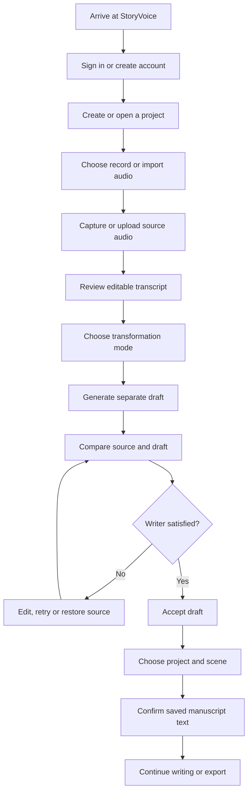
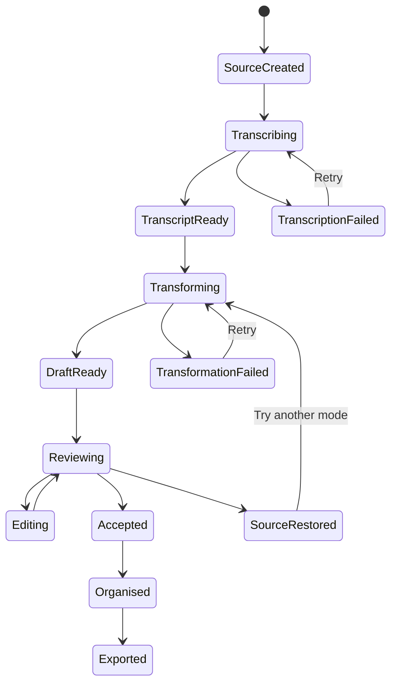
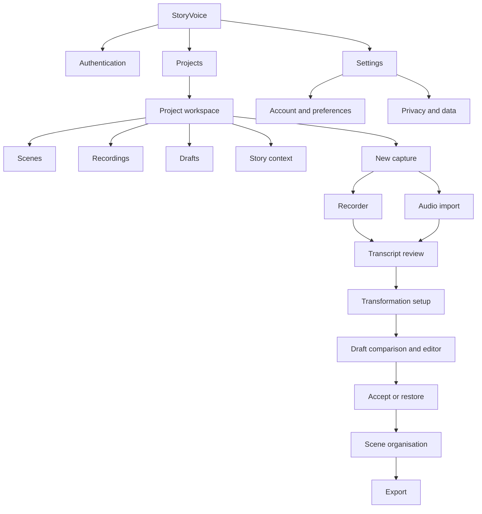

# StoryVoice: Phase 3: Product Design, UX/UI & Experience Architecture

## Why This Phase Exists

Phase 1 identified the problem StoryVoice should solve: fiction writers who prefer speaking to typing need a dependable way to turn spoken ideas and rough narration into editable manuscript material without losing their intended meaning, authorial voice or control over the story.

Phase 2 turned that research into a product direction. StoryVoice is a voice-first manuscript drafting environment. Its initial strategic wedge is faithful voice-to-manuscript transformation with writer control. The writer records or imports audio, reviews a source transcript, chooses how much transformation is appropriate, compares the result, edits or accepts it, organises the approved passage and exports it into an existing writing workflow.

Phase 3 translates that direction into an experience that can be designed, prototyped and handed to engineering. It defines the information architecture, user journeys, screen responsibilities, core interaction patterns, low-fidelity wireframes, interface states, responsive behaviour, design system direction and usability evaluation plan.

The objective is not to design every possible feature. It is to make the first complete writing workflow coherent and testable. A writer should be able to understand the product, start a project, capture a scene, review the transcript, shape a draft, understand what changed, approve the result and retrieve it later without needing to understand the internal AI process.

This document is a design specification. The wireframes are structural representations, not final visual mockups. The proposed interactions and design decisions must be tested with writers before they are treated as validated.

## What We Are Designing

The primary design problem is not how to make a recording interface attractive. It is how to help a writer move confidently between spoken material and accepted manuscript text.

The experience has to make four things clear at all times:

1. **What is the source?** The writer must be able to identify the original recording and source transcript.
2. **What has StoryVoice changed?** The transformation level and the resulting edits must be inspectable.
3. **What is approved?** Generated or transformed material must remain a draft until the writer accepts it.
4. **Where did the work go?** The writer must know which project and scene contain the accepted material and whether it is saved or exported.

The interface should feel like a focused writing environment with voice capture built into it, not a generic AI dashboard. The manuscript remains the primary content. Controls, metadata and AI assistance should support the writing task without competing with it.

## 1. Experience Design Principles

### 1.1 The manuscript is the centre of the interface

The most important content on a drafting screen is the writer's text. The interface should give passages comfortable line length, readable type, clear paragraph spacing and enough room for comparison. Secondary controls should remain visually quiet and should not make the workspace feel like an analytics dashboard.

### 1.2 Preserve the source and distinguish versions

The recording, source transcript, transformed draft and accepted manuscript text are different artefacts. The interface must label them accurately. A transformed draft must never silently replace the original transcript. The writer should be able to return to the source and understand which version is currently being edited or accepted.

### 1.3 Make AI intervention explicit

The writer chooses a transformation mode before processing. The interface explains the expected intervention in plain language. Actions should not be hidden behind vague labels such as “Magic” or “Enhance”. A writer should be able to distinguish transcription, cleanup and prose shaping.

### 1.4 Keep approval human-controlled

The system may prepare, suggest and compare text. Only the writer can accept it into the manuscript. Acceptance must be a deliberate action with a clear destination. Story context inferred by the system must not become a canonical project fact without approval.

### 1.5 Protect the writing flow

Recording, transcription and draft preparation can take time, but the interface should communicate progress without forcing the writer into unnecessary steps. Preserve work when navigating away where technically possible, and make save status visible.

### 1.6 Make recovery understandable

A failed upload, interrupted recording, unavailable transcription service or failed transformation should not leave the writer guessing whether their work is safe. The interface must distinguish a confirmed saved source from an upload or save that has not completed.

### 1.7 Introduce complexity progressively

The first-use experience should not require a complete story bible. Project creation should be lightweight. Optional vocabulary and story facts can be added when they become useful. Advanced continuity tools remain outside the initial workflow.

### 1.8 Fit the writer's existing workflow

StoryVoice should not imply that a writer must abandon Word, Scrivener or another manuscript tool. Export should be visible and reliable. The product should make it easy to take accepted text elsewhere.

## 2. Primary User and Design Scenario

### 2.1 Primary user

The first design target remains an active independent fiction writer working on a novel or series who already dictates, records ideas or is willing to use voice as part of drafting. The person has an active project and values getting spoken material into a usable manuscript without losing creative intent.

This is a design hypothesis based on Phase 2. It is not a verified demographic profile. The interface should avoid assuming technical expertise, a particular genre, a specific writing schedule or a particular device preference.

### 2.2 Primary scenario

A writer has a scene in mind. They open an existing project, record a rough narration, review the transcript, choose a transformation mode, compare the result with the transcript, make corrections, accept the passage into a scene and later export the accepted text.

### 2.3 Secondary scenarios to accommodate

- The writer records an idea on a phone and imports the audio later from a desktop.
- The writer imports an audio file created in another recording application.
- The writer corrects a character name or invented term that speech recognition has misheard.
- The writer wants a faithful transcript without prose shaping.
- The writer rejects a transformed draft and returns to the source transcript.
- The writer leaves a recording or draft unfinished and resumes it later.
- The writer exports one accepted scene rather than the entire project.

### 2.4 Design exclusions

The first experience is not designed around collaborative editing, team permissions, social feeds, AI-generated plot invention, full manuscript publishing, advanced timeline visualisation or complex continuity management. These capabilities may be considered later, but they must not complicate the primary drafting path.

## 3. End-to-End User Journey

### 3.1 Primary journey



The journey should feel linear when the writer wants a straightforward result, while allowing safe exits and returns. The writer should not have to complete optional story-context setup before recording. If the writer leaves during processing, the system should preserve the source and show the processing state when they return, subject to actual backend capability.

### 3.2 Journey stages and user needs

| Stage | User intention | Main interface responsibility | Evidence of completion |
|---|---|---|---|
| Entry | Understand what StoryVoice does | Explain the outcome and establish trust | User can identify the primary action |
| Account | Access personal projects | Keep registration concise and secure | Account is created or session begins |
| Project | Give work a clear home | Create, open and organise a project | Project workspace is visible |
| Capture | Speak or bring in audio | Make recording and import straightforward | Source audio is saved and identifiable |
| Transcription | Inspect what was heard | Show editable transcript and processing state | Writer can review and correct source text |
| Transformation | Choose degree of editing | Explain modes and expected changes | Mode is selected and visible |
| Comparison | Decide whether the draft preserves intent | Make source and transformed text easy to compare | Writer can identify meaningful changes |
| Approval | Decide what enters the manuscript | Provide accept, edit, reject and restore actions | Explicit approval is recorded |
| Organisation | Place writing in the project | Select or create a scene | Accepted passage appears in the chosen location |
| Export | Continue in another writing tool | Offer clear formats and export feedback | File is generated and accessible |

### 3.3 Experience control model



This state model is intended to prevent ambiguous transitions. “Accepted” is not the same as “saved”, and “saved” is not the same as “exported”. The interface should communicate each state distinctly.

## 4. Information Architecture

### 4.1 Primary navigation

The first release should use a compact navigation model. The writer should be able to return to projects and continue an active task without navigating through multiple layers.

| Navigation area | Purpose | Main content | Priority |
|---|---|---|---|
| Projects | Find and manage writing projects | Recent projects, project list, create project | Must have |
| Project workspace | Work within one manuscript | Scenes, recordings, drafts, approved vocabulary and limited story facts | Must have |
| Capture | Create source material | Recorder, audio import, source details and status | Must have |
| Draft review | Shape and approve material | Transcript, transformation mode, comparison, editor and approval | Must have |
| Story context | Manage writer-approved facts and terms | Character names, places, recurring terms and approved facts | Limited / should have |
| Export | Move accepted writing out of StoryVoice | Export selection, format and completion status | Must have |
| Settings | Manage account and preferences | Profile, privacy, data controls and subscription if enabled | Must have |

### 4.2 Sitemap



### 4.3 Navigation rules

- The project name and current location should remain visible within the project workspace.
- The writer should be able to return to the project without losing a confirmed saved recording or draft.
- A draft review should identify its source recording and project.
- Story context should be accessible from the project, but it should not block capture or draft review.
- Export should be available from an accepted passage and from a scene or project-level view where supported.
- Destructive actions such as deleting a recording or project require confirmation and clear consequences.

## 5. Screen Inventory and Responsibilities

### 5.1 Screen list

| ID | Screen | Primary purpose | Main action |
|---|---|---|---|
| S-01 | Welcome / landing | Explain the product and invite first use | Get started |
| S-02 | Sign up / sign in | Establish a secure account | Continue |
| S-03 | Projects home | Show active writing projects | Create or open project |
| S-04 | Create project | Collect minimum project details | Create project |
| S-05 | Project workspace | Show project content and next actions | Record or open material |
| S-06 | Capture choice | Choose recording or import | Continue to capture |
| S-07 | Recorder | Record spoken material | Start / pause / stop |
| S-08 | Audio import | Select and upload a file | Upload audio |
| S-09 | Transcript review | Review and correct source transcript | Continue |
| S-10 | Transformation setup | Select degree of intervention | Prepare draft |
| S-11 | Draft comparison | Compare source and transformed text | Accept / edit / retry |
| S-12 | Draft editor | Edit the proposed passage | Save changes |
| S-13 | Organise accepted text | Assign passage to a scene | Save to scene |
| S-14 | Scene view | Read and manage accepted scene material | Continue / export |
| S-15 | Story context | Manage approved vocabulary and facts | Add or edit fact |
| S-16 | Export | Select content and format | Export |
| S-17 | Settings | Manage account, privacy and preferences | Save settings |

### 5.2 Screen design requirements

Each screen must answer one primary user question. Avoid placing every possible project action on the same screen. Use progressive disclosure for secondary settings and advanced options.

| Screen | Must communicate | Must avoid |
|---|---|---|
| Projects home | What projects exist and where to continue | Decorative metrics with no action value |
| Project workspace | What is in this manuscript and how to capture new material | Dense dashboards or complex project administration |
| Recorder | Whether recording is active, paused, saved or failed | Ambiguous recording status or hidden stop action |
| Transcript review | That this is source text linked to original audio | Styling it as already approved manuscript content |
| Transformation setup | What each mode will change | Vague AI labels or unexplained model settings |
| Draft comparison | What changed and which version is the source | Overwhelming diff markup or loss of readable prose |
| Draft editor | Which version is being edited and whether changes are saved | Silent replacement of source content |
| Scene view | Which material is accepted and where it belongs | Mixing unapproved suggestions with manuscript text |
| Story context | Which facts are writer-approved | Treating inferred facts as canonical |
| Export | What will be exported and in which format | Implying export succeeded before file creation completes |

## 6. Low-Fidelity Wireframes

This section uses one consistent wireframe language across all screens. Each screen follows the same visual order: **navigation → page purpose → primary content → supporting information → actions**. The layouts are desktop-first structural views; responsive behaviour is described beneath each relevant screen.

The wireframes are intentionally simple. They show content grouping, hierarchy and the placement of important actions without introducing decorative detail. Repeated elements use the same alignment and spacing so the screens read as one product rather than a collection of unrelated sketches.

### 6.1 Projects home

```text
┌──────────────────────────────────────────────────────────────────┐
│ StoryVoice                                          Help  Account│
├──────────────────────────────────────────────────────────────────┤
│ PROJECTS                                                         │
│ Your writing, organised in one place.                            │
│                                                                  │
│                                                   [+ New project]│
│                                                                  │
│ CONTINUE WRITING                                                 │
│  ┌────────────────────────────────────────────────────────────┐  │
│  │ Project title                                              │  │
│  │ Recent scene or draft · Last opened                        │  │
│  │ [Open project →]                                           │  │
│  └────────────────────────────────────────────────────────────┘  │
│                                                                  │
│ ALL PROJECTS                                                     │
│ ┌─────────────────────────────┐  ┌─────────────────────────────┐ │
│ │ Project title               │  │ Project title               │ │
│ │ Short description           │  │ Short description           │ │
│ │ Recent activity             │  │ Recent activity             │ │
│ │ [Open project →]            │  │ [Open project →]            │ │
│ └─────────────────────────────┘  └─────────────────────────────┘ │
└──────────────────────────────────────────────────────────────────┘
```

**Design intent:** Make it easy to resume an active manuscript. The continue-writing area receives the strongest emphasis. New project creation remains easy to find without competing with the writer's existing work.

**Responsive behaviour:** On narrow screens, project cards become a single column. The new-project action remains visible near the page heading.

### 6.2 Project workspace

```text
┌──────────────────────────────────────────────────────────────────┐
│ StoryVoice  /  Project title                          Account    │
├──────────────────────────────────────────────────────────────────┤
│ PROJECT              │ PROJECT TITLE                             │
│                      │ Short project description                 │
│                      │                                           │
│ Overview             │ ┌───────────────────┐  ┌──────────────────│
│ Scenes               │ │ + Record a scene  │  │ Import audio     │
│ Recordings           │ └───────────────────┘  └──────────────────│
│ Drafts               │                                           │
│ Story context        │ CONTINUE WORKING                          │
│                      │ ┌────────────────────────────────────────┐│
│                      │ │ Recent recording or draft              ││
│                      │ │ Status · Last updated                  ││
│                      │ │                         [Review draft] ││
│                      │ └────────────────────────────────────────┘│
│                      │                                           │
│                      │ SCENES                                    │
│                      │ Accepted scenes and their current status  │
└──────────────────────────────────────────────────────────────────┘
```

**Design intent:** Keep capture actions prominent and make existing work easy to resume. Scenes, recordings and drafts are primary workspace destinations. Story context remains available but secondary.

**Responsive behaviour:** The project navigation becomes a compact menu or horizontal navigation. Main content becomes one column, with capture actions stacked when needed.

### 6.3 Recorder

```text
┌──────────────────────────────────────────────────────────────────┐
│ Project title  /  New recording                                  │
├──────────────────────────────────────────────────────────────────┤
│ RECORD A SCENE                                                   │
│ Capture your narration. Review the transcript afterwards.        │
│                                                                  │
│ Project       Project title                                      │
│ Save to       Unassigned scene                         [Change]  │
│                                                                  │
│                         00:00:00                                 │
│                    ● Ready to record                             │
│                                                                  │
│                     [Start recording]                            │
│                                                                  │
│ Speak naturally. Pause or stop whenever you need.                │
│                                                                  │
│ Recording status and microphone permission appear in this area.  │
└──────────────────────────────────────────────────────────────────┘
```

**Design intent:** This is a focused task screen. Timer, recording status and primary control form one clear central group. Do not add a decorative waveform unless it represents actual microphone input or audio level.

**Required states:** Ready, requesting microphone permission, recording, paused, saving, saved and failed. A saved confirmation must appear only after the source audio is safely stored.

**Responsive behaviour:** Keep the timer and primary control centred and comfortably tappable. Project and destination details sit above the controls.

### 6.4 Transcript review

```text
┌──────────────────────────────────────────────────────────────────┐
│ Project title  /  Recording title                                │
├──────────────────────────────────────────────────────────────────┤
│ SOURCE TRANSCRIPT                              Audio  [▶ Play]   │
│ Transcript ready                                                 │
│                                                                  │
│  ┌────────────────────────────────────────────────────────────┐  │
│  │ Editable source transcript                                 │  │
│  │                                                            │  │
│  │ Original spoken words converted into text.                 │  │
│  │ Correct names, punctuation and recognition errors here.    │  │
│  │                                                            │  │
│  └────────────────────────────────────────────────────────────┘  │
│                                                                  │
│ PROJECT VOCABULARY                                               │
│ Review names and specialised terms                         [Open]│
│                                                                  │
│ [Save transcript]                         [Choose draft mode →]  │
└──────────────────────────────────────────────────────────────────┘
```

**Design intent:** Make the source transcript feel like an editable record of what was spoken, not an already-polished manuscript. Audio playback remains available as a reference. Transcript corrections must not overwrite the preserved source version.

**Responsive behaviour:** Audio controls remain adjacent to the transcript status. The transcript uses the full available width, and the two actions stack on small screens.

### 6.5 Transformation setup

```text
┌──────────────────────────────────────────────────────────────────┐
│ PREPARE YOUR DRAFT                                               │
│ Choose how much shaping the text needs.                          │
├──────────────────────────────────────────────────────────────────┤
│ ○  FAITHFUL CLEANUP                                              │
│    Correct transcription issues and remove obvious disfluencies. │
│                                                                  │
│ ○  CLEAN TRANSCRIPT                                              │
│    Improve readability while keeping the spoken structure.       │
│                                                                  │
│ ○  READABLE DRAFT                                                │
│    Shape rough narration into readable prose without adding      │
│    story events or changing intended meaning.                    │
│                                                                  │
│ SOURCE                                                           │
│ Recording title                                                  │
│                                                                  │
│ STORY CONTEXT                                                    │
│ □ Use approved project vocabulary and story facts                │
│   Context is reference material; the writer remains in control.  │
│                                                                  │
│                                           [Prepare draft →]      │
└──────────────────────────────────────────────────────────────────┘
```

**Design intent:** Present the three transformation levels as equally understandable choices. Descriptions should explain the degree of intervention, not imply that the most transformative option is best. The mode names are proposed and require writer testing.

**Responsive behaviour:** Each mode becomes a full-width selectable row. Keep the context option visually separate from the transformation choices.

### 6.6 Draft comparison and review

```text
┌──────────────────────────────────────────────────────────────────┐
│ REVIEW YOUR DRAFT                                                │
│ Compare the source with the transformed version before accepting.│
├──────────────────────────────────────────────────────────────────┤
│ ┌─────────────────────────────┐  ┌─────────────────────────────┐ │
│ │ SOURCE TRANSCRIPT           │  │ TRANSFORMED DRAFT           │ │
│ │ Original wording            │  │ Selected mode               │ │
│ │                             │  │                             │ │
│ │ Original text remains       │  │ Revised text appears in     │ │
│ │ available for reference.    │  │ full reading context.       │ │
│ │                             │  │                             │ │
│ │                             │  │                             │ │
│ └─────────────────────────────┘  └─────────────────────────────┘ │
├──────────────────────────────────────────────────────────────────┤
│ CHANGE SUMMARY                                                   │
│ • Wording simplified                                             │
│ • Repeated phrase removed                                        │
│ • Paragraph structure adjusted                                   │
├──────────────────────────────────────────────────────────────────┤
│ [Edit draft] [Try another mode]  [Restore source]  [Accept draft]│
└──────────────────────────────────────────────────────────────────┘
```

**Design intent:** Keep the source and draft visually distinct but equally readable. The desktop default is a two-column comparison. The change summary sits below both text panels and uses concise, factual statements. Detailed change inspection may be added only if writer testing shows that the summary and side-by-side view are insufficient.

**Responsive behaviour:** On narrow screens, replace the two columns with a Source / Draft tab switch or a clearly labelled stacked layout. Keep the change summary and primary actions below the selected text.

### 6.7 Scene organisation

```text
┌──────────────────────────────────────────────────────────────────┐
│ SAVE ACCEPTED DRAFT                                              │
│ Choose where this accepted passage belongs.                      │
├──────────────────────────────────────────────────────────────────┤
│ PROJECT                                                          │
│ Project title                                                    │
│                                                                  │
│ SAVE TO                                                          │
│ Existing scene       [Select a scene                         ▾]  │
│                       or                                         │
│                       [+ Create new scene]                       │
│                                                                  │
│ PASSAGE TITLE                                                    │
│ ┌──────────────────────────────────────────────────────────────┐ │
│ │ Scene title                                                  │ │
│ └──────────────────────────────────────────────────────────────┘ │
│                                                                  │
│ The accepted draft will be added to the selected scene.          │
│                                                                  │
│ [Cancel]                                      [Save to scene →]  │
└──────────────────────────────────────────────────────────────────┘
```

**Design intent:** Make acceptance and organisation connected but explicit decisions. The writer must know which project and scene will receive the text. Never silently choose a destination. Provide a clear create-scene path when no suitable scene exists.

**Responsive behaviour:** Form fields use the full available width. Actions stack on narrow screens, with the save action remaining visually primary.

### 6.8 Export

```text
┌──────────────────────────────────────────────────────────────────┐
│ EXPORT ACCEPTED WRITING                                          │
│ Take your manuscript into the writing tools you already use.     │
├──────────────────────────────────────────────────────────────────┤
│ EXPORT SCOPE                                                     │
│ ○ Current passage                                                │
│ ○ Current scene                                                  │
│ ○ Selected scenes                                                │
│                                                                  │
│ FILE FORMAT                                                      │
│ ○ DOCX                    ○ Markdown                    ○ TXT    │
│                                                                  │
│ INCLUDE                                                          │
│ ☑ Scene headings          ☑ Basic paragraph formatting           │
│                                                                  │
│ Export status and any errors will appear after the request.      │
│                                                                  │
│ [Cancel]                                           [Export →]    │
└──────────────────────────────────────────────────────────────────┘
```

**Design intent:** Keep scope, format and optional inclusions in clearly separated groups. The available formats follow the Phase 2 requirement. Explain unsupported formatting before export rather than silently discarding it.

**Responsive behaviour:** Format choices wrap into a vertical list where necessary. The export action remains easy to reach without obscuring the selected scope.


## 7. Core Interaction Specifications

### 7.1 Recording interaction

| Interaction | Expected behaviour | Feedback |
|---|---|---|
| Start | Request microphone permission if required, then begin capture | Recording indicator and elapsed time |
| Pause | Stop capturing temporarily without finalising the recording | Paused label and resume action |
| Resume | Continue the same recording | Recording indicator returns |
| Stop | End capture and begin save process | Saving state, then saved confirmation or actionable failure |
| Cancel | Ask whether to discard or keep the recording | Explicit confirmation and consequence |
| Navigate away | Warn only if work is not safely saved or capture cannot continue | Clear explanation and available recovery action |

Recording permission denial must be handled without blaming the user. Explain how to grant permission and allow an alternate import path. If the browser or device does not support recording, do not display an enabled control that cannot work.

### 7.2 Audio import interaction

The import screen must explain supported formats and file-size limits once these are established in technical research. It should provide file selection, upload progress, cancel behaviour and retry after recoverable failure. Do not invent supported formats or limits in the interface specification; Phase 4 must define them based on the selected implementation.

### 7.3 Transcription interaction

The writer must be able to distinguish these states:

- Audio ready for transcription.
- Transcription queued or processing.
- Transcript ready for review.
- Transcription failed and can be retried.
- Source audio unavailable or upload not confirmed.

A processing state should not block unrelated project navigation unless the implementation has a real dependency. The writer should be able to return to the transcript when it is ready.

### 7.4 Transformation interaction

The selected mode must remain visible during processing and review. If the writer retries with a different mode, create a new draft version rather than overwriting the prior result. The writer should be able to compare versions or return to the source. The system must not add plot events, character motivations, setting details or dialogue not present in the source unless a later, explicitly separate creative-assistance feature is designed and approved.

### 7.5 Comparison interaction

The comparison experience should support:

- Reading the source and draft in context.
- Identifying additions, removals and rewrites.
- Switching between side-by-side and single-column views where appropriate.
- Editing the draft without modifying the preserved source.
- Restoring the source as the working draft.
- Accepting the current draft deliberately.

Detailed inline diff behaviour should be tested. Excessive highlighting can make long-form prose difficult to read. A concise change summary plus optional detailed comparison may be a better default than highlighting every punctuation change.

### 7.6 Approval interaction

“Accept draft” must be a distinct action. Before acceptance, the interface should make clear which version is being accepted and where it will be saved. After acceptance, show a confirmation and a direct path to the saved scene. The accepted text remains editable; acceptance is not a lock.

### 7.7 Story context interaction

Story context should be introduced as writer-controlled project information. A character name, place or recurring term can be added or corrected by the writer. Any suggested fact inferred from a transcript must be labelled as a suggestion and require approval before becoming a project fact. The first release should keep the scope limited to vocabulary and simple approved facts.

### 7.8 Export interaction

The export action should show the selected scope and file format. During generation, show progress where possible. On success, provide a clear file action. On failure, explain whether the accepted manuscript content remains saved in StoryVoice and provide a retry path. Never confuse a failed export with lost manuscript content.

## 8. Interface States and Error Recovery

### 8.1 Required state coverage

| State | Where it applies | Required behaviour |
|---|---|---|
| Default | All screens | Show the next meaningful action |
| Hover | Pointer-enabled controls | Provide restrained visual affordance |
| Focus | Keyboard-operable controls | Visible focus indicator |
| Active | Buttons, tabs, selectors | Clearly show current selection or action |
| Disabled | Unavailable actions | Explain why an action is unavailable when not obvious |
| Loading | Project, upload, processing and export | Indicate activity without implying completion |
| Empty | Projects, scenes, recordings and drafts | Explain what belongs there and how to create it |
| Success | Save, accept, create and export | Confirm exactly what succeeded |
| Error | Network, permission, processing and export | Explain the problem and next recovery action |
| Offline / connection lost | Where supported | Preserve local unsaved state where technically possible and show sync status |
| Destructive confirmation | Delete, discard or replace | State the consequence and offer a safe cancel action |

### 8.2 Error message requirements

Error messages should be specific, calm and recovery-oriented. They should not expose internal stack traces or model errors to writers. They must not claim that audio or text is saved unless the system has confirmed persistence.

| Situation | Suggested message | Recovery action |
|---|---|---|
| Microphone permission denied | “Microphone access is off. Allow access in your browser settings, or import an existing recording.” | Retry permission / import audio |
| Recording save failed | “We couldn't confirm that this recording was saved. Keep this page open and try saving again.” | Retry save / recover local recording if supported |
| Upload interrupted | “The upload stopped before it finished.” | Retry upload |
| Transcription failed | “We couldn't transcribe this recording.” | Retry / review source audio |
| Transformation failed | “We couldn't prepare this draft. Your source transcript is unchanged.” Only show if that is confirmed. | Retry / return to transcript |
| Save failed | “Your latest changes haven't been confirmed as saved.” | Retry save |
| Export failed | “The export couldn't be created. Your accepted writing remains in the project.” Only show if persistence is confirmed. | Retry export |
| Session expired | “Your session has expired. Sign in again to continue.” | Sign in |

### 8.3 Empty-state copy

| Location | Proposed copy |
|---|---|
| No projects | “Start with a project for the story you're working on. You can add recordings and scenes as you go.” |
| No recordings | “Your recordings will appear in this project. Start a new recording or import audio.” |
| No scenes | “Create a scene when you're ready to organise accepted writing.” |
| No drafts | “Drafts prepared from your recordings will appear here for review.” |
| No story context | “Add character names and recurring terms when they become useful. You can start recording without setting this up.” |

## 9. Responsive Experience

### 9.1 Design approach

StoryVoice is a writing product, so responsive design must preserve reading comfort and editing control rather than simply shrink desktop layouts. Desktop is likely to be useful for long-form review and scene organisation, while mobile is especially relevant for capturing spoken ideas. These are design assumptions to test, not confirmed usage patterns.

### 9.2 Responsive behaviour by screen

| Screen / component | Desktop | Tablet | Mobile |
|---|---|---|---|
| Projects home | Multi-column project cards where useful | Two-column or single-column cards | Single-column list |
| Project workspace | Sidebar and main content | Collapsible sidebar | Compact navigation and stacked sections |
| Recorder | Focused centred control area | Same core hierarchy | Large touch targets and clear recording status |
| Transcript review | Wide text editor with audio controls | Stacked or adjustable panels | Single-column transcript with accessible audio controls |
| Draft comparison | Side-by-side source and draft | Switchable panels | Tabs or stacked source/draft views |
| Scene editor | Comfortable manuscript column | Fluid manuscript column | Full-width text with reduced secondary chrome |
| Export | Dialog or dedicated panel | Dialog or panel | Full-screen sheet or stacked controls |

### 9.3 Responsive rules

- Preserve readable text size and line spacing; do not compress manuscript text to fit more controls.
- Use touch targets suitable for mobile interaction.
- Keep recording controls visible and prevent accidental destructive taps.
- Replace side-by-side comparison with tabs or stacked sections when the viewport cannot support two readable text columns.
- Avoid horizontal scrolling for primary tasks.
- Ensure keyboard focus and screen-reader order remain logical when layouts reflow.
- Test long project names, long scene titles and long passages rather than only short sample content.

## 10. Visual Design System Direction

### 10.1 Design direction

The Phase 2 brand direction is **editorial clarity with a subtle voice motif**. The interface should feel calm, precise, trustworthy and centred on writing. Avoid generic AI visual shorthand: excessive gradients, neon glow, abstract neural networks, robot imagery, decorative sparkles and waveforms that do not communicate an actual audio state.

### 10.2 Colour tokens

Phase 2 proposed a starting palette. Phase 3 carries it forward as a design direction, not a final approved system. Contrast and accessibility testing are still required.

| Token | Proposed value | Intended use |
|---|---|---|
| Ink | `#20242B` | Primary text and high-contrast elements |
| Paper | `#FAF9F6` | Main light surface and reading canvas |
| Slate | `#68717D` | Secondary text and quiet interface elements |
| Voice Blue | `#456B8A` | Primary interactive accent and selected states |
| Soft Blue | `#E8EFF4` | Subtle selected surfaces and supporting backgrounds |
| Success | `#3F765B` | Confirmed save or completion states |
| Warning | `#A56D2A` | Attention and recoverable warnings |
| Error | `#A34848` | Errors and destructive-action warnings |

Colour must communicate hierarchy and state. Do not use multiple accent colours merely to make screens look more elaborate. Status must also be conveyed through text or icons, not colour alone.

### 10.3 Typography

- Use a highly legible sans-serif for navigation, controls, labels and interface text.
- Test a readable serif option for the manuscript canvas; do not assume all writers prefer serif text.
- Establish a consistent hierarchy for page titles, project titles, scene headings, body text, labels and metadata.
- Use comfortable line length and line spacing for long passages.
- Avoid low-contrast metadata and unnecessarily small controls.
- Select exact font families only after checking licensing, web performance, language coverage and rendering quality.

### 10.4 Layout and spacing

- Use a consistent spacing scale and alignment system.
- Keep the manuscript column readable rather than stretching text across the full desktop width.
- Use clear separation between source, transformed draft and accepted manuscript content.
- Keep primary actions close to the content they affect.
- Use whitespace to establish hierarchy, not to create empty decorative space.
- Avoid card-heavy layouts where a simple list or editor is more appropriate.

### 10.5 Components to define

| Component | Variants / states to design | Notes |
|---|---|---|
| Button | Primary, secondary, text, destructive, disabled, loading | Labels describe the action |
| Text input | Default, focus, error, disabled | Persistent labels and useful validation |
| Project item | Default, active, recently updated | Avoid decorative metrics |
| Scene item | Default, selected, unsaved indicator | Show title and relevant status |
| Audio player | Play, pause, seek, loading, unavailable | Accessible controls and time labels |
| Recorder control | Ready, recording, paused, saving, saved, failed | Clear state and safe stop behaviour |
| Status label | Processing, ready, saved, failed, accepted | Text plus visual indicator |
| Transformation option | Unselected, selected, unavailable | Plain-language description |
| Comparison panel | Source, draft, selected change | Readable long-form text |
| Change summary | Addition, removal, rewrite categories | Avoid excessive visual highlighting |
| Confirmation dialog | Confirm, cancel, destructive | Consequences stated clearly |
| Toast / inline notice | Success, warning, error, neutral | Do not use for critical unsaved-work warnings only |
| Empty state | No projects, no scenes, no recordings | Include a meaningful next action |

### 10.6 Brand expression inside the product

The recommended tagline from Phase 2 is **“Your voice. Your story.”** The descriptor is **“Voice-first drafting for fiction writers.”** The product interface should express these through control and clarity, not repeated slogans. Use writer-first language, restrained voice-related cues and a quiet editorial canvas.

## 11. Content Design and UX Writing

### 11.1 Language principles

- Describe the operation, not the technology behind it.
- Use “transcript” for source text created from speech and “draft” for transformed text.
- Reserve “accepted” for material the writer has explicitly approved.
- Use “saved” only when persistence is confirmed.
- Explain transformation modes by their effect on the text.
- Avoid anthropomorphising the AI or presenting it as a co-author.
- Do not praise or judge creative work with generic language.
- Keep instructions short, specific and calm.

### 11.2 Preferred terminology

| Use | Avoid | Reason |
|---|---|---|
| Record audio | Talk to AI | Describes the actual action |
| Source transcript | Raw AI text | Clarifies provenance |
| Prepare draft | Generate magic | Sets an understandable expectation |
| Compare changes | See the magic | Makes review explicit |
| Accept draft | Publish | Acceptance is not publication |
| Restore original | Undo everything | Identifies the exact version |
| Approved story fact | AI memory | Keeps ownership with the writer |
| Export accepted text | Download your story (when only one passage is exported) | Avoids overclaiming export scope |

### 11.3 Action hierarchy

Primary actions should be limited to the main task on a screen. For example, the recorder has Start/Pause/Stop as its core controls; the transformation screen has one selected mode and one “Prepare draft” action; the review screen has “Accept draft” as the primary completion action, with edit, retry and restore as secondary actions.

## 12. Accessibility and Inclusive Design

Accessibility must be considered in the first design system rather than added after implementation.

- All primary actions must be operable by keyboard.
- Focus indicators must be visible and consistent.
- Inputs need persistent labels and programmatically associated help and error text.
- Status changes such as recording, processing, saved and failed must be perceivable without relying on colour alone.
- Text contrast must be checked against the selected background tokens.
- The interface should support browser zoom and responsive reflow without hiding primary controls.
- Audio content must have a text transcript for review; audio-only status must not be the sole source of essential information.
- Motion should be restrained and respect reduced-motion preferences.
- Avoid time-limited actions unless there is a clear product reason.
- Long-form editing should remain usable with keyboard navigation and assistive technology; implementation details require validation during design and engineering.

This section establishes design requirements. Formal accessibility conformance must be evaluated in later testing and should not be claimed from the specification alone.

## 13. Usability Testing Plan

### 13.1 What we need to learn

The first usability study should determine whether a writer can understand and complete the core workflow without unnecessary explanation. It should test both task completion and trust in the source-to-draft process.

Key questions:

- Does the writer understand what StoryVoice does before starting?
- Can the writer create a project and begin recording or importing audio?
- Does the writer understand the difference between transcript and transformed draft?
- Can the writer predict what each transformation mode will do?
- Can the writer identify what changed in the comparison view?
- Does the writer understand that the original is preserved?
- Can the writer accept, edit, reject or restore the draft?
- Does the writer know where accepted text is saved?
- Can the writer export the correct material?
- Does the experience feel like it supports authorship rather than taking creative control?

### 13.2 Proposed participants

Use a small qualitative round of approximately 5–8 participants for the first moderated prototype test, prioritising active fiction writers with an ongoing project. Include a mix of people who already dictate and people who currently type but are open to voice. This is a proposed research sample, not a statistically representative sample.

### 13.3 Test tasks

| Task | What it tests | Observe |
|---|---|---|
| Explain what StoryVoice is for | Comprehension | What outcome the participant expects |
| Create a project | Onboarding and information architecture | Hesitation, unnecessary fields and terminology confusion |
| Record or import a short passage | Capture workflow | Control discoverability and status comprehension |
| Correct a transcript term | Source editing | Whether source provenance is understood |
| Select a transformation mode | Mode clarity | Whether the participant predicts the result accurately |
| Compare source and draft | Trust and comparison | Whether meaningful changes are noticed |
| Reject or restore a draft | Reversibility | Whether the participant feels in control |
| Accept and organise a draft | Approval and organisation | Whether the destination is clear |
| Export a scene | Workflow completion | Whether scope and format are understood |

### 13.4 Measures

| Measure | Definition | Why it matters |
|---|---|---|
| Task completion | Whether participant completes each task without moderator intervention | Basic usability |
| Time on task | Time required for key workflow steps | Friction and efficiency |
| Misclicks / backtracks | Unintended actions and navigation reversals | Information architecture clarity |
| Mode comprehension | Whether participant can explain expected transformation | Trust and expectation setting |
| Source preservation comprehension | Whether participant understands the source remains available | Core trust principle |
| Change detection | Whether participant can identify important differences | Comparison quality |
| Approval confidence | Whether participant is comfortable accepting the draft | Product promise |
| Destination comprehension | Whether participant knows where accepted text was saved | Organisation clarity |
| Qualitative trust feedback | Participant's explanation of what they would or would not trust | Product fit and risks |

Do not set arbitrary pass rates before the first study. Record a baseline, identify recurring failures and revise the prototype. A successful task completion score does not, by itself, establish that the transformed writing is faithful or useful; that requires separate content-quality evaluation.

### 13.5 Study method

1. Give participants a short neutral introduction without teaching every control.
2. Ask them to complete tasks using a realistic sample recording.
3. Encourage think-aloud commentary without leading them toward the expected action.
4. Record where they hesitate, misinterpret a label, lose context or question whether work is saved.
5. Ask them to compare source and draft and explain what they believe changed.
6. Ask what would make them comfortable accepting the result into a real manuscript.
7. Summarise recurring issues by severity and frequency, then revise the prototype.

Use fictional sample material or participant-provided material only with clear consent and appropriate data handling. Do not upload unpublished manuscripts to external services without explicit permission and a documented data policy.

## 14. Prototype Scope and Design Deliverables

### 14.1 Prototype boundary

The clickable prototype should demonstrate the complete primary workflow from project selection through accepted draft organisation and export. It may use realistic sample content and simulated processing, but it must never imply that a selected recording was actually transcribed or that a generated passage came from a production AI model when neither operation occurred.

The prototype implementation supplied for review is a single-file HTML/CSS/JavaScript application. It is a high-fidelity interactive prototype, not a production application. Its local state, simulated capture/transcription/transformation and sample data are acceptable prototype techniques when they are disclosed clearly to the user.

### 14.2 Required prototype screens

The primary clickable path must include:

1. Projects home.
2. Create project.
3. Project workspace.
4. Capture choice.
5. Recorder state and audio import state.
6. Transcript review.
7. Transformation mode selection.
8. Draft preparation state.
9. Draft comparison.
10. Draft editing.
11. Acceptance and scene organisation.
12. Scene view and accepted-text editing.
13. Story context.
14. Export selection and completion.
15. Settings sufficient to demonstrate the product shell.

The existing product screen inventory also includes a welcome/landing screen and sign-up/sign-in screens. These are not present in the supplied prototype. They are not required to validate the core voice-to-manuscript workflow, so they may remain outside this prototype's primary path, but the omission must be explicit. Account creation, authentication and production onboarding remain product requirements to resolve in the appropriate engineering and technical-design work; they must not be treated as completed because a prototype profile avatar exists.

### 14.3 Design artefacts and current status

| Artefact | Purpose | Current status after prototype review |
|---|---|---|
| Primary user journey | Show the end-to-end experience | Defined and represented in the prototype |
| Sitemap / information architecture | Establish navigation and content hierarchy | Defined in this document; represented by prototype navigation |
| Screen inventory | Define required screens and responsibilities | Defined; coverage assessed in Section 14.5 |
| Low-fidelity wireframes | Establish layout and task hierarchy | Included |
| Interaction specifications | Define key actions and state transitions | Included; prototype implements the primary interactions |
| Responsive behaviour | Adapt across viewport sizes | CSS breakpoints are present; device-level validation remains pending |
| Design tokens | Establish visual direction | Core colour and typography variables are present; font loading and accessibility checks remain pending |
| Component inventory | Identify reusable UI components | Reusable patterns are present in the implementation; formal component documentation remains pending |
| Clickable prototype | Test the workflow in realistic interactions | Implemented as a single-file HTML/CSS/JavaScript prototype; runtime and usability validation remain pending |
| High-fidelity UI | Establish visual design | Implemented in the supplied prototype; final visual approval remains pending |
| Engineering handoff | Document measurements, behaviours and states | Partial; requires issue resolution, design decisions and handoff documentation |


### 14.4 Prototype implementation reviewed

I reviewed the supplied `StoryVoice — Your voice. Your story.` HTML prototype as an implementation artefact, rather than treating it as a second product brief.

The supplied file contains a complete HTML document with embedded CSS and JavaScript. Its visual direction follows the Phase 2 proposal: Ink, Paper, Slate, Voice Blue, Soft Blue and restrained success, warning and error colours. It uses a manuscript-oriented serif treatment for text and a sans-serif interface treatment. It also includes responsive CSS breakpoints, visible keyboard focus styling and a reduced-motion preference.

The prototype uses the demonstration project **The Last Light**, with the sample scene **The Lighthouse at Midnight**, the sample character Mara Ellison and the approved story-context items specified for the demonstration.

The implementation includes the following working prototype capabilities:

- Projects home with a sample project, project cards and a create-project flow.
- Project workspace with recent material, scene status and quick actions.
- Capture choice between simulated recording and local audio-file selection.
- Recorder interface with start, pause, resume, stop, discard and simulated failure states.
- Local file selection and simulated import states.
- Simulated transcription and editable source transcript.
- Three transformation choices: Faithful Transcript, Clean Transcript and Readable Draft.
- Simulated draft preparation.
- Source and transformed-draft comparison with a written change summary.
- Draft editing, draft version history, rejection and restoration.
- Explicit acceptance and assignment to a new or existing scene.
- Accepted scene view and accepted-scene editing.
- Story-context creation, editing, deletion and writer-approval marking.
- Export scope and format selection for DOCX, Markdown and TXT, with client-side file-generation code.
- Settings placeholder.
- In-memory project state and prototype disclosure language.

A JavaScript syntax check of the supplied script passed. This is a static syntax check only. The prototype has not yet been verified through a complete browser-based interaction test, cross-device test, accessibility audit, generated-file validation or moderated writer usability study. No such validation should be claimed until it is performed.

### 14.5 Screen coverage against the Phase 3 inventory

| Phase 3 screen | Supplied prototype coverage | Assessment |
|---|---|---|
| S-01 Welcome / landing | Not present | Not included in the core prototype path |
| S-02 Sign up / sign in | Not present | Not included; production authentication remains unresolved |
| S-03 Projects home | Projects page | Implemented |
| S-04 Create project | Project creation form | Implemented |
| S-05 Project workspace | Project overview, scenes and quick actions | Implemented |
| S-06 Capture choice | Record or import choice | Implemented |
| S-07 Recorder | Simulated recording controls and states | Implemented as simulation only; no microphone capture or audio file is created |
| S-08 Audio import | Local file selection and simulated import | Partially implemented; no upload or actual audio processing occurs |
| S-09 Transcript review | Editable source transcript and simulated audio reference | Implemented as a sample-data experience; transcript is not derived from selected audio |
| S-10 Transformation setup | Three explicit transformation modes and optional context use | Implemented |
| S-11 Draft comparison | Side-by-side source and draft with a written change summary | Partially implemented; no inline diff or alternate comparison layout |
| S-12 Draft editor | Editable draft with unsaved-change handling | Implemented; acceptance behaviour needs correction when edits are unsaved |
| S-13 Organise accepted text | New/existing scene destination and explicit acceptance | Implemented |
| S-14 Scene view | Accepted manuscript view and scene editing | Implemented |
| S-15 Story context | Add, edit, delete and approval state | Implemented |
| S-16 Export | Scope and DOCX/Markdown/TXT generation code | Implemented in prototype code; downloaded-file integrity still requires verification |
| S-17 Settings | Basic profile and preference placeholders | Partially implemented; not a complete settings experience |

The prototype therefore covers the core workflow well enough to serve as the starting point for design validation. It does not yet satisfy every screen and interaction requirement in the Phase 3 specification.

### 14.6 Issues to resolve before prototype sign-off

The following issues are based on direct inspection of the supplied implementation. They are not speculative production architecture requirements.

| Priority | Issue | Why it matters | Required correction |
|---|---|---|---|
| Critical | The simulated recording/import flow can lead to the same fixed sample transcript | A writer could reasonably infer that their recording or selected audio file was transcribed, even though no audio was captured or processed | Make the sample transcript an explicit demonstration choice. Clearly state that it is not derived from the selected or recorded audio. Do not label it as the result of the user's audio |
| Critical | Accepting from the draft editor while edits are unsaved triggers the leave-without-saving guard | The visible Accept action can lead to the user's latest edits being discarded after confirmation | Either save the current editor buffer as part of acceptance or disable acceptance until the writer saves. The interaction must never silently discard the edited passage |
| High | Editing and saving the source transcript does not clearly invalidate an already prepared draft | A draft may be accepted even though it was generated from an older source version | Track source revision/version lineage. Mark the draft as based on an earlier transcript and require regeneration or an explicit decision before acceptance |
| High | Comparison provides two text panels and a general change summary, but no detailed change inspection | The user may not be able to identify specific additions, removals or rewrites | Add an optional, restrained change-inspection view or explicitly test and document that side-by-side reading plus a reliable summary is sufficient |
| High | The DOCX, Markdown and TXT export code has not been validated through actual downloaded files | A successful UI state does not prove that the generated file opens correctly or preserves the expected manuscript structure | Generate and open representative files in the intended applications; test Unicode, paragraph breaks, scene headings and multi-scene project export |
| Medium | The CSS declares DM Sans and Newsreader but does not load those font files | The actual rendering will use system fallbacks, so the visible typography may differ from the intended design | Either load properly licensed web fonts or explicitly approve the fallback typography and document it |
| Medium | The modal does not implement a complete keyboard focus trap and focus restoration pattern | Keyboard and assistive-technology users may lose context while a modal is open or closed | Complete keyboard interaction, focus containment, Escape behaviour and focus restoration testing |
| Medium | Contrast and responsive behaviour have not been formally tested | Presence of colour tokens and media queries does not establish accessibility or usability | Run contrast checks and test key workflows at desktop, tablet and mobile widths |
| Medium | Prototype data is held in in-memory JavaScript state | Reloading or closing the browser loses the prototype session | Keep the limitation visible. If persistence is needed for usability sessions, add explicitly labelled local prototype persistence without implying production cloud storage |

### 14.7 Prototype boundaries and interpretation

The following behaviours are intentionally simulated and must remain distinct from production capability:

- The recorder runs a timer but does not request microphone access or create an audio recording.
- The audio player is a visual simulation; it does not play the selected recording.
- The import flow selects a local file but does not upload or process it.
- The transcription flow displays demonstration text; no speech-to-text provider is called.
- The transformation flow uses predefined demonstration outputs for the supplied sample. For other text, the implementation uses simple local text manipulation, not an LLM or production transformation system.
- Project, transcript, draft, scene and context state is held in the browser session; it is not persisted to a production database.
- Export generation is attempted client-side; output integrity has not yet been independently verified.
- The interface contains no production authentication, authorisation, cloud storage, billing or account system.

These are acceptable prototype boundaries when the interface communicates them accurately. They must not be represented as implemented product capabilities in product marketing, technical documentation or a developer handoff.

## 15. Design Risks and Open Questions

| Risk / question | Why it matters | How to resolve |
|---|---|---|
| Side-by-side comparison may be difficult for long passages | Reading columns can become narrow | Test side-by-side, tabs and stacked comparison |
| Transformation mode names may be misunderstood | Incorrect expectations reduce trust | Test labels and examples with writers |
| Writers may want to edit while listening | Audio and text interaction may need synchronisation | Test transcript playback and optional segment navigation |
| Mobile recording may be more important than expected | Capture behaviour may be device-specific | Test mobile-first capture with target writers |
| Desktop may be essential for serious editing | Long-form editing needs space | Test responsive editing and export workflows |
| Story context may be too complex for MVP | Setup friction could block the first useful outcome | Keep optional and limited to approved vocabulary/facts |
| Save state may be misunderstood | Data loss is especially damaging | Test language and persistence feedback |
| Change summaries may be inaccurate | Incorrect summaries undermine trust | Only show supported summaries and compare with actual edits |
| Export formatting expectations may vary | Writers use different manuscript tools | Test DOCX, Markdown and TXT outputs with realistic passages |
| Serif manuscript typography may not suit all writers | Reading preference is personal | Offer a clear, testable typography choice if evidence supports it |
| A simulated transcript may be mistaken for a transcription of the user's audio | This would directly undermine source fidelity and trust | Require an explicit sample-transcript step and label demonstration content clearly |
| Unsaved editor changes may be lost during acceptance | The writer may believe their latest edits were accepted | Save the editor buffer during acceptance or require an explicit save first |
| A draft may become stale after source edits | The accepted passage may no longer correspond to the current source | Track source revisions and flag drafts generated from earlier source versions |
| Prototype-only export may be mistaken for production export quality | Writers may rely on unsupported formatting assumptions | Validate generated files and document prototype limitations |

### 15.1 Questions to carry into Phase 4

- Which browser and device capabilities are required for recording and audio import?
- What audio formats and file-size limits can the selected stack reliably support?
- How will source audio, transcript versions, transformed drafts and accepted text be stored and related?
- What save guarantees can the product truthfully communicate?
- How will transcription and transformation processing states be represented across sessions?
- What is the minimum viable comparison model for long passages?
- Which DOCX library or export approach can preserve the required structure?
- What privacy, retention and deletion controls are required for unpublished manuscripts and recordings?

These are not design decisions to guess. They require technical research, data strategy and system architecture in Phase 4.

## 16. Phase 3 Decisions and Handoff

### 16.1 Proposed experience decisions

| Decision area | Phase 3 direction |
|---|---|
| Primary experience | Move from spoken material to accepted manuscript text |
| Primary user | Active fiction writer with an ongoing project |
| Navigation | Projects, project workspace, capture, draft review, story context, export and settings |
| Core workflow | Record/import → transcript → transform → compare → approve → organise → export |
| Source handling | Preserve original audio and source transcript as distinct artefacts |
| Transformation | Explicit modes with clear intervention descriptions |
| Review | Source and draft comparison with edit, retry, reject and restore actions |
| Approval | Writer explicitly accepts draft before it becomes manuscript content |
| Story context | Optional, limited and writer-approved |
| Responsive strategy | Desktop-friendly long-form review; mobile-friendly capture; responsive editing |
| Visual direction | Editorial clarity with a subtle voice motif |
| Colour | Phase 2 palette carried forward for testing, not final approval |
| Accessibility | Keyboard operation, visible focus, contrast, status clarity and responsive reflow |
| Validation | Moderated prototype testing with active fiction writers |
| Next phase | Technical research, AI research, data strategy and system architecture |

### 16.2 What is not approved yet

- Final high-fidelity visual design and final visual QA. A high-fidelity prototype implementation exists, but it has not been usability-validated or formally approved.
- Exact font families and final design tokens.
- Final transformation mode names.
- Final comparison interaction and detailed diff behaviour.
- Recording and upload technical limits.
- Offline capture or background processing guarantees.
- Final data retention and privacy implementation.
- Technical stack, AI vendors, transcription provider or model selection.
- Production export fidelity and supported formatting beyond the stated target formats.
- Production onboarding, authentication and account-management experience.
- Final persistence and save-state behaviour.

### 16.3 Phase 4 handoff requirements

Phase 4 must use the user journeys, screen responsibilities, interaction states and trust requirements in this document as product constraints. Technical choices should support the approved experience rather than forcing the product into whatever a vendor or framework makes easiest.

The technical research must specifically investigate audio capture and upload reliability, transcription quality for fiction vocabulary and dialogue, transformation quality, source/draft version preservation, project-context retrieval, export generation, privacy and data deletion. It must also evaluate latency and cost per successful accepted draft, not merely cost per API call.

## Phase 3 Completion Record

| Area | Outcome |
|---|---|
| Experience principles | Defined |
| Primary user and scenario | Carried forward from Phase 2 |
| End-to-end journey | Mapped and represented in the prototype |
| Information architecture | Defined |
| Sitemap | Defined |
| Screen inventory | Defined and checked against the supplied prototype |
| Low-fidelity wireframes | Included |
| Core interactions | Specified and substantially represented in the prototype |
| Interface states and recovery | Specified; prototype includes several key states, with further QA required |
| Responsive behaviour | Specified and basic CSS breakpoints implemented; device validation pending |
| Visual design direction | Carried forward and implemented as a high-fidelity visual direction |
| Design tokens | Core CSS variables implemented; font loading and contrast validation pending |
| Component inventory | Reusable implementation patterns present; formal component documentation pending |
| Accessibility requirements | Defined; initial focus and reduced-motion support present; full audit pending |
| Usability test plan | Defined; participant testing not yet conducted |
| Clickable prototype | Supplied as an HTML/CSS/JavaScript implementation; core workflow represented |
| High-fidelity UI | Implemented in the supplied prototype; final design approval pending |
| Prototype code review | JavaScript syntax check passed; browser-based end-to-end verification pending |
| Critical prototype issues | Identified; must be corrected before sign-off |
| Export verification | Client-side generation code present; generated-file validation pending |
| Engineering handoff | Partial; final handoff follows issue resolution and design validation |
| Phase 3 status | In progress; prototype exists but is not yet signed off |
| Decision | Resolve critical prototype issues, complete browser/device QA and conduct writer usability testing before Phase 3 sign-off and formal Phase 4 handoff |

---

**Phase 3 decision:** StoryVoice now has a high-fidelity clickable prototype representing the core writer-controlled workflow. The prototype is a meaningful design artefact, but it is not yet a validated or production-ready product. Resolve the critical sample-transcript and unsaved-edit issues, verify export files, complete responsive/accessibility QA and test the experience with active fiction writers. Once those checks are complete and design decisions are recorded, hand the validated experience into Phase 4 for technical research, AI research, data strategy and system architecture.

## Reference to Earlier Phases

- **Phase 1:** Problem Discovery & Research established the problem, competitive landscape, target-user hypothesis and opportunity direction.
- **Phase 2:** Product Strategy, Vision, Definition & Brand Identity established the product thesis, initial audience, strategic wedge, MVP scope, product principles, success measures and brand direction.
- **Phase 3:** Product Design, UX/UI & Experience Architecture translates those decisions into the user experience, information architecture, screen structure, interaction model, high-fidelity clickable prototype and validation plan.
