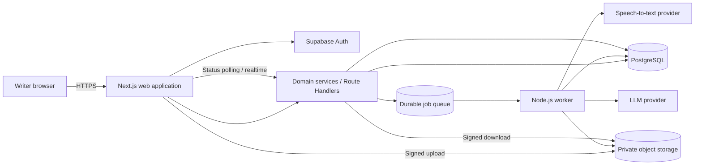
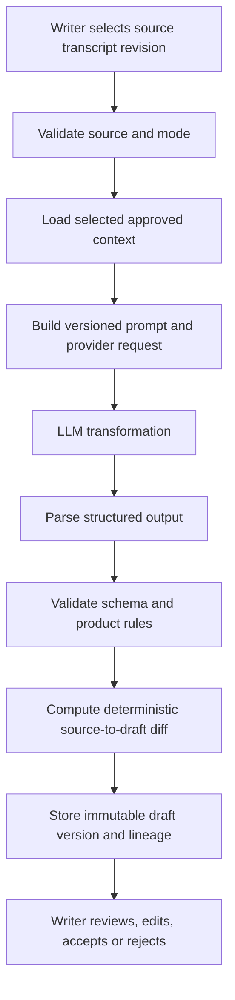
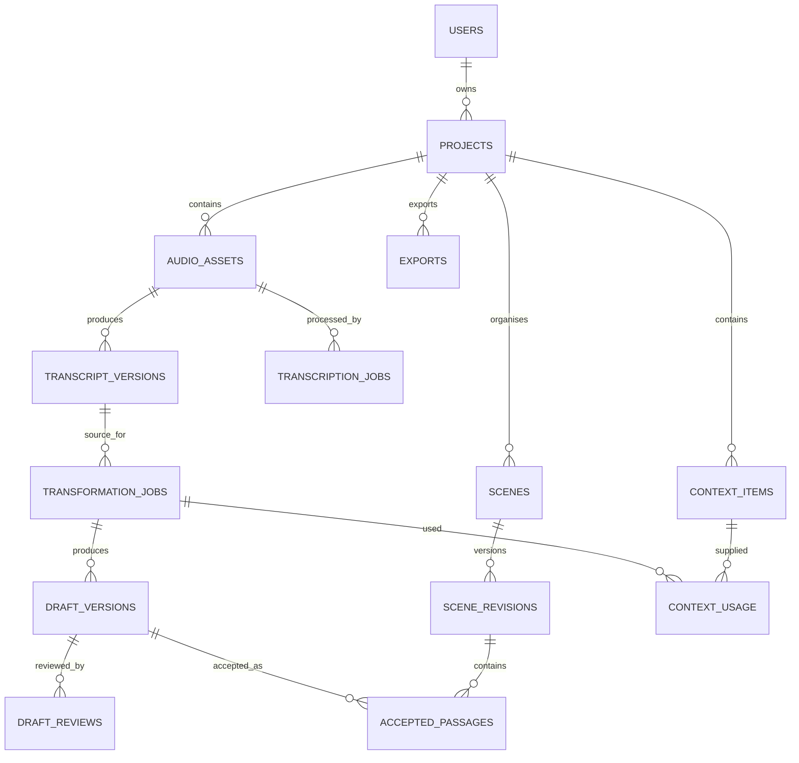
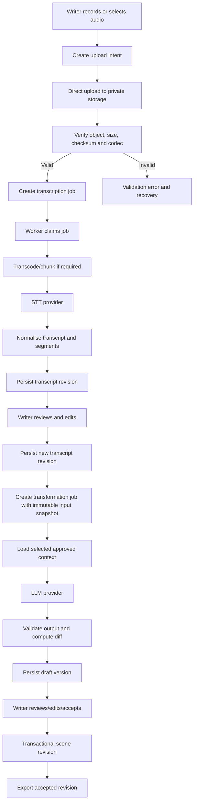
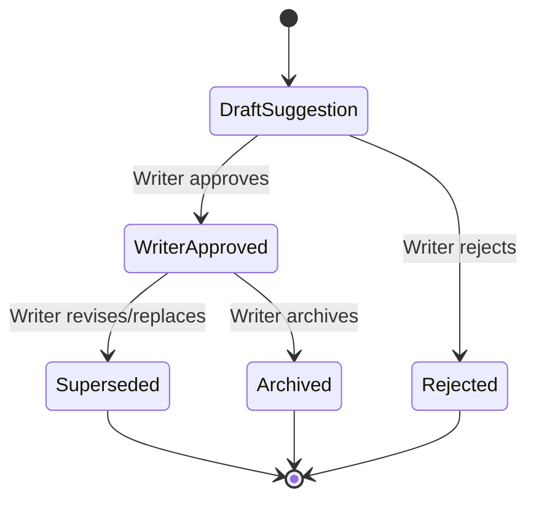

# StoryVoice: Phase 4: Technical Research, AI Research, Data Strategy & System Architecture
---

## Why This Phase Exists

Phase 4 translates the product strategy and designed experience into a technically credible system. It defines how StoryVoice should capture and preserve audio, transcribe spoken material, transform transcripts into drafts, preserve version lineage, organise accepted manuscript content, retrieve writer-approved story context, protect private creative work and produce portable exports.

This phase is grounded in the actual Phase 3 prototype implementation and the requirements established in Phases 1 and 2. It distinguishes:

- What the prototype visibly demonstrates.
- What the prototype actually implements.
- What the production product must implement.
- What is recommended but still requires technical validation.
- What is deliberately deferred because it is not needed to prove the core product thesis.

The central technical objective is not to build the largest AI writing system. It is to build a dependable path from a writer's spoken material to writer-approved manuscript text, with provenance, control and recovery at every meaningful step.

## Phase 4 Research and Decision Method

Recommendations use four evidence classes:

| Label | Meaning |
|---|---|
| **Observed** | Directly visible in the supplied Phase 3 code or established in the earlier phase documents |
| **Documented** | Supported by current official technical documentation reviewed for this phase |
| **Recommended** | Architecture or implementation direction selected for the proposed MVP |
| **Unvalidated** | Requires a spike, benchmark, security review, user test or commercial decision before it can be treated as final |

Vendor feature descriptions and published prices are not independent proof of product quality. No model accuracy, user acceptance, latency, cost-per-user or production reliability result is claimed unless it has actually been measured.

---

# 1. Technical Objectives and System Constraints

## 1.1 Product definition carried into engineering

StoryVoice is a voice-first manuscript drafting environment that helps fiction writers turn spoken ideas into accepted, organised manuscript text through faithful transcription, controlled transformation and writer-approved story context.

The technical system must protect five product outcomes:

1. **Capture:** the writer can record or import spoken material without losing the original source.
2. **Transcribe:** the system creates a reviewable source transcript linked to the original audio.
3. **Transform:** the writer selects a clearly described transformation level; AI output remains a separate draft.
4. **Review and accept:** the writer can inspect, edit, compare, reject, restore and explicitly accept a draft.
5. **Organise and export:** accepted text becomes manuscript material in a project and can be exported in usable formats.

The North Star remains **Weekly Accepted Draft Words**. Raw audio minutes, transcript words and generated draft words are not substitutes for accepted manuscript text.

## 1.2 Core technical quality attributes

| Attribute | Required system behaviour |
|---|---|
| Provenance | Every draft can be traced to an exact source transcript revision, transformation mode, prompt version, model/provider and context snapshot |
| Reversibility | Source audio and source transcript are not overwritten by transformation; earlier drafts and accepted manuscript revisions remain recoverable under the retention policy |
| Writer authority | Generation never implies approval; only an explicit writer action can add draft text to the accepted manuscript |
| Correctness | Stale drafts cannot be silently accepted; acceptance is transactional and version-aware |
| Privacy | Manuscript text, story context and audio are private user content, not analytics payloads or training material by default |
| Reliability | Long-running audio and AI work is asynchronous, observable, retryable and idempotent |
| Portability | Accepted manuscript text can be exported without requiring the user to remain on the platform |
| Cost visibility | Provider usage is attributable to project, job, model and accepted output so unit economics can be measured |
| Accessibility | Capture, review, editing, error recovery and acceptance work across supported devices and assistive technologies |

## 1.3 Non-goals for the first production release

The architecture should not begin with:

- An autonomous AI novelist or agentic co-author.
- Multi-agent story generation or multi-agent critique loops.
- A graph database for plot, character relationships or timelines.
- A vector database and RAG pipeline for all manuscript content.
- Fine-tuned proprietary speech or language models.
- Real-time voice conversation as a prerequisite for core drafting.
- Collaboration, comments, co-author permissions or public sharing.
- A complex manuscript publishing/layout engine.
- Self-hosted GPU inference infrastructure.
- Microservices for every domain module.

These capabilities may become relevant after evidence supports them. They do not solve the immediate trust and workflow requirements better than a well-designed, versioned application pipeline.

---

# 2. Phase 3 Code Review: Actual Implementation and Architectural Implications

## 2.1 Source inspected

The supplied Phase 3 prototype is a single HTML document containing:

- HTML screen markup and dynamic templates.
- A large embedded CSS design system.
- A single JavaScript application state object.
- Template functions that generate each screen as HTML strings.
- Delegated click, submit, change, input and keyboard handlers.
- Browser timers and client-side file generation.

The file is approximately 78 KB and 185 source lines, with much of the CSS and JavaScript compressed into long lines. It is a useful interaction prototype, not a production codebase or an established technology stack.

## 2.2 Screen and workflow coverage observed

The prototype has 19 page states:

1. Projects
2. Create project
3. Project workspace
4. Capture choice
5. Recorder
6. Audio import
7. Importing
8. Transcribing
9. Transcript review
10. Transformation setup
11. Processing
12. Draft review/comparison
13. Draft editor
14. Scene organisation
15. Accepted scene
16. Accepted scene editor
17. Story context
18. Export
19. Settings

The intended user flow is:

`Project → Capture or import → Source transcript → Transformation mode → Processing → Compare/review → Edit/accept/reject/restore → Scene organisation → Export`

The prototype also contains project switching, scene selection, draft history loading, story-context CRUD, export scope selection and responsive navigation.

## 2.3 Actual data/state model in the prototype

The prototype has one global `state` object. A project stores a copy of selected state fields through `snapshotProject()` and restores them through `activateProject()`.

The principal in-memory entities and fields are:

| Prototype object/state | Observed fields or behaviour | Production implication |
|---|---|---|
| Project | `id`, `title`, `genre`, `description`, `notes`, `updated`, `scene`, `status`, `data` | Create a persistent project record owned by a user; do not store the whole project as an unvalidated opaque state blob |
| Audio/import | `file`, `recordingTitle`, `recordingStatus`, `recordingSaved`, `seconds`, `recordingSceneId` | Add durable audio asset metadata, object storage, upload state, checksums and processing lineage |
| Source transcript | `source`, `sourceBuffer`, `sourceDirty`, `transcriptEdited`, `transcriptReady`, `transcriptionStatus` | Store immutable transcript revisions and a mutable current-revision pointer |
| Draft | `draft`, `mode`, `draftReady`, `draftEdited`, `editorBuffer`, `editorDirty`, `draftVersions` | Store immutable draft versions with source revision, prompt/model and context lineage |
| Approval | `accepted`, `rejected`, `restored`, `sceneCreated` | Create an explicit acceptance record and atomic manuscript write operation; generation and approval must remain separate |
| Scene | `sceneTitle`, `sceneDescription`, `sceneText`, `scenes`, `activeSceneId`, scene edit buffers | Persist scenes and scene revisions separately from generated drafts |
| Story context | `context` array with `id`, `type`, `name`, `detail`, `approved` | Persist context items with approval status, provenance, revision and project ownership |
| Export | `format`, `exportScope` | Generate from accepted manuscript revisions, not the current draft or transcript buffer |
| Processing | `processing`, timers, status fields | Replace timeouts with durable background jobs and server-authoritative status |

`PROJECT_FIELDS` copies a long list of values into each project object. This is appropriate for a compact prototype but is not a durable relational model. The browser session is the only state store; a reload loses user-created data.

## 2.4 Behaviours that are simulated rather than implemented

Direct code inspection confirms:

- The recorder starts a JavaScript timer but does not request microphone access, create a `MediaStream`, use `MediaRecorder`, or produce an audio blob.
- The “stop” flow marks a recording as saved in prototype state; it does not save audio bytes.
- The audio import screen accepts a browser-selected audio file, but the code does not upload it or pass its bytes to a transcription provider.
- The audio player is a timed visual state change; it does not play the selected recording.
- `startTranscription()` waits briefly and then uses a fixed demonstration transcript (`SOURCE`) if the source is empty.
- `modeOutput()` returns hard-coded sample outputs for the demonstration passage. For other text it uses simple string replacement and paragraph splitting; it does not call an LLM.
- The context toggle is captured in state, but the transformation function does not retrieve or inject the context into model inference.
- The comparison screen shows separate text panels and a general change summary; it does not compute a production-grade word/character diff.
- Project, transcript, draft, scene and context records are JavaScript memory objects. There is no API, database, authentication or cloud persistence.
- Export is generated client-side. The code includes a hand-built ZIP writer and DOCX XML assembly, but downloaded DOCX/Markdown/TXT files have not been independently validated in the supplied review record.
- Settings are prototype-only; there is no profile, account, preference persistence or billing integration.

The UI must never imply that a selected audio file was transcribed when the transcript is fixed demonstration content. The production implementation must replace these simulated steps with real services and truthful status states.

## 2.5 Directly observed implementation risks and defects to carry forward

| Priority | Code-level issue | Production/Phase 5 requirement |
|---|---|---|
| Critical | Recording/import can lead to the same fixed sample transcript | Demo content must be unmistakably labelled. In production, transcript must reference the exact stored audio asset and transcription job |
| Critical | Accepting from the editor while edits are unsaved can hit the leave-without-saving guard and discard the latest buffer | Acceptance must save the current editor buffer as part of the same transaction, or prevent acceptance until a confirmed save completes |
| High | Saving a changed source transcript does not invalidate an existing draft | Track transcript revision IDs; mark drafts stale when source revision changes; block acceptance until regeneration or explicit policy-compliant resolution |
| High | Comparison has no detailed deterministic diff | Generate a server/client diff from source and draft versions; do not ask the LLM to invent its own diff |
| High | Export code is not validated | Test actual files in Microsoft Word, LibreOffice and common Markdown/TXT readers, including Unicode and multiple scenes |
| High | The existing-scene acceptance branch appends a double-escaped newline sequence (`\\n\\n`) rather than actual paragraph separators | Verify the stored scene text contains real paragraph breaks; add a regression test for appending multiple accepted passages |
| High | `snapshotProject()` copies selected global state rather than normalised entities | Replace with server-owned entities and transactional updates |
| Medium | `Date.now()` is used for several prototype identifiers | Use UUID/ULID or database-generated IDs; timestamps are metadata, not identity guarantees |
| Medium | Timers and delayed transitions are browser-owned | Use durable job IDs and server status; cancellation/retry must be explicit |
| Medium | `startRecording()` and `resumeRecord` share timer logic | Production recording state machine must distinguish start, pause, resume, stop, upload and finalisation |
| Medium | Modal has `role="dialog"` and `aria-modal`, but no complete focus trap/restoration | Implement accessible dialog primitives and keyboard testing |
| Medium | Declared fonts are not loaded in the HTML | Load licensed font assets or approve fallbacks; typography is a deployment dependency |
| Medium | No automated contrast/device validation is demonstrated | Include responsive and accessibility tests in release gates |

## 2.6 Production architecture implication

Do not treat the 78 KB HTML file as the production foundation to extend indefinitely. Rebuild the application shell and screens as a componentised application while preserving the Phase 3 information architecture, copy intent, workflow, visual tokens and interaction rules.

The prototype is a **behavioural and design reference**. It is not evidence that the frontend framework, database, API, AI provider, cloud provider or production security model has already been selected.

---

# 3. Proposed Technology Stack

## 3.1 Stack recommendation

The following is the recommended MVP stack if no existing StoryVoice repository or infrastructure constraints supersede it. Before Phase 5 implementation, inspect the actual repository, deployment setup and existing dependencies. Preserve a sound established stack rather than migrating solely to match this recommendation.

| Layer | Recommended technology | Role | Status |
|---|---|---|---|
| Language | TypeScript | Shared application and worker language; contracts and safer refactoring | Recommended |
| Frontend | React with Next.js App Router | Component-based product UI, routing, server/client rendering and API boundary | Recommended |
| Styling | CSS Modules or a disciplined tokenised CSS system | Preserve the Phase 3 visual language without introducing unnecessary UI framework weight | Recommended |
| Forms/validation | React Hook Form plus Zod, or equivalent typed validation | Form state and client/server schema consistency | Candidate |
| Backend application | Next.js Route Handlers / server-side domain services | Authenticated application APIs and orchestration entry points | Recommended |
| Primary database | PostgreSQL via Supabase | Relational source of truth, transactions, constraints, indexes and RLS | Recommended candidate |
| Authentication | Supabase Auth | Account lifecycle, sessions and identity | Recommended candidate |
| Object storage | Private Supabase Storage bucket | Original audio and generated export assets | Recommended candidate |
| Queue | Supabase Queues (Pgmq-backed) or a managed durable queue | Durable background job delivery | Recommended candidate; validate operational fit |
| Worker | Separate Node.js/TypeScript container process | Audio validation, transcoding, STT, LLM transformation and exports | Recommended |
| Audio utilities | FFmpeg/FFprobe in isolated worker image | Inspect, transcode and split audio where required | Recommended |
| Speech-to-text | Provider adapter; benchmark OpenAI `gpt-transcribe` and Deepgram Nova-3 | Convert audio to source transcript | Provider not finally selected |
| LLM transformation | Provider adapter; benchmark current high-quality writing-capable models | Faithful, clean and readable transformation | Model not finally selected |
| Structured output | JSON Schema/Zod validation; provider structured outputs where supported | Validate machine-readable model response | Recommended |
| Monitoring | Structured logs, error tracking and metrics/traces | Operational and AI job observability | Select vendor in Phase 5 |
| Testing | Vitest/Jest, Playwright, contract tests and provider eval harness | Unit, integration, browser and AI quality tests | Recommended |
| Deployment | Next.js web host plus separately deployed worker in a compatible container environment | Keep interactive requests separate from long-running work | Recommended |

### Why TypeScript across the app and worker

A shared language reduces duplicated contracts between browser, server, queue payloads and worker. It supports typed domain objects and schema validation. FFmpeg and provider SDKs can be called from Node.js. Python remains a valid option for offline evaluation notebooks and data analysis; it is not required as a second production service at MVP.

### Why not microservices

StoryVoice has a small number of tightly related domain workflows and a small initial engineering surface. A modular monolith with a separate background worker provides clean module boundaries without the deployment, networking, tracing and distributed consistency overhead of many services.

## 3.2 Proposed repository structure

```text
storyvoice/
├── apps/
│   ├── web/                         # Next.js application
│   │   ├── app/                      # Routes, layouts and Route Handlers
│   │   ├── components/               # Shared UI components
│   │   ├── features/                  # Projects, capture, transcript, review, scenes
│   │   └── styles/                   # Tokens and global styles
│   └── worker/                       # Background job consumer
├── packages/
│   ├── contracts/                   # Zod schemas and API/job contracts
│   ├── domain/                      # Domain rules and state transitions
│   ├── database/                    # SQL migrations and typed DB access
│   ├── ai/                          # STT/LLM provider adapters and prompts
│   ├── audio/                       # Audio metadata, validation and chunking
│   ├── export/                      # DOCX, Markdown and TXT generation
│   └── observability/               # Logging, tracing and usage helpers
├── evals/
│   ├── transcription/               # Consented audio fixtures and references
│   ├── transformation/              # Source/draft/human rating datasets
│   └── reports/                     # Reproducible benchmark outputs
├── infra/                           # Deployment and environment configuration
├── docs/                             # ADRs, runbooks and technical notes
└── tests/                            # Cross-package integration fixtures
```

This is a target structure, not a claim about the current repository. Naming and package boundaries can be adapted after the repository is inspected.

## 3.3 Frontend architecture

Build the Phase 3 screens as feature-oriented React components. Keep the editorial manuscript canvas, source/draft comparison, transformation selector, scene organisation and export experience as reusable, independently testable components.

Recommended frontend domains:

- `projects`: project list, creation, switching and workspace overview.
- `capture`: microphone permission, recording controls, upload progress and recovery.
- `audio-assets`: import, metadata, playback and asset status.
- `transcripts`: transcript viewer/editor, revision history and save state.
- `transformations`: mode selection, context selection, job status and retry.
- `draft-review`: source/draft comparison, deterministic diff and draft version history.
- `manuscript`: scenes, accepted passages and manuscript revisions.
- `story-context`: character, location, terminology and writer-approved facts.
- `exports`: accepted-content selection, format generation and download history.
- `settings`: profile, privacy, data export and deletion controls.

Frontend state rules:

1. Server-owned project and manuscript records are fetched through authenticated APIs.
2. UI state such as open panels and selected tabs stays client-side.
3. Editor buffers are distinct from persisted revisions and have explicit dirty/saving/saved/error states.
4. Job status is read from the server; local timers must not pretend to be processing evidence.
5. Optimistic UI is allowed only where rollback and conflict behaviour are defined.
6. A local draft buffer must never be silently discarded on route changes, tab close or acceptance.

## 3.4 Backend architecture

The backend is a modular monolith with clear domain services:

- Identity and access.
- Project and scene management.
- Audio asset lifecycle.
- Transcription orchestration.
- Transcript revision management.
- Draft transformation orchestration.
- Story-context management and retrieval.
- Acceptance/manuscript write operations.
- Export generation.
- Usage metering and analytics events.

Route Handlers should validate input, authenticate the caller, enforce ownership and call domain services. Long-running provider calls should not be performed synchronously inside ordinary page requests. The API should create a durable job, return a job identifier and let the worker perform processing.

## 3.5 Third-party integration boundaries

All external vendors must sit behind adapters. Application domain code must not depend directly on vendor-specific response shapes.

| Integration | Adapter boundary | Failure behaviour |
|---|---|---|
| Speech-to-text | `TranscriptionProvider` | Retry transient errors, record provider request ID, preserve audio, allow safe retry/fallback |
| LLM | `TransformationProvider` | Preserve source, reject malformed/unsafe output, record model and prompt versions |
| Object storage | `ObjectStorage` | Verify object ownership, checksum and upload completion before processing |
| Authentication | `IdentityProvider` | Deny by default; no access based only on client-supplied user IDs |
| Queue | `JobQueue` | Durable enqueue, retry, visibility timeout, dead-letter handling and idempotent consumers |
| Export | Internal format adapters | Fail without mutating accepted manuscript data |
| Monitoring | `Telemetry` | No raw manuscript content or audio in routine logs |

---

# 4. High-Level System Architecture

## 4.1 Recommended MVP topology



The browser communicates with the application API and obtains short-lived signed URLs for direct object transfer. The browser does not receive provider secrets. The worker reads and writes private assets using server credentials and scoped object keys.

## 4.2 Request and processing boundaries

| Work | Execution location | Reason |
|---|---|---|
| Authentication and CRUD | Web/server application | Short-lived request/response work |
| Recording capture | Browser | Microphone access is a browser permission and media API capability |
| Audio upload | Browser to private object storage using short-lived signed/resumable upload | Avoid routing large files through the web server |
| Audio validation/transcoding | Worker | CPU, file parsing and longer duration work |
| Transcription | Worker calling provider | Long-running external operation and retries |
| Transformation | Worker calling LLM provider | Model latency, cost attribution and structured validation |
| Draft diff | Server/domain package | Deterministic, reproducible comparison |
| Acceptance | Database transaction | Atomic manuscript mutation and provenance record |
| Export | Worker for larger projects; synchronous server path only for small validated exports | Reliable file generation and storage |

## 4.3 Deployment topology

Recommended starting deployment:

- One web application deployment.
- One worker service deployment, horizontally scalable by queue depth.
- One managed PostgreSQL project.
- One private object-storage bucket or bucket set.
- One durable queue.
- One monitoring/error-tracking system.

Keep the database, worker and object storage in compatible regions to reduce transfer latency and avoid unnecessary egress. Select the region based on the first validated customer geography, vendor availability, contractual/data-residency requirements and latency tests. Do not assume that the founder's current location determines the product's data region.

## 4.4 Environment separation

Use separate development, staging and production environments. Each environment must have independent:

- Database and storage buckets.
- Auth configuration and callback URLs.
- Queue names and worker credentials.
- Provider API keys and usage budgets.
- Webhook secrets.
- Monitoring projects and retention settings.

Never use real customer manuscripts or recordings in local development fixtures unless the user has explicitly consented and the handling has been reviewed.

---

# 5. Audio Capture, Import, Storage and Processing

## 5.1 Capture requirements derived from Phase 3

The recorder screen and flow already exist in the prototype, but capture is simulated. Production capture must use browser media APIs and handle the full lifecycle:

`permission → device selection (where supported) → recording → pause/resume → stop → local finalisation → upload → server verification → ready for transcription`

The application must show separate states for:

- Microphone permission not yet requested.
- Permission denied or unavailable.
- Device not found or device lost.
- Recording in progress.
- Paused recording.
- Recording stopped and awaiting upload.
- Upload in progress.
- Upload interrupted/retry available.
- Audio asset verified and ready.
- Unsupported or corrupt audio.

A timer alone is not evidence that audio has been captured or saved.

## 5.2 Browser capture strategy

Use `navigator.mediaDevices.getUserMedia()` and `MediaRecorder` where supported. Detect available MIME types at runtime rather than assuming a codec. Record the selected MIME type, codec/container metadata and browser information needed for diagnostics, while avoiding unnecessary device fingerprinting.

A technical spike must test:

- Chrome desktop and Android.
- Safari on macOS and iOS.
- Firefox desktop where supported.
- Permission denial and permission revocation.
- Incoming calls, tab backgrounding and device sleep.
- Pause/resume semantics.
- Long recordings and low-memory devices.
- Browser interruption and page reload recovery.
- Audio playback after upload.

Do not promise uninterrupted background recording on mobile browsers until device testing establishes that behaviour. If browser capture proves unreliable on a target device class, support import as the dependable fallback and evaluate a native capture client separately.

## 5.3 Upload design

Use private object storage with short-lived signed upload authorisation. The browser should not upload through a long-lived application request. For larger files or unstable networks, use resumable upload supported by the chosen storage provider. Supabase currently recommends its TUS-based resumable path for files above 6 MB or unstable networks; its current documentation describes resumable transfer and progress reporting. Verify chunk size, limits and signed-upload compatibility in the selected project before implementation.

Upload lifecycle:

1. Client requests an upload intent for a project and recording metadata.
2. Server authenticates the user and checks project ownership/quota.
3. Server creates an `audio_asset` record with `uploading` status and a random storage key.
4. Server returns a short-lived upload capability scoped to that object.
5. Client uploads the audio bytes directly to storage.
6. Client calls upload completion endpoint.
7. Server verifies object existence, size, metadata and checksum where available.
8. Server marks the asset `uploaded` or `validation_failed`.
9. Only a verified asset can be queued for transcription.

Never trust a client-supplied filename, MIME type, file size or project ID without server-side validation.

## 5.4 Supported input formats

The prototype only checks whether the browser reports a MIME type beginning with `audio/`. That is insufficient for production.

Start with a deliberately small tested set, subject to provider compatibility and browser capture results:

- WAV
- MP3
- M4A/AAC
- WebM audio
- Ogg/Opus where the chosen browser/provider combination is validated

Use FFprobe to inspect actual container and codec. Do not rely exclusively on extension or browser MIME. Reject unsupported, empty, corrupt or suspicious files with actionable error messages.

## 5.5 File size, duration and long recordings

OpenAI's current file transcription documentation states a 25 MB upload limit for the transcription endpoint and lists supported formats including FLAC, MP3, MP4, MPEG, MPGA, M4A, OGG, WAV and WebM. Larger files need compression or chunking; chunk boundaries should avoid cutting through sentences. This is a provider constraint, not a universal StoryVoice product limit.

StoryVoice should define limits after testing recording quality, storage cost, worker capacity and user behaviour. Initial product defaults to validate:

- Maximum single recording duration: 60 minutes for first production beta.
- Maximum source upload size: 250 MB before compression/transcoding policy.
- Larger recordings: reject with clear guidance or split through a tested server-side pipeline.

These are proposed operational starting values, not final commercial entitlements. The app should display the current configured limits and never silently truncate a recording.

For chunking:

- Preserve original audio as the canonical asset.
- Generate derived chunks with deterministic order and time offsets.
- Add a small overlap between adjacent chunks to preserve boundary context.
- Store chunk start/end offsets and source asset checksum.
- Merge provider results using offsets and deterministic overlap reconciliation.
- Never expose chunk boundaries as if they were writer-authored paragraph boundaries.

## 5.6 Storage lifecycle

Store original audio separately from derived/transcoded audio. Use opaque, non-guessable object keys; never put a user's manuscript title or email in the storage path.

Suggested object key pattern:

`users/{user_id}/projects/{project_id}/audio/{audio_asset_id}/original`

The key is an internal locator, not an authorisation mechanism. Access is enforced by server-side ownership checks and storage policies.

Store metadata in PostgreSQL:

- Asset ID, owner and project.
- Object key and storage provider.
- Original filename as user-visible metadata, not as the object key.
- MIME/container/codec and byte size.
- Duration, sample rate and channel count where available.
- Checksum/hash.
- Upload and validation timestamps.
- Retention/deletion status.
- Derived asset relationships.

Do not store large audio bytes in PostgreSQL.

---

# 6. Speech-to-Text Research and Selection

## 6.1 What transcription must do for fiction writers

General word error rate is not sufficient. Fiction material contains:

- Character names and invented names.
- Fictional locations and place names.
- Dialogue, contractions and colloquial speech.
- Intentional fragments and repetition.
- Unusual terminology and fantasy/science-fiction vocabulary.
- Long pauses and shifts between narration and dialogue.
- Accents, room noise and variable microphone distance.
- Multilingual speech or code-switching for some writers.

A transcript that gets common words right but changes a character name or negation may damage the story more than a higher aggregate WER suggests.

## 6.2 Current provider candidates

### Candidate A: OpenAI `gpt-transcribe`

Current OpenAI speech-to-text documentation recommends `gpt-transcribe` for completed recordings. The file transcription documentation lists a 25 MB file limit and supports streaming the transcription of a completed recording. The current model page reports an estimated price of **US$0.0045 per minute**. The documented workflow also supports context/keyword hints and language hints.

Implications:

- Strong initial candidate for the batch transcription path.
- Need to test fiction proper-noun recall and correction burden on StoryVoice audio.
- 25 MB limit requires a compression/chunking policy for longer or high-bitrate recordings.
- Provider pricing and supported features must be rechecked at implementation time.

### Candidate B: Deepgram Nova-3

Deepgram documents pre-recorded transcription support and Nova-3 keyterm prompting. Its current keyterm documentation describes boosting recognition for important terms and supports up to 100 keyterms, with a total keyterm token limit of 500. The provider explicitly notes that keyterms can appear in usage records and documents a redaction option for sensitive keyterm usage.

Implications:

- Strong candidate for project-specific character names and invented vocabulary.
- Keyterm handling must be included in privacy review because names may be sensitive.
- Keyterm improvement claims are provider-published and must not be treated as StoryVoice benchmark results.
- Test proper-noun recall with and without approved project vocabulary.

### Candidate C: AssemblyAI

Keep AssemblyAI as a secondary benchmark candidate if its current model, pricing, language coverage and privacy terms meet the project requirements at the time of the test. No provider selection should be based solely on marketing claims or generic leaderboard results.

## 6.3 Transcription adapter contract

Define a provider-neutral interface:

```ts
export type TranscriptionRequest = {
  audioAssetId: string;
  sourceObjectKey: string;
  languageHint?: string;
  vocabularyHints: string[];
  requestId: string;
};

export type TranscriptSegment = {
  startMs?: number;
  endMs?: number;
  text: string;
  speaker?: string | null;
  confidence?: number | null;
};

export type TranscriptionResult = {
  provider: string;
  providerModel: string;
  providerRequestId?: string;
  detectedLanguage?: string;
  text: string;
  segments?: TranscriptSegment[];
  durationMs?: number;
  usage?: { audioSeconds?: number; estimatedCostUsd?: number };
};

export interface TranscriptionProvider {
  transcribe(input: TranscriptionRequest): Promise<TranscriptionResult>;
}
```

The adapter normalises provider output but retains provider-specific metadata needed for debugging and evaluation. The domain model must not become coupled to one provider's field names.

## 6.4 Fiction-specific benchmark design

Build a consented, rights-cleared evaluation corpus. Do not copy published novels or commercial audiobook recordings into the dataset without appropriate rights.

Proposed first benchmark:

- 30–50 short recordings, 1–5 minutes each.
- 8–12 longer recordings, 10–30 minutes each.
- At least 5 distinct speaker/accent profiles where possible.
- Quiet and moderately noisy environments.
- Narration, dialogue, contractions, fragments and repeated words.
- Character names, invented place names and fictional terminology.
- A subset with writer-approved vocabulary hints.
- A subset with multilingual/code-switching only if that segment is in the intended launch market.

For each recording, obtain a human-checked reference transcript. Participants must consent to evaluation use and the data must have a defined deletion/retention schedule.

## 6.5 Transcription metrics

| Metric | Why it matters |
|---|---|
| Word Error Rate (WER) | Baseline overall recognition quality |
| Character Error Rate (CER) | Useful for names and spelling-sensitive terms |
| Proper-noun error rate | Character/location/fictional term correctness |
| Critical meaning error rate | Negation, tense, event, relationship and dialogue meaning errors |
| Punctuation/paragraph usability | How much formatting repair the writer must do |
| Correction time | Writer effort to reach a usable source transcript |
| Correction burden | Number and severity of manual changes per 1,000 words |
| Latency | Time from verified upload to usable transcript |
| Cost per audio minute | Provider unit cost |
| Retry/failure rate | Operational reliability |

The evaluation should report aggregate results and slices by accent, noise, vocabulary hints and recording length. A single average score can hide the exact fiction-specific failures StoryVoice must avoid.

## 6.6 Transcription context and vocabulary

Only writer-approved project terms should be eligible for provider hints. The user must be able to review, edit and remove these terms. Do not automatically send every character name or manuscript phrase to a provider without considering privacy and the provider's usage logging practices.

Context sent to a transcription provider should be minimal:

- Approved character names and recurring proper nouns.
- Approved fictional locations.
- User-selected language hints.
- A limited prior-chunk tail only where needed for continuity and supported by the provider.

Do not send full manuscript chapters as a transcription prompt.

## 6.7 Diarization and speaker labels

Speaker diarization is not a first-release requirement for solo author dictation. It can create additional errors when the writer performs multiple character voices. Preserve timestamps/segments when available, but do not make diarization a blocking dependency. Revisit if interviews, multi-speaker writing rooms or collaborative narration become a validated use case.

## 6.8 Recommendation

Run a controlled benchmark between `gpt-transcribe` and Deepgram Nova-3, including project vocabulary hints. Select based on fiction-specific quality, language coverage, provider privacy terms, latency, failure handling and cost per corrected transcript—not on one vendor's headline accuracy claim.

No production STT provider is declared finally selected in Phase 4.

---

# 7. AI Transformation Architecture

## 7.1 AI use cases and their boundaries

| AI capability | MVP role | Required boundary |
|---|---|---|
| Faithful Transcript | Minimal punctuation/formatting and transcription repair only when explicitly requested | Do not rewrite sentences or add story detail |
| Clean Transcript | Remove obvious non-meaningful disfluencies and improve readability | Preserve meaningful repetition, dialogue, fragments and intent |
| Readable Draft | Shape rough spoken language into readable prose | Do not invent events, motivations, sensory details, relationships or plot facts |
| Fiction vocabulary support | Help STT recognise approved names and invented terms | Hints are suggestions to the provider, not canonical corrections |
| Context-assisted transformation | Use selected approved story facts and terminology | Show/record the context snapshot used; never silently update canon |
| Optional creative suggestions | Later experiment for selected passages | Keep separate from accepted manuscript text and outside core MVP |
| Continuity assistance | Later experiment | Warnings only; no automatic manuscript mutation |

The three prototype transformation modes are retained as the initial interface vocabulary: Faithful Transcript, Clean Transcript and Readable Draft. Their names and descriptions remain subject to writer testing.

## 7.2 One controlled transformation pipeline

Use one model call per transformation job initially, with deterministic pre/post-processing. Do not create multiple agents for planning, rewriting, critic review and revision as a default pipeline.



## 7.3 Prompt and model versioning

Every transformation must record:

- Transformation mode and mode definition version.
- Prompt template identifier and version/hash.
- Model provider and exact model identifier/snapshot where available.
- Inference parameters relevant to reproducibility.
- Source transcript revision ID and content hash.
- Selected context item IDs and context revision/hash.
- Output schema version.
- Provider request ID and usage metadata.
- Processing timestamps and result status.

Do not edit a production prompt in place without changing its version. A user should be able to compare drafts generated under different versions when needed.

## 7.4 Transformation system instructions

Prompt design must express the mode as a contract, not as a vague style preference. Each mode should define:

- Allowed edits.
- Forbidden edits.
- Treatment of dialogue and quotation marks.
- Treatment of intentional repetition and sentence fragments.
- Treatment of uncertainty and incomplete thoughts.
- Treatment of names and fictional terminology.
- Whether paragraph restructuring is allowed.
- Whether the model may add connective language.
- What to do when the input is ambiguous.

For Readable Draft, the model may reorganise phrasing but must not add new plot facts or implied events. When a change would require invention, preserve ambiguity rather than resolve it.

## 7.5 Structured output contract

Use provider-supported structured outputs with a strict JSON Schema where available, then validate the response again in the application. Structured output guarantees schema adherence only within the supported schema and does not guarantee factual or creative correctness.

Example internal response:

```json
{
  "transformed_text": "The returned draft text...",
  "mode": "readable",
  "warnings": [
    {
      "code": "AMBIGUOUS_SOURCE",
      "message": "A phrase in the source was unclear and was preserved conservatively."
    }
  ],
  "context_used": ["context-item-uuid-1"],
  "requires_writer_review": true
}
```

The model should not generate the definitive word-level diff. The server computes the diff deterministically from the stored source and draft strings.

Validation rules:

- `transformed_text` must be non-empty and within configured size limits.
- `mode` must match the requested mode.
- `context_used` may only contain IDs included in the request.
- Model output must not be accepted directly into manuscript tables.
- Refusal, incomplete response, provider timeout and schema failure are separate job outcomes.
- Do not auto-retry a semantically poor output indefinitely; allow a bounded retry and writer-facing recovery.

## 7.6 Context retrieval architecture

MVP context is small and structured. Use PostgreSQL relational queries, not vector search.

Retrieval sequence:

1. Fetch only approved context items belonging to the current project.
2. Filter by user selection and relevance to the current source passage.
3. Prefer exact approved names and terminology for transcription hints.
4. Include only a small, bounded set of relevant approved facts for transformation.
5. Record exactly which context revisions were supplied.
6. Keep inferred suggestions outside the approved context set.

For initial MVP, the writer can explicitly select whether approved context should be used. If automatic relevance ranking is added, benchmark it against manual selection and expose the used context to the writer.

## 7.7 Embeddings, vector databases and RAG decision

**Decision: defer embeddings, vector databases and RAG for the MVP.**

The current product scope includes a limited number of approved character names, locations, terminology entries and selected facts. These can be retrieved accurately with indexed relational queries and explicit writer selection. A vector database adds embedding cost, indexing complexity, retrieval evaluation and additional privacy/data deletion obligations without a demonstrated need.

Reconsider vector retrieval only when:

- Projects contain large manuscript corpora or many hundreds/thousands of context records.
- Writers cannot find relevant facts with explicit filters and relational search.
- A retrieval benchmark demonstrates a meaningful improvement in recall and writer trust.
- Retrieval can distinguish canon, suggestions, rejected drafts and obsolete facts.

If introduced later, use a hybrid retrieval design: metadata/permission filters first, then semantic retrieval over eligible approved records. A future pgvector extension in PostgreSQL is a candidate, not a current requirement. Retrieval results must carry source IDs and revision metadata. The system must never treat retrieved manuscript prose as an instruction to override product rules.

## 7.8 Fine-tuning decision

**Decision: no fine-tuning for the MVP.**

Use prompt engineering, explicit modes, structured output and evaluation first. Fine-tuning should be considered only after a sufficiently large, representative, consented dataset exists and measured evaluation shows a repeatable gap that prompting/model selection cannot close.

Never train or fine-tune on private manuscript content by default. Any future opt-in must be explicit, informed, revocable where technically possible and separated from normal product use. Maintain dataset provenance, consent, deletion and rights records.

## 7.9 Machine learning and deep learning scope

StoryVoice will use third-party deep-learning models for speech recognition and language transformation. It does not need to train custom neural networks, build a speech model, train a text foundation model or deploy GPU infrastructure for the MVP.

Potential future conventional ML uses—such as estimating correction burden or predicting likely transcription review hotspots—must be treated as assistive signals and validated for fairness and usefulness. They are not required for initial launch.

## 7.10 AI agents and multi-agent systems

**Decision: no autonomous agents or multi-agent architecture in the MVP.**

The workflow is a bounded sequence of known tasks. A deterministic job orchestrator is easier to audit, test, price and recover than an agent deciding which tools to call. StoryVoice does not need an agent with authority to edit scenes, update canon, accept text or publish content.

If a future assistant is introduced, it should be read-only by default and require explicit confirmation for every manuscript mutation. No agent may accept a draft, modify an approved fact or delete source material without a writer action.

## 7.11 Inference architecture and model serving

Use external provider inference behind adapters. Do not self-host LLMs or STT models in the first release.

- Keep API keys in server-side secret storage.
- Use provider-specific timeouts, retry budgets and concurrency limits.
- Pin model identifiers or snapshots where supported; avoid silent model alias drift where reproducibility matters.
- Store model/provider and prompt version for every output.
- Apply per-user/project usage budgets.
- Route only the minimum required content to each provider.
- Keep a provider fallback behind the same adapter only after output compatibility and quality have been evaluated.

## 7.12 AI quality evaluation

A transformation benchmark must include source transcript, intended mode, writer-approved reference or rating rubric, and human review. Use blind pairwise comparisons where possible.

| Dimension | Evaluation question |
|---|---|
| Meaning preservation | Did the output retain all stated events and intended meaning? |
| No invention | Did the model add an event, motive, character, setting detail or plot fact? |
| Voice preservation | Does the output still sound like the writer's intended voice? |
| Dialogue integrity | Were speaker intent, wording and dialogue boundaries preserved? |
| Mode fidelity | Did the output stay within the selected intervention level? |
| Readability | Is the result easier to read without over-editing? |
| Context correctness | Were approved facts used correctly and only where relevant? |
| Writer effort | How much editing was needed before acceptance? |
| Acceptance | Did the writer accept the output, and how much did they change first? |

Track human ratings and writer actions. Model self-reported confidence is not a substitute for quality evaluation.

---

# 8. Data Strategy, Data Pipeline and Governance

## 8.1 Data principles

1. The writer owns the creative content and controls its use within StoryVoice.
2. Original audio is immutable after upload; corrections create metadata or derived assets, not destructive replacements.
3. Source transcript revisions are distinct from transformed drafts.
4. Draft versions are distinct from accepted manuscript passages.
5. Accepted manuscript content is distinct from all unaccepted AI outputs.
6. Story facts have explicit approval status and revision history.
7. Provider payloads and usage are attributable without copying raw content into analytics.
8. Deletion must cover database rows, object storage, derived files, indexes, backups according to documented retention windows and vendor processing terms.

## 8.2 Canonical data entities

| Entity | Purpose | Important fields |
|---|---|---|
| `users` | Auth-linked profile | `id`, `auth_subject`, `created_at`, `status` |
| `projects` | Writer's manuscript project | `id`, `owner_id`, `title`, `genre`, `description`, `notes`, `created_at`, `updated_at`, `deleted_at` |
| `project_members` | Future collaboration boundary; can remain unused in MVP | `project_id`, `user_id`, `role` |
| `audio_assets` | Original and derived audio metadata | `id`, `project_id`, `owner_id`, `object_key`, `asset_kind`, `mime_type`, `codec`, `size_bytes`, `duration_ms`, `checksum`, `status` |
| `transcription_jobs` | STT job lifecycle | `id`, `audio_asset_id`, `provider`, `model`, `status`, `attempt`, `idempotency_key`, `error_code`, `usage` |
| `transcript_versions` | Immutable transcript revisions | `id`, `audio_asset_id`, `project_id`, `revision_no`, `text`, `segments_json`, `language`, `created_by`, `source_job_id`, `content_hash` |
| `transformation_jobs` | LLM transformation job lifecycle | `id`, `transcript_version_id`, `mode`, `provider`, `model`, `prompt_version`, `context_snapshot_hash`, `status`, `usage`, `error_code` |
| `draft_versions` | Immutable generated/edited draft versions | `id`, `transcript_version_id`, `job_id`, `parent_draft_id`, `mode`, `text`, `revision_no`, `created_by`, `content_hash`, `stale` |
| `draft_reviews` | Writer decisions on drafts | `id`, `draft_version_id`, `decision`, `writer_note`, `created_at` |
| `scenes` | Manuscript organisation unit | `id`, `project_id`, `title`, `description`, `position`, `current_revision_id` |
| `scene_revisions` | Immutable accepted scene text revisions | `id`, `scene_id`, `revision_no`, `text`, `created_by`, `created_at`, `content_hash` |
| `accepted_passages` | Link accepted draft material to manuscript destination | `id`, `draft_version_id`, `scene_revision_id`, `start_offset`, `end_offset`, `accepted_by`, `accepted_at` |
| `context_items` | Characters, places, terms, approved facts and suggestions | `id`, `project_id`, `type`, `name`, `detail`, `approval_status`, `revision_no`, `source_reference`, `created_by`, `updated_at` |
| `context_usage` | Context items supplied to a model run | `transformation_job_id`, `context_item_id`, `context_revision_no` |
| `exports` | Export request and file metadata | `id`, `project_id`, `scope`, `format`, `status`, `object_key`, `created_at`, `expires_at` |
| `usage_events` | Metering and cost attribution | `id`, `user_id`, `project_id`, `job_id`, `provider`, `model`, `metric`, `quantity`, `unit_cost`, `currency`, `occurred_at` |
| `audit_events` | Security and important user action trail | `id`, `actor_id`, `project_id`, `event_type`, `entity_type`, `entity_id`, `metadata`, `created_at` |
| `prompt_versions` | Immutable prompt catalogue | `id`, `prompt_key`, `version`, `content_hash`, `status`, `created_at` |

The schema is a logical proposal. Exact table shape, indexes, enum strategy and migration plan must be finalised in Phase 5.

## 8.3 Relationship and provenance model



Required lineage chain:

`audio_asset → transcript_version → transformation_job → draft_version → writer_review → accepted_passage → scene_revision → export`

Every accepted passage must retain the draft and source lineage that produced it. A later scene edit may change the accepted manuscript text, but it must not erase the historical acceptance event.

## 8.4 Versioning rules

- Original audio object is immutable. Re-uploading creates a new asset.
- A transcript correction creates a new transcript revision; do not overwrite the previous transcript text.
- Every transformation references exactly one transcript revision.
- A new transformation creates a new draft version, not an overwrite.
- Writer edits to a draft create a new draft version with the prior draft as parent.
- If the source transcript changes, drafts based on earlier revisions become `stale=true`.
- A stale draft cannot be accepted without a defined explicit override path. The preferred MVP policy is regenerate from the latest transcript revision.
- Accepting a draft writes an accepted passage and a new scene revision atomically.
- Editing an accepted scene creates a new scene revision; prior accepted revisions remain recoverable.
- Export records the exact scene revision IDs included in the file.

## 8.5 Transactional acceptance

Acceptance is the most important data integrity boundary in StoryVoice.

The acceptance operation must:

1. Authenticate the writer and verify project/scene ownership.
2. Verify the draft exists and is reviewable.
3. Verify the draft's transcript revision is still eligible for acceptance.
4. Read the current scene revision and apply the append/insert operation.
5. Persist the accepted passage and new scene revision in one database transaction.
6. Persist the writer's acceptance event and lineage metadata.
7. Return the committed scene revision ID.

If any step fails, no partial acceptance should be visible. Use optimistic concurrency (`expected_scene_revision`) to prevent two tabs or devices from silently overwriting each other.

## 8.6 Data collection and sources

First-party data sources:

- Writer-entered project metadata.
- Audio captured in the browser or imported by the writer.
- Provider-generated transcript output.
- Writer corrections to source transcript.
- AI-generated draft versions.
- Writer edits, accept/reject/restore decisions.
- Writer-created and writer-approved context items.
- Export requests and technical usage metadata.
- Product analytics events with no raw manuscript payload.

Third-party data sources:

- Speech-to-text provider responses and usage records.
- LLM provider responses and usage records.
- Authentication identity/session metadata.
- Hosting, database, storage and monitoring operational metadata.

Do not scrape or ingest published fiction to build a training corpus. Do not assume that a writer's manuscript can be used for model training, evaluation sharing or product improvement without explicit permission.

## 8.7 Data pipeline and processing flow



## 8.8 Data quality controls

| Data area | Quality control |
|---|---|
| Audio | File signature/codec validation, checksum, duration, byte size, object existence |
| Transcript | Non-empty text, language metadata, source asset link, revision number, content hash |
| Draft | Valid mode, exact source revision, prompt/model lineage, schema validation, non-empty output |
| Context | Project ownership, explicit approval status, revision history, duplicate-term checks |
| Acceptance | Transaction, draft eligibility, scene revision concurrency check, actor identity |
| Export | Accepted revision manifest, file integrity tests, checksum, expiry metadata |
| Analytics | Event schema validation, no raw content fields, controlled cardinality |

## 8.9 Retention and deletion

Create a retention matrix before beta launch. It must specify:

- Original audio retention while the user keeps the project, plus any user-configured deletion policy.
- Derived audio retention and deletion dependency on the original.
- Transcript/draft/manuscript retention and user export/delete rights.
- Failed upload and abandoned job cleanup windows.
- Export file expiry.
- Operational logs and usage event retention.
- Backup retention and the practical time window for deletion from backups.
- Provider retention and deletion behaviour for audio/text sent for inference.

Deletion must be a lifecycle job, not a UI-only database delete. It should remove or schedule removal of storage objects, database records, derived assets, exports, context indexes (if later introduced) and provider-side resources where the vendor supports deletion. Preserve only records that must legally or operationally remain, and document why.

---

# 9. Knowledge Architecture and Story Context

## 9.1 Knowledge types

Keep these types distinct:

1. **Writer-authored project metadata:** title, genre, description and notes.
2. **Approved story context:** characters, locations, terminology and explicit facts.
3. **Unapproved suggestions:** model or writer suggestions not yet promoted to canon.
4. **Source transcript content:** what the writer said, not automatically a story fact.
5. **Draft content:** transformed text, not automatically canon.
6. **Accepted manuscript content:** writer-approved prose.

A model's inferred statement is not a canonical fact. A line in a rough transcript does not automatically become a context item. A possible continuity conflict should be presented as a review signal, not silently corrected.

## 9.2 Context approval state machine



Only `WriterApproved` items can be included in the default approved context retrieval set. The writer can explicitly include or exclude context for each transformation.

## 9.3 Knowledge retrieval policy

- Scope every query to the authenticated project.
- Retrieve only approved context by default.
- Keep context result IDs and revisions in the transformation job.
- Limit context tokens to a defined budget.
- Never retrieve rejected items as authoritative facts.
- Never let content inside a manuscript or context item override system instructions or security rules.
- Treat user content as untrusted input for prompt-injection purposes.
- Provide a visible indication when context was used, with a way to inspect the items.

---

# 10. API Architecture and Specifications

## 10.1 API design principles

- Version APIs under `/api/v1`.
- Authenticate every private request.
- Derive user identity from the verified session/token, never from a request body field.
- Check project ownership/role on every resource access.
- Validate request and response schemas.
- Use UUIDs or equivalent collision-resistant IDs.
- Use idempotency keys for job creation and acceptance operations.
- Return stable machine-readable error codes.
- Do not return storage secrets or provider credentials.
- Keep large binary uploads out of ordinary JSON endpoints.

## 10.2 Endpoint inventory

| Method | Endpoint | Purpose |
|---|---|---|
| `GET` | `/api/v1/projects` | List current user's projects |
| `POST` | `/api/v1/projects` | Create a project |
| `GET` | `/api/v1/projects/{projectId}` | Get project and summary |
| `PATCH` | `/api/v1/projects/{projectId}` | Update project metadata |
| `DELETE` | `/api/v1/projects/{projectId}` | Request project deletion |
| `GET` | `/api/v1/projects/{projectId}/scenes` | List scenes |
| `POST` | `/api/v1/projects/{projectId}/scenes` | Create scene |
| `GET` | `/api/v1/scenes/{sceneId}` | Read current scene revision |
| `PATCH` | `/api/v1/scenes/{sceneId}` | Save a new scene revision with concurrency check |
| `POST` | `/api/v1/projects/{projectId}/audio-uploads` | Create audio upload intent |
| `POST` | `/api/v1/audio-assets/{assetId}/complete` | Verify upload completion |
| `GET` | `/api/v1/audio-assets/{assetId}` | Get audio metadata/status |
| `POST` | `/api/v1/audio-assets/{assetId}/transcriptions` | Create transcription job |
| `GET` | `/api/v1/jobs/{jobId}` | Read job status and safe error information |
| `GET` | `/api/v1/audio-assets/{assetId}/transcripts` | List transcript revisions |
| `GET` | `/api/v1/transcripts/{transcriptId}` | Read transcript revision |
| `POST` | `/api/v1/transcripts/{transcriptId}/revisions` | Save writer-corrected transcript revision |
| `POST` | `/api/v1/transcripts/{transcriptId}/transformations` | Create transformation job |
| `GET` | `/api/v1/drafts/{draftId}` | Read draft version and lineage |
| `GET` | `/api/v1/drafts/{draftId}/diff` | Return deterministic source/draft diff |
| `POST` | `/api/v1/drafts/{draftId}/revisions` | Save writer-edited draft version |
| `POST` | `/api/v1/drafts/{draftId}/accept` | Atomically accept draft into a scene |
| `POST` | `/api/v1/drafts/{draftId}/reject` | Record rejection |
| `GET` | `/api/v1/projects/{projectId}/context` | List context items |
| `POST` | `/api/v1/projects/{projectId}/context` | Create context item |
| `PATCH` | `/api/v1/context/{contextItemId}` | Edit/approve/archive context item |
| `DELETE` | `/api/v1/context/{contextItemId}` | Delete context item |
| `POST` | `/api/v1/projects/{projectId}/exports` | Create export job |
| `GET` | `/api/v1/exports/{exportId}` | Read export status and download capability |
| `GET` | `/api/v1/usage` | Read user-visible usage summary |

## 10.3 Example: create audio upload intent

Request:

```http
POST /api/v1/projects/PROJECT_UUID/audio-uploads
Authorization: Bearer <session-token>
Idempotency-Key: 9d7b... 
Content-Type: application/json
```

```json
{
  "filename": "chapter-03.m4a",
  "contentType": "audio/mp4",
  "sizeBytes": 18432000,
  "durationMs": 1320000,
  "recordingTitle": "Chapter 3 first pass"
}
```

Response:

```json
{
  "audioAssetId": "ASSET_UUID",
  "status": "uploading",
  "upload": {
    "method": "PUT",
    "url": "SHORT_LIVED_SIGNED_URL",
    "expiresAt": "2026-11-24T07:00:00Z"
  }
}
```

The example is illustrative. The actual upload method may use multipart/resumable semantics based on the storage provider and file size.

## 10.4 Example: create transformation job

Request:

```http
POST /api/v1/transcripts/TRANSCRIPT_REVISION_UUID/transformations
Authorization: Bearer <session-token>
Idempotency-Key: 2a8e...
Content-Type: application/json
```

```json
{
  "mode": "readable",
  "contextPolicy": "selected_approved",
  "contextItemIds": ["CONTEXT_UUID_1", "CONTEXT_UUID_2"]
}
```

Response:

```json
{
  "jobId": "JOB_UUID",
  "status": "queued",
  "sourceTranscriptRevisionId": "TRANSCRIPT_REVISION_UUID",
  "mode": "readable"
}
```

The client polls or subscribes to safe status updates. It does not assume the job is complete because a local timer elapsed.

## 10.5 Example: accept a draft

Request:

```http
POST /api/v1/drafts/DRAFT_UUID/accept
Authorization: Bearer <session-token>
Idempotency-Key: 0d0a...
Content-Type: application/json
```

```json
{
  "sceneId": "SCENE_UUID",
  "expectedSceneRevisionId": "SCENE_REVISION_UUID",
  "placement": "append",
  "editedText": "The exact current writer-reviewed editor buffer..."
}
```

Response:

```json
{
  "acceptedPassageId": "PASSAGE_UUID",
  "sceneRevisionId": "NEW_SCENE_REVISION_UUID",
  "status": "accepted"
}
```

The server validates that the draft is eligible and that the current transcript lineage is not stale. The exact editor buffer is submitted or a previously saved immutable draft revision is referenced; unsaved content must never be discarded silently.

## 10.6 Error contract

Use a stable structure:

```json
{
  "error": {
    "code": "DRAFT_SOURCE_REVISION_STALE",
    "message": "This draft was created from an earlier transcript revision.",
    "retryable": false,
    "requestId": "REQUEST_UUID"
  }
}
```

Suggested error families:

- `AUTH_REQUIRED`, `FORBIDDEN`, `RESOURCE_NOT_FOUND`.
- `UPLOAD_EXPIRED`, `UPLOAD_INCOMPLETE`, `AUDIO_UNSUPPORTED`, `AUDIO_CORRUPT`.
- `TRANSCRIPTION_PROVIDER_TIMEOUT`, `TRANSCRIPTION_FAILED`, `TRANSCRIPT_EMPTY`.
- `TRANSFORMATION_PROVIDER_TIMEOUT`, `TRANSFORMATION_INVALID_OUTPUT`, `TRANSFORMATION_FAILED`.
- `DRAFT_SOURCE_REVISION_STALE`, `DRAFT_NOT_REVIEWABLE`.
- `SCENE_REVISION_CONFLICT`, `ACCEPTANCE_NOT_ALLOWED`.
- `EXPORT_FAILED`, `QUOTA_EXCEEDED`, `RATE_LIMITED`.

Do not expose provider stack traces or sensitive payloads to the browser.

---

# 11. Background Jobs and Orchestration

## 11.1 Why asynchronous processing is required

Audio upload verification, audio transcoding, transcription, LLM transformation and large exports may outlive a normal web request. They require durable status, bounded retries, worker concurrency controls and recovery after deployment or process failure.

## 11.2 Job states

Use a shared state model with domain-specific job types:

`queued → running → succeeded`

Failure and cancellation paths:

`queued → cancelled`  
`running → retry_wait → queued`  
`running → failed`  
`running → cancelled` (only where safe)

Persist:

- Job ID and type.
- Owning user/project and source entity.
- Idempotency key.
- Queue message ID.
- Attempt count and maximum attempts.
- Status timestamps.
- Safe error code and internal diagnostic reference.
- Provider request ID and usage metadata.
- Cancellation request state.

## 11.3 Worker responsibilities

The worker must:

1. Claim a job with a visibility timeout/lease.
2. Verify the job is still eligible and not already completed.
3. Load required source objects and revisions.
4. Perform deterministic preprocessing.
5. Call the provider adapter with timeout and request ID.
6. Validate provider output.
7. Persist results in a transaction.
8. Record usage and safe operational events.
9. Acknowledge the queue message only after durable persistence.
10. Retry only transient failures within a bounded policy.

## 11.4 Queue selection

Supabase Queues is a current candidate: its documentation describes a Postgres-native durable message queue built on PGMQ, with message persistence, delivery guarantees and queue management. The precise operational semantics, visibility timeout, retry, archival, concurrency, regional availability and plan limits must be verified in the chosen project before committing.

Even if a queue product advertises exactly-once delivery, StoryVoice must still make job handlers idempotent. End-to-end side effects can be duplicated by client retries, network failures, worker restarts or provider timeouts.

Alternatives to evaluate only if needed:

- A database-backed jobs table with `SKIP LOCKED` worker claims for a very small beta.
- A managed workflow/queue service such as Trigger.dev or Inngest if it materially reduces operational burden.

Do not add multiple queue systems at MVP.

## 11.5 Retry and dead-letter policy

- Retry network timeouts, rate limits and transient provider errors with exponential backoff and jitter.
- Do not retry invalid audio, unsupported codecs or invalid schema indefinitely.
- Set a maximum attempt count per job type.
- Move exhausted jobs to a failed/dead-letter state with a user-facing recovery action.
- Keep the original asset and transcript/draft state intact on failure.
- Use provider request IDs to support support-ticket investigation.
- Do not automatically charge the user for duplicate provider calls caused by internal retries without metering reconciliation.

## 11.6 Webhooks and callbacks

If a provider uses asynchronous callbacks, verify signatures, enforce replay protection, persist callback IDs, make callback handling idempotent and never trust a callback's resource identifiers without checking the associated job and user/project relationship.

---

# 12. Security, Privacy and Content Protection

## 12.1 Threat model

StoryVoice stores private creative work, unpublished manuscripts, recordings and personal story details. The primary risks include:

- Cross-user or cross-project data access.
- Publicly exposed audio or export objects.
- Stolen or leaked provider/API credentials.
- Malicious uploads and parser vulnerabilities.
- Prompt injection inside transcript or context content.
- Accidental logging of manuscript text or audio URLs.
- Unauthorised provider use or cost abuse.
- Session compromise and account takeover.
- Data deletion that removes database rows but leaves storage objects or derived content.
- Stale draft acceptance or concurrent manuscript overwrites.

## 12.2 Authentication and authorisation

- Use a managed authentication provider such as Supabase Auth, subject to security review.
- Enforce ownership at the database layer with Row Level Security (RLS) and at the domain-service layer.
- Every project-scoped query must include authenticated ownership/role conditions.
- Never rely on a UUID being difficult to guess as an access-control mechanism.
- Keep service-role credentials server-only.
- Use short-lived signed storage URLs.
- Add rate limits and abuse controls to upload, transcription and transformation endpoints.

Supabase Storage documentation states that storage object operations are governed by policies on `storage.objects`; private buckets and signed URLs still require careful policy and server-side issuance. Validate the exact policy behaviour in staging.

## 12.3 Storage security

- All audio buckets private by default.
- No public object URLs for manuscripts or audio.
- Signed URLs short-lived and scoped to one object/action.
- Random object keys; do not expose internal storage paths as authorisation.
- Validate uploads server-side and isolate media parsers in worker containers.
- Set content length/type restrictions where supported.
- Encrypt data in transit and at rest through the selected managed providers.
- Keep export files private and expire download capabilities.

## 12.4 Prompt injection and untrusted content

Transcripts, imported documents and story context are user content. They may contain text that resembles instructions. Treat them as untrusted data.

- System instructions and mode policy remain outside the retrieved content.
- Never allow story context to invoke tools or perform application actions.
- No model output directly mutates project data.
- Validate any structured output and restrict fields.
- Context retrieval is read-only.
- Do not create agent tools that can accept drafts, change approval state or delete content.

## 12.5 Provider data handling

Do not promise that a provider retains no data unless the exact contract, API mode, account configuration and endpoint behaviour support that claim.

OpenAI's data controls documentation distinguishes abuse-monitoring logs and application state. The Responses API documentation describes default application-state retention, with specific behaviour dependent on endpoint and configuration. Therefore:

- Review current provider terms, DPA, retention controls and data residency before launch.
- Confirm whether audio and text are retained, for how long and for what operational purposes.
- Confirm whether zero-data-retention or modified-abuse-monitoring controls are available and approved for the account.
- Do not enable optional provider storage unless the product needs it and the user has been informed.
- Minimise provider payloads.
- Keep a provider inventory and data-flow record.
- Disclose the use of subprocessors in the privacy policy.

## 12.6 Encryption and secrets

- TLS for all network traffic.
- Managed at-rest encryption for database and object storage.
- Secrets stored in deployment secret manager, never in source code or browser bundles.
- Separate keys per environment.
- Rotate provider keys and webhook secrets.
- Restrict worker and application service credentials to least privilege.
- Audit access to production data and administrative tooling.

## 12.7 Data protection and legal review

Before public launch, obtain appropriate legal review for the markets served. Review privacy notice, consent language for recording, data processing agreements, subprocessors, deletion and export rights, cookies/analytics, data residency and applicable laws including India's DPDP framework where relevant, GDPR/UK GDPR where relevant and other regional privacy laws where customers are located.

This document is a technical design, not legal advice or a compliance certification.

---

# 13. Export and Portability Architecture

## 13.1 Export source of truth

Exports must be generated from accepted manuscript scene revisions only. They must never include an unaccepted draft or raw transcript unless the writer explicitly chooses a future transcript export feature.

## 13.2 Initial formats

- TXT
- Markdown
- DOCX

PDF is not a first-release requirement unless user research establishes demand and layout requirements.

## 13.3 Export manifest

Each export job should record:

- Project ID and export scope.
- Scene revision IDs included.
- Format and generator version.
- User-requested ordering.
- Created time and expiry.
- Object key and checksum.
- Success/failure status.

## 13.4 DOCX requirements

Use a maintained DOCX generation library rather than hand-assembling OOXML in production unless there is a compelling reason and a complete conformance test suite.

Test:

- Unicode and smart punctuation.
- Apostrophes, em dashes and non-Latin text.
- Scene titles and heading hierarchy.
- Paragraph breaks and blank lines.
- Long documents and large exports.
- Multiple scenes in correct order.
- Open/save in Microsoft Word and LibreOffice.
- File integrity and MIME type.

The current prototype's hand-built ZIP/DOCX output is unverified and should not be assumed production-ready.

---

# 14. Performance, Scalability and Reliability Requirements

## 14.1 Initial non-functional targets

These are proposed beta targets, not measured prototype results. Validate and revise after load testing and user research.

| Area | Proposed target |
|---|---|
| Project list/API read | p95 under 500 ms excluding cold starts and external network conditions |
| Save transcript/draft | p95 under 800 ms for normal manuscript passages |
| Upload initiation | p95 under 500 ms |
| Upload reliability | Resume/retry for supported upload method; no silent truncation |
| Job enqueue | p95 under 500 ms |
| Job status freshness | Within 5 seconds using polling or realtime updates |
| Transcription | Measure time-to-transcript against audio duration; establish p50/p95 from benchmark rather than promise a fixed ratio |
| Transformation | Measure p50/p95 by source length and model; show processing status and preserve source during delay |
| Acceptance | One atomic database transaction; no partial write |
| Export | Correctness and completion for defined beta manuscript-size test corpus |
| Availability | Establish initial service objective after hosting/database selection; do not claim an SLA before operations are in place |

## 14.2 Scalability approach

Scale the simplest bottleneck first:

- Add worker concurrency based on queue depth and provider rate limits.
- Limit per-user concurrent jobs.
- Use database indexes on ownership, project, status and creation time.
- Paginate project, scene, context and history lists.
- Keep large audio out of the database.
- Store large exports in object storage.
- Avoid full manuscript context in every LLM request.
- Cache only non-sensitive metadata or carefully scoped context where invalidation is reliable.
- Add read replicas or separate analytics storage only when actual load requires it.

## 14.3 Reliability patterns

- Idempotency keys for user-triggered job creation and acceptance.
- Durable queue and worker leases.
- Transactional result persistence.
- Exponential backoff with jitter.
- Dead-letter/failure states.
- Provider timeouts and circuit breakers.
- Upload checksums and completion verification.
- Optimistic concurrency for scene revisions.
- Autosave with explicit save status and conflict resolution.
- Backups and tested restore procedures.
- Graceful degradation when a provider is unavailable.

## 14.4 Backup and disaster recovery

Define recovery point objective (RPO) and recovery time objective (RTO) before launch. Test database restoration and object-storage recovery. A database backup does not restore deleted audio objects unless object retention/versioning/backup is configured. Document the full recovery dependency chain.

---

# 15. Observability, Analytics and Cost Architecture

## 15.1 Operational telemetry

Capture:

- Request ID and trace ID.
- Job ID and job type.
- Provider and model.
- Provider request ID.
- Queue wait time and processing duration.
- Upload bytes and duration.
- Retry count and error code.
- Provider usage and estimated cost.
- Export generation duration and result.

Do not include raw audio, transcript text, draft text, full context payloads, signed URLs or API secrets in routine logs.

## 15.2 Product analytics events

Suggested events:

- `project_created`
- `audio_capture_started`
- `audio_capture_completed`
- `audio_upload_completed`
- `transcription_started`
- `transcription_completed`
- `transcript_revision_saved`
- `transformation_requested`
- `transformation_completed`
- `draft_opened`
- `draft_edited`
- `draft_accepted`
- `draft_rejected`
- `draft_restored`
- `scene_created`
- `scene_revision_saved`
- `export_requested`
- `export_completed`
- `export_failed`

Each event should include stable entity IDs, mode, duration and status as needed. Do not include user-authored prose.

## 15.3 North Star measurement

**Weekly Accepted Draft Words** = sum of words in accepted passages that became part of a committed scene revision during the measurement week.

Define whether edited accepted passages count by accepted delta or by full accepted passage once. Prevent double counting when a scene is re-saved or exported. Use an immutable acceptance event and deterministic word-count rule.

Supporting metrics:

- Audio-to-transcript completion rate.
- Transcript correction burden per 1,000 words.
- Transformation completion rate.
- Draft acceptance rate by mode.
- Median time from transcript ready to acceptance.
- Writer edits before acceptance.
- Repeat weekly active writers.
- Accepted words per active writer.
- Export completion rate.
- Job failure and retry rates.
- Cost per accepted 1,000 words.

## 15.4 Cost attribution

Cost model must include:

- STT audio minutes.
- LLM input and output tokens.
- Prompt/context token overhead.
- Retry and failed provider calls.
- Audio storage GB-months.
- Object-storage egress/download.
- Database and worker compute.
- Queue/monitoring/observability costs.
- Export generation compute.

Attribute costs by user, project, job, provider and model. Report gross provider cost and fully loaded variable cost separately.

## 15.5 Initial cost examples

At the current published OpenAI `gpt-transcribe` estimate of US$0.0045 per audio minute:

| Audio duration | Indicative transcription cost |
|---:|---:|
| 10 minutes | US$0.045 |
| 30 minutes | US$0.135 |
| 60 minutes | US$0.27 |
| 300 minutes / 5 hours | US$1.35 |

These are simple calculations from the published per-minute estimate and exclude storage, retries, LLM transformations, hosting, queue, egress, taxes and currency conversion. Provider pricing can change.

For LLM transformation, estimate cost with the selected model's current input/output rates and measured tokens per source word. Do not fabricate a blended per-user number before the transformation benchmark exists.

Use this formula:

`Cost per accepted 1,000 words = total attributable variable cost / accepted manuscript words × 1,000`

Track both cost per generated 1,000 words and cost per accepted 1,000 words. The latter is the more meaningful product-economics measure.

---

# 16. Technical Validation and Benchmark Plan

## 16.1 Required technical spikes before production commitment

| Spike | Question to answer | Exit evidence |
|---|---|---|
| Browser recording | Can target browsers record, pause/resume and finalise reliable audio? | Device/browser matrix, codec matrix, failure notes and working proof |
| Resumable upload | Can large audio upload reliably over interrupted networks? | Tested upload flow with checksum and resume behaviour |
| Audio processing | Can FFmpeg/FFprobe validate and chunk supported formats safely? | Fixture test suite and measured processing time |
| STT provider benchmark | Which provider produces the best fiction transcript at acceptable cost? | Reference dataset, WER/CER, proper-noun/critical-error and correction-burden report |
| LLM transformation benchmark | Which model and prompt best preserve meaning and voice for each mode? | Blind human evaluation, acceptance/edit metrics and cost report |
| Context retrieval | Are relational approved-context queries sufficient? | Retrieval precision/recall sample and token budget |
| Database/RLS | Can users access only their own projects and assets? | Automated cross-user isolation tests |
| Job queue | Can jobs survive worker restarts and avoid duplicate side effects? | Retry/idempotency/recovery tests |
| Export | Are DOCX/TXT/Markdown valid and portable? | Files opened and verified in target readers |
| Privacy/security | Are data flows, subprocessors and deletion paths acceptable? | Threat model, vendor review, security test and legal review |

## 16.2 Transformation benchmark protocol

Use the same source transcript for each candidate model and mode. Randomise model output order for reviewers. Reviewers should not know which provider produced which output.

For each output, collect:

- Meaning-preservation rating.
- Voice-preservation rating.
- Mode-fidelity rating.
- Invention/error count.
- Writer preference in pairwise comparison.
- Time and number of edits to reach acceptance.
- Whether the writer would accept the draft.

Include both the sample passage from the prototype and new consented material. Do not optimise solely for the supplied lighthouse sample.

## 16.3 Proposed release gates

The beta gate should require:

- No critical source/draft lineage defect.
- No cross-user data access in security tests.
- No silent transcript or draft overwrite.
- No acceptance of stale drafts without explicit approved policy.
- Audio upload and job recovery tested under interruption.
- Provider failure leaves original audio and transcript intact.
- Export files pass integrity and content checks.
- AI transformation benchmark meets thresholds agreed with product after pilot data; no arbitrary accuracy claim is inserted in advance.
- Privacy notice and provider data handling reviewed.
- Monitoring, alerting, backups and restore procedures tested.

## 16.4 Phase 3 validation dependencies remain open

The Phase 3 prototype is not formally signed off. The following remain dependencies:

1. Correct the demo transcript disclosure so users cannot believe selected audio was transcribed.
2. Fix unsaved editor buffer loss on acceptance.
3. Introduce source revision lineage and stale draft behaviour.
4. Evaluate whether side-by-side comparison plus summary is sufficient or a detailed diff is needed.
5. Validate DOCX, Markdown and TXT exports using actual downloaded files.
6. Test responsive behaviour, contrast and keyboard/modal accessibility.
7. Conduct moderated usability tests with active fiction writers.

Phase 4 architecture research can proceed in parallel, but these product/UX issues must be carried into Phase 5 implementation and Phase 6 QA.

---

# 17. Architecture Decision Records

The following ADRs record the recommended direction and current confidence. They are not substitutes for implementation review.

## ADR-001: Modular monolith plus background worker

- **Status:** Recommended
- **Decision:** Use one modular web application and a separate worker service.
- **Reason:** The workflow is cohesive; audio and AI jobs require asynchronous processing, but the product does not need distributed microservices.
- **Consequences:** Domain boundaries must be enforced in code; worker contracts must be versioned.

## ADR-002: TypeScript as primary production language

- **Status:** Recommended
- **Decision:** Use TypeScript for frontend, backend and worker; Python may be used for offline research/evaluation.
- **Reason:** Shared types and reduced integration friction.
- **Consequences:** Media processing and provider SDK support must be verified in the Node worker image.

## ADR-003: React/Next.js frontend

- **Status:** Recommended, subject to repository inspection
- **Decision:** Rebuild the Phase 3 interface as a componentised React application, using Next.js App Router if no established stack supersedes it.
- **Reason:** The prototype is a single-file HTML application and needs component/state/routing boundaries for production.
- **Consequences:** Preserve UX and design decisions; do not port the monolith line by line.

## ADR-004: PostgreSQL as canonical data store

- **Status:** Recommended
- **Decision:** Use relational PostgreSQL for users, projects, assets, revisions, jobs, context and acceptance records.
- **Reason:** Strong transactions and relationships fit the source-to-draft-to-accepted-manuscript lineage.
- **Consequences:** Schema migrations, RLS, indexes and backup policy are mandatory.

## ADR-005: Private object storage for audio and exports

- **Status:** Recommended
- **Decision:** Store audio and generated export bytes in private object storage; store metadata and lineage in PostgreSQL.
- **Reason:** Binary media should not be stored as database rows; direct/resumable upload reduces web-server load.
- **Consequences:** Deletion, signed URL, object verification and backup behaviour must be tested.

## ADR-006: External STT provider behind adapter

- **Status:** Benchmark required
- **Decision:** Compare OpenAI `gpt-transcribe` and Deepgram Nova-3 on fiction-specific material.
- **Reason:** Quality, proper-noun recall, privacy, latency and cost must be measured against StoryVoice's use case.
- **Consequences:** Keep provider-specific options behind an adapter; retain provider/model lineage.

## ADR-007: External LLM transformation behind adapter

- **Status:** Benchmark required
- **Decision:** Use one high-quality current writing-capable model initially, selected by blinded evaluation; keep a second candidate for comparison.
- **Reason:** Fidelity and writer acceptance matter more than general model ranking.
- **Consequences:** Version prompts and schemas; no provider lock-in in domain logic.

## ADR-008: No embeddings/vector database in MVP

- **Status:** Recommended
- **Decision:** Use relational approved-context retrieval.
- **Reason:** Initial context is small and structured; no retrieval-scale problem has been demonstrated.
- **Consequences:** Reassess only after context volume and retrieval evaluation justify semantic search.

## ADR-009: No fine-tuning in MVP

- **Status:** Recommended
- **Decision:** Use prompt engineering, structured outputs and evals first.
- **Reason:** No consented training corpus or measured fine-tuning gap exists.
- **Consequences:** Keep fine-tuning out of roadmap commitments until evidence and data rights exist.

## ADR-010: No agents or multi-agent orchestration in MVP

- **Status:** Recommended
- **Decision:** Use deterministic jobs and explicit writer actions.
- **Reason:** The core workflow is bounded; autonomous agents increase control and audit risk without a demonstrated need.
- **Consequences:** AI cannot mutate manuscript state or approve work.

## ADR-011: Immutable source and versioned derived artefacts

- **Status:** Required product architecture
- **Decision:** Preserve original audio, transcript revisions, draft versions and accepted scene revisions as distinct entities.
- **Reason:** This is the product's core trust contract.
- **Consequences:** Storage and database costs increase modestly; provenance and recovery become reliable.

## ADR-012: Durable asynchronous job processing

- **Status:** Recommended; queue implementation to validate
- **Decision:** Use a durable queue with idempotent workers and bounded retry policies.
- **Reason:** Audio and AI processing cannot rely on browser timers or short-lived requests.
- **Consequences:** Queue/worker monitoring and operational runbooks are required.

## ADR-013: Acceptance is transactional

- **Status:** Required
- **Decision:** Accepting a draft creates an accepted passage and a new scene revision in one transaction.
- **Reason:** Prevent partial manuscript writes and preserve writer approval.
- **Consequences:** Concurrency and idempotency must be implemented and tested.

---

# 18. Open Decisions and Risks

## 18.1 Decisions requiring evidence

- Actual StoryVoice repository and any existing hosting/database constraints.
- Final framework and deployment provider.
- First supported browser/device matrix for real recording.
- Maximum recording duration, upload size and audio formats.
- Final STT provider and model.
- Final LLM provider/model for each transformation mode.
- Transformation prompt wording and mode naming.
- Context retrieval policy and token budget.
- Queue product and worker deployment platform.
- Data region, retention windows and provider data-processing terms.
- Free usage allowance and paid plan boundaries.
- Export fidelity and manuscript formatting scope.
- Initial beta availability target and operational SLO.

## 18.2 Technical risks

| Risk | Severity | Mitigation |
|---|---|---|
| STT changes names or critical story meaning | High | Fiction-specific benchmark, vocabulary hints, writer transcript review |
| LLM invents story details or erases voice | Critical | Explicit modes, no-invention rubric, human review, version lineage |
| User assumes generated draft is accepted | Critical | Separate draft/manuscript entities and explicit accept action |
| Stale draft accepted after transcript edit | High | Transcript revision lineage and acceptance guard |
| Audio upload interrupted | High | Resumable upload, checksum and clear recovery state |
| Provider outage or rate limiting | Medium/High | Queue, bounded retry, provider adapters and user-facing status |
| Manuscript data exposure | Critical | RLS, private storage, least privilege, security testing and vendor review |
| Queue duplicate delivery | Medium | Idempotent worker handlers and unique job keys |
| Export corruption | High | Maintained library and real file conformance tests |
| Costs rise with long recordings and repeated rewrites | High | Usage metering, quotas, cost per accepted 1,000 words |
| Over-engineered RAG/agent architecture | Medium | Defer vector DB, fine-tuning and agents until evidence requires them |

---

# 19. Phase 5 Engineering Handoff

## 19.1 Build sequence

### Build 0 — Repository and deployment discovery

- Inspect the actual StoryVoice repository, package manager, current stack and deployment configuration.
- Confirm whether the Phase 3 HTML prototype is the only implementation asset or whether another codebase exists.
- Record baseline tests and current deploy state.
- Create an implementation ADR for any deviation from this Phase 4 recommendation.

### Build 1 — Production foundation

- Create typed application and worker structure.
- Configure environment separation and secret handling.
- Create PostgreSQL schema/migrations.
- Configure authentication and RLS.
- Configure private storage and signed upload flow.
- Add request IDs, structured logs and error handling.

### Build 2 — Projects and manuscript persistence

- Implement projects and project workspace.
- Implement scenes and immutable scene revisions.
- Implement autosave and optimistic concurrency.
- Implement project switching from server-backed state.

### Build 3 — Audio capture and import

- Implement real microphone capture with MediaRecorder where supported.
- Implement upload intent, resumable upload, completion and verification.
- Implement playback of the actual stored asset.
- Add browser/device support matrix and failure recovery.

### Build 4 — Transcription pipeline

- Implement transcription provider adapters.
- Implement queue and worker lifecycle.
- Implement audio validation, transcoding and chunking.
- Implement transcript version storage and editable transcript revisions.
- Add provider benchmark and usage attribution.

### Build 5 — Transformation pipeline

- Implement mode contracts and prompt versioning.
- Implement selected approved-context retrieval.
- Implement LLM adapter and structured output validation.
- Implement draft version history and deterministic diff.
- Enforce stale-draft rules.

### Build 6 — Review, acceptance and export

- Implement editor save/dirty state.
- Implement explicit accept/reject/restore flows.
- Implement transactional acceptance and scene revision creation.
- Implement TXT/Markdown/DOCX export from accepted revisions.
- Validate actual output files.

### Build 7 — Security, analytics and beta hardening

- Complete cross-user isolation tests.
- Complete deletion and export flows.
- Add usage metering and product events.
- Add alerts, backups and restore testing.
- Run browser/device, accessibility, performance and AI quality evaluations.

## 19.2 Phase 5 must not do

- Do not copy the prototype's global state object as the production data model.
- Do not treat simulated recorder/transcription/AI functions as implemented services.
- Do not accept generated output automatically.
- Do not overwrite source transcript revisions.
- Do not accept stale drafts silently.
- Do not put manuscript text or audio in analytics events or ordinary logs.
- Do not expose provider API keys to the browser.
- Do not build a vector database, fine-tuning pipeline, agent framework or microservice mesh without evidence.
- Do not claim a browser/device combination supports reliable capture before testing it.
- Do not declare exports valid without opening and verifying the actual files.

## 19.3 Phase 5 deliverables

1. Repository and stack discovery report.
2. Architecture and deployment baseline.
3. Database schema and migrations.
4. API and job contracts.
5. Authentication/RLS/storage security implementation.
6. Real capture/import/upload pipeline.
7. STT provider adapter and benchmark report.
8. Transcript revision system.
9. LLM transformation adapter and benchmark report.
10. Prompt and model version registry.
11. Draft versioning and diff system.
12. Transactional acceptance and scene revision system.
13. Export generation and conformance report.
14. Automated test suite and QA evidence.
15. Security/privacy data-flow and retention documentation.
16. Operational runbooks, cost dashboard and monitoring.

## 19.4 Phase 5 entry conditions

Phase 5 can begin with repository discovery and foundation work. Production provider selection and public launch should remain blocked until the relevant browser, STT, LLM, privacy and export validation gates have passed.

---

# 20. Phase 4 Decisions and Completion Record

## 20.1 Recommended architecture decisions

| Area | Phase 4 recommendation | Confidence/status |
|---|---|---|
| Production architecture | Modular monolith plus separate worker | High; recommended |
| Primary language | TypeScript | High; recommended |
| Frontend | React/Next.js App Router if no existing repository constraint | Medium-high; inspect repository first |
| Backend | Server-side domain services and Route Handlers | High; recommended |
| Database | PostgreSQL | High; recommended |
| Auth/storage | Supabase Auth and private Storage as leading candidate | Medium; validate region, terms and operational needs |
| Queue | Supabase Queues or equivalent durable queue | Medium; test semantics and plan availability |
| STT | Benchmark OpenAI `gpt-transcribe` vs Deepgram Nova-3 | Open; no final provider selected |
| LLM | Provider adapter; select model through blind fiction-specific evaluation | Open; no final model selected |
| Context | Relational approved-context retrieval | High; recommended |
| Embeddings/RAG | Defer | High; recommended |
| Fine-tuning | Defer | High; recommended |
| Agents/multi-agent | Defer | High; recommended |
| Source/draft/accepted content | Distinct immutable/versioned artefacts | Required |
| Acceptance | Explicit writer action and atomic database transaction | Required |
| Export | Server-side generation from accepted scene revisions | High; recommended |

## 20.2 What Phase 4 establishes

Phase 4 establishes:

- A code-informed interpretation of the Phase 3 prototype.
- The boundary between prototype simulation and production requirements.
- A recommended technology stack and modular architecture.
- Audio capture, upload, storage and processing requirements.
- Current STT candidates and a fiction-specific benchmark method.
- A controlled LLM transformation pipeline and model evaluation framework.
- Data entities, versioning, lineage, governance and deletion principles.
- A relational story-context knowledge architecture.
- Explicit decisions to defer vector databases, RAG, fine-tuning and agents for MVP.
- API endpoint inventory and example contracts.
- Queue, worker, security, privacy, observability and cost requirements.
- Architecture decision records and Phase 5 build sequence.

## 20.3 What Phase 4 does not establish

This phase does not establish:

- That a production stack has already been implemented.
- That the supplied HTML prototype is production-ready.
- That any transcription or LLM provider has passed StoryVoice's benchmark.
- That a provider's published accuracy claim applies to fiction writing.
- That a specific monthly infrastructure cost or gross margin has been validated.
- That legal compliance or data residency has been certified.
- That real microphone capture, cloud persistence, AI transformation or export fidelity has been tested in production.
- That the Phase 3 prototype has passed usability testing or formal sign-off.

## 20.4 Phase 4 completion status

**Status:** Architecture research completed; validation pending.

**Decision:** Proceed to Phase 5 repository discovery and technical spikes. Begin with production foundations and persistent project/manuscript data, but do not lock STT/LLM vendors or launch limits until the required benchmarks and privacy reviews are complete.

---

# References and Technical Research Sources

All vendor documentation below was reviewed on **24 November 2026**. Documentation and pricing change; recheck before implementation and again before launch.

## Phase source documents

1. `StoryVoice_Phase_1_Pure_Markdown.md` — Problem Discovery & Research.
2. `StoryVoice_Phase_2_Pure_Markdown.md` — Product Strategy, Vision, Definition & Brand Identity.
3. `StoryVoice_Phase_3_Pure_Markdown_Final.md` — Product Design, UX/UI & Experience Architecture.
4. `Pasted text(7).txt` — supplied Phase 3 interactive HTML/CSS/JavaScript prototype, directly inspected for this phase.

## Speech-to-text and audio

- OpenAI, File transcription: https://developers.openai.com/api/docs/guides/speech-to-text
- OpenAI, Transcription workflows: https://developers.openai.com/api/docs/guides/transcription
- OpenAI, GPT-Transcribe model: https://developers.openai.com/api/docs/models/gpt-transcribe
- OpenAI, API pricing: https://developers.openai.com/api/docs/pricing
- Deepgram, Pre-recorded speech-to-text API: https://developers.deepgram.com/reference/speech-to-text/listen-pre-recorded
- Deepgram, Keyterm prompting: https://developers.deepgram.com/docs/keyterm
- Deepgram, Nova-3 language prompting: https://developers.deepgram.com/docs/nova-3-language-prompting
- AssemblyAI, Features: https://www.assemblyai.com/docs

## Language models, structured outputs and data controls

- OpenAI, Structured Outputs: https://developers.openai.com/api/docs/guides/structured-outputs
- OpenAI, Responses API: https://developers.openai.com/api/docs/guides/text
- OpenAI, Data controls: https://developers.openai.com/api/docs/guides/your-data
- OpenAI, Prompt engineering: https://developers.openai.com/api/docs/guides/prompt-engineering

## Application, database, storage and queue

- Next.js, App Router: https://nextjs.org/docs/app
- Next.js, Route Handlers: https://nextjs.org/docs/app/getting-started/route-handlers
- Supabase, Auth: https://supabase.com/docs/guides/auth
- Supabase, Row Level Security: https://supabase.com/docs/guides/database/postgres/row-level-security
- Supabase, Storage Access Control: https://supabase.com/docs/guides/storage/security/access-control
- Supabase, Resumable Uploads (TUS; recommended for larger files and unstable networks): https://supabase.com/docs/guides/storage/uploads/resumable-uploads
- Supabase, Queues: https://supabase.com/docs/guides/queues
- PostgreSQL, Documentation: https://www.postgresql.org/docs/
- Vercel, Function limitations: https://vercel.com/docs/functions/limitations
- Vercel, Function duration configuration: https://vercel.com/docs/functions/configuring-functions/duration

## Interpretation and limitations

- Provider documentation establishes available interfaces, documented constraints and published pricing; it does not prove StoryVoice-specific transcription or transformation quality.
- The OpenAI transcription guide currently documents a 25 MB file limit and recommends `gpt-transcribe` for recorded audio. The model page currently reports US$0.0045 per minute; pricing must be rechecked at build time.
- Deepgram keyterm documentation describes Nova-3 keyterm support and its limits. The improvement claims are provider-reported and require independent StoryVoice evaluation.
- OpenAI Structured Outputs constrains response shape to supported JSON Schema; it does not validate the truth, fidelity or literary quality of the generated prose.
- OpenAI data controls distinguish abuse-monitoring and application-state retention. Do not translate a default no-training statement into a promise of zero retention.
- Supabase Storage access policies operate on storage object operations; validate the exact RLS and signed URL configuration in a staging project.
- Supabase Queues documentation describes durable queue behaviour. StoryVoice should still use idempotent consumers and test the actual queue configuration and plan.
- No web search result or vendor statement in this document is treated as a completed StoryVoice implementation or benchmark.

---

**End of Phase 4 — Technical Research, AI Research, Data Strategy & System Architecture**