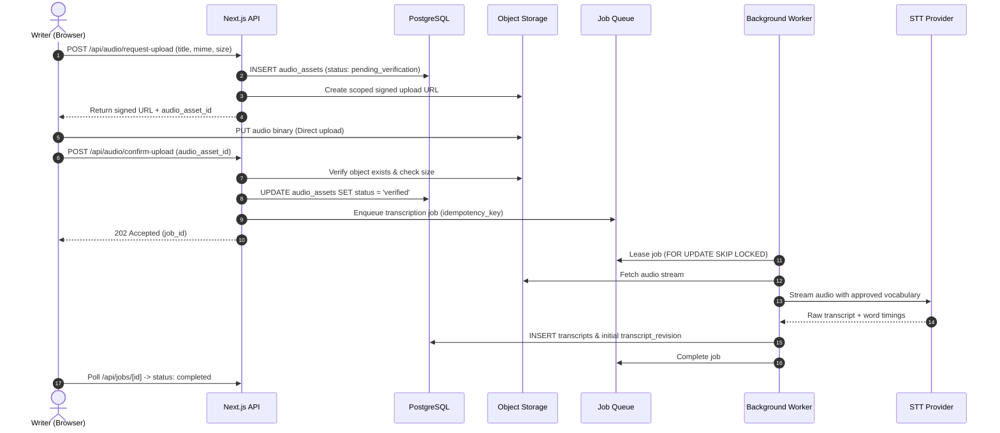
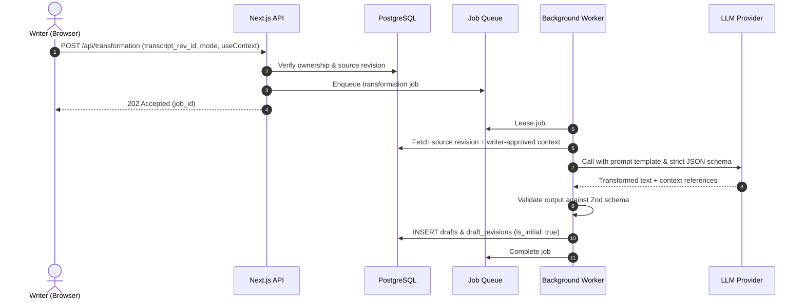
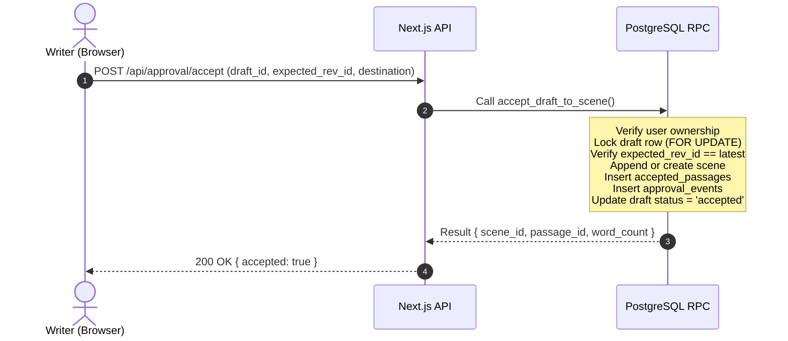

# StoryVoice — System Architecture

**Document Version:** 1.0.0 (Phase 4 / Phase 5 Foundation)  
**Status:** Approved Architectural Baseline  
**Maintainers:** StoryVoice Engineering Team

---

## 1. Architectural Philosophy and Non-Negotiable Core Principle

StoryVoice is a voice-first manuscript drafting environment that helps fiction writers turn spoken ideas into accepted, organised manuscript text.

### The Non-Negotiable Core Principle:
> **The writer remains the authority over every meaningful transformation and every accepted piece of manuscript content.**

From an architectural standpoint, this means:
1. **Separation of Artefacts:** The original audio recording, source transcript, draft revisions, and accepted manuscript passages are stored as separate immutable records with explicit lineage.
2. **Never Overwrite Source:** No transformed draft, AI output, or edited text ever overwrites the source recording or source transcript.
3. **No Automatic Acceptance:** AI models never approve their own output. Generated drafts are unaccepted candidates until an explicit server-side acceptance transaction executed by the writer occurs.
4. **No Spurious Story Facts:** Model inferences or suggestions never become approved story context without explicit writer action.

---

## 2. High-Level System Architecture (Modular Monolith)

StoryVoice employs a **modular monolith** with a dedicated asynchronous background processing worker:

```
+-----------------------------------------------------------------------------------+
|                                  CLIENT LAYER                                     |
|  Responsive Web App (Next.js 15, React 19, TypeScript, MediaRecorder, Audio Node)  |
+-----------------------------------------------------------------------------------+
                               |                      |
                    HTTPS / JSON REST API       Direct S3 / Storage Upload
                               |                      |
                               v                      v
+-----------------------------------------------------------------------------------+
|                           APPLICATION SERVER (Next.js)                            |
|                                                                                   |
|  [ Auth & Sessions ]     [ Project Domain ]         [ Manuscript Service ]         |
|  [ Audio Manager ]       [ Queue Dispatcher ]       [ Server-Side Export Engine ] |
+-----------------------------------------------------------------------------------+
             |                         |                           |
             | Relational CRUD         | Enqueue Job               | Verify Upload
             v                         v                           v
+------------------------+  +------------------------+  +------------------------+
|  CANONICAL DATA STORE  |  |  DURABLE JOB QUEUE     |  | PRIVATE OBJECT STORE   |
|  PostgreSQL 16         |  |  PostgreSQL Table      |  | Supabase Storage       |
|  - RLS Security Model  |  |  - Row-Level Locking   |  | - audio_recordings/    |
|  - Atomic Acceptance   |  |  - Exponential Backoff |  | - exports/             |
|  - Revision Lineage    |  |  - Idempotency Keys    |  | (Private Buckets)      |
+------------------------+  +------------------------+  +------------------------+
                                       ^
                                       | Lease Jobs (FOR UPDATE SKIP LOCKED)
                                       v
+-----------------------------------------------------------------------------------+
|                        BACKGROUND PROCESSING WORKER (Node.js)                     |
|                                                                                   |
|  +-----------------------+  +-----------------------+  +-----------------------+  |
|  | Speech-to-Text        |  | AI Transformation     |  | Document Exporter     |  |
|  | Provider Adapter      |  | Provider Adapter      |  | DOCX / MD / TXT       |  |
|  | (Deepgram / Whisper)  |  | (Gemini / Claude / OAI|  | Packaging             |  |
|  +-----------------------+  +-----------------------+  +-----------------------+  |
+-----------------------------------------------------------------------------------+
```

---

## 3. Core Subsystems

### 3.1 Web & Application Tier (Next.js App Router)
- **Framework:** Next.js 15 with React Server Components (RSC) and Server Actions.
- **Responsibilities:**
  - Authenticated session verification via Supabase SSR cookies.
  - CRUD operations for projects, scenes, context, and audio metadata.
  - Issuing short-lived signed upload URLs to clients for direct-to-storage audio ingestion.
  - Atomic acceptance transactions via PostgreSQL stored procedures.
  - Enqueuing background jobs.

### 3.2 Canonical Data Store (PostgreSQL 16 with Row Level Security)
- **Database Engine:** PostgreSQL 16 hosted via Supabase.
- **Security:** Strict multi-tenant Row Level Security (RLS) on all 17 canonical tables.
- **Integrity:** Foreign keys with strict constraints (`RESTRICT` on source transcripts and drafts to ensure historical lineage cannot be severed accidentally).

### 3.3 Private Object Storage (Supabase Storage)
- **Buckets:**
  - `audio_recordings`: Private bucket. Objects keyed as `{user_id}/{project_id}/{audio_asset_id}.{ext}`.
  - `exports`: Private bucket for generated manuscript files.
- **Access:** Direct browser upload via pre-signed, scoped URLs. Downloads served exclusively via signed URLs with 15 to 60-minute TTLs.

### 3.4 Durable Job Queue
- **Implementation:** PostgreSQL-backed durable queue (`processing_jobs`) utilizing `FOR UPDATE SKIP LOCKED` atomic leasing.
- **Guarantees:**
  - At-least-once delivery with idempotency keys.
  - Heartbeat leasing with timeout reclamation (`locked_until`).
  - Exponential backoff retry policies.
  - Permanent failure states with error logging.

### 3.5 Asynchronous Processing Worker
- **Runtime:** Separate Node.js/TypeScript daemon process (`src/workers/index.ts`).
- **Jobs Handled:**
  - `audio_validation`: Validating uploaded audio container headers and durations.
  - `transcription`: Executing provider adapter calls (Deepgram Nova-3 / OpenAI Whisper) and creating source transcript revisions.
  - `transformation`: Invoking LLMs with versioned prompts and strict JSON schemas for Faithful, Clean, and Readable drafts.
  - `export_generation`: Building server-side Open XML DOCX, Markdown, and TXT packages.

---

## 4. Key Data Flows

### 4.1 Audio Ingestion & Transcription Flow


### 4.2 AI Transformation & Draft Flow


### 4.3 Atomic Acceptance Flow


---

## 5. Technology Stack Decisions (Summary)

Detailed in Architecture Decision Records (ADRs):
- **ADR 001:** Modular monolith over microservices.
- **ADR 002:** Supabase Auth and PostgreSQL Row Level Security for multi-tenant isolation.
- **ADR 003:** Durable PostgreSQL table job queue over external queue brokers (Redis/RabbitMQ) for MVP simplicity and transactional consistency.
- **ADR 004:** Multi-provider transcription abstraction (Deepgram Nova-3 primary, OpenAI Whisper secondary).
- **ADR 005:** Three-mode transformation pipeline with strict server-side Zod validation and writer approval gate.
