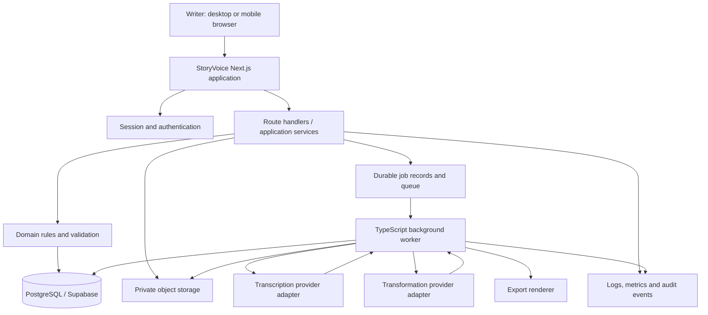

# StoryVoice: Phase 5: AI Development, Engineering & Implementation


## Why This Phase Exists

Phase 1 established the problem and the strategic opportunity: fiction writers need a reliable way to move spoken intent into manuscript material without losing meaning, voice or creative control. Phase 2 defined the product strategy, target user, MVP boundaries, product promise and success measures. Phase 3 translated those decisions into the user experience and a clickable prototype. Phase 4 converted the product requirements into a proposed technical architecture, data strategy, AI architecture, security model and engineering sequence.

Phase 5 turns that architecture into an implementation programme and an executable engineering specification. It defines how the existing StoryVoice repository should be audited, completed, corrected and advanced into a working product. It covers application engineering, database implementation, audio infrastructure, transcription, AI transformation, writer approval, exports, security, testing, deployment, observability and technical debt.

This phase is not a proposal to discard the existing repository and start again. The public repository already contains a substantial Next.js/TypeScript application structure, service modules, API routes, tests, database migrations, worker code and technical documentation. The first engineering responsibility is to determine what works, what is incomplete, what is simulated, what is inconsistent with Phase 4 and what must be changed. Existing working code should be retained unless a documented technical reason justifies replacement.

**Phase 5 is an implementation plan informed by a repository-level source inspection. It is not a claim that the application has been run, deployed, security-audited or production-validated.** File presence is not proof of working behaviour. A route, service, migration, test or adapter is only considered implemented to the degree that its behaviour is verified.

The governing engineering principle is:

> **Build a dependable path from a writer’s spoken words to accepted manuscript text. Preserve every source, make AI changes inspectable, and keep the writer in control of what becomes part of the story.**

## 1. Phase 5 Objectives

### 1.1 Primary objective

Implement the first dependable end-to-end StoryVoice workflow:

1. A writer can register, sign in and securely access their account.
2. A writer can create, view, update and delete projects and scenes within their own account.
3. A writer can record audio in a supported browser or import an audio file.
4. The original audio is uploaded, verified and retained as a distinct source asset.
5. A real transcription provider converts the audio into a source transcript.
6. The writer can correct the transcript and save explicit revisions.
7. The writer can choose Faithful Transcript, Clean Transcript or Readable Draft.
8. A real language-model provider produces a separate, versioned draft under the selected mode.
9. The writer can inspect the source and draft, edit the draft, and understand whether it is current or stale.
10. The writer can accept, reject or restore a draft through explicit, traceable actions.
11. Accepted passages are stored as manuscript content in a selected scene, separately from source transcripts and generated drafts.
12. The writer can export accepted manuscript content to DOCX, Markdown or TXT.
13. The system reports honest processing, save, failure and recovery states.
14. Operational events and product analytics measure quality and usage without collecting raw manuscript content unnecessarily.

### 1.2 Engineering objectives

- Establish a verified baseline for the existing repository.
- Preserve the current product experience and visual direction while connecting real functionality.
- Complete the modular application architecture and domain boundaries.
- Make authentication, ownership and database access enforceable server-side.
- Implement private audio and export storage.
- Implement reliable asynchronous processing with idempotency, retry and recovery.
- Integrate transcription and LLM providers through application-owned adapters.
- Enforce strict transformation-mode boundaries and structured outputs.
- Preserve source-to-draft-to-accepted-content lineage.
- Fix the Phase 3 critical workflow defects carried into Phase 4.
- Add automated tests, CI checks, staging deployment and operational visibility.
- Maintain technical documentation and explicit decision records.

### 1.3 Definition of success

Phase 5 is successful when the core workflow works end to end in a controlled staging environment, its critical trust and security invariants are enforced, its important failure paths are tested, and the team can demonstrate the complete journey with a test account and test project.

Phase 5 completion does not by itself establish product-market fit, production-scale reliability, final AI quality, legal compliance in every jurisdiction or a validated commercial model. Those belong to subsequent evaluation, business and release phases.

## 2. Product and Engineering Constraints Carried Forward

### 2.1 Product definition

StoryVoice is a voice-first manuscript drafting environment that helps fiction writers turn spoken ideas into accepted, organised manuscript text through faithful transcription, controlled transformation and writer-approved story context.

**Product promise:** Turn spoken ideas into manuscript-ready drafts while keeping the writer in control of every meaningful change.

**Strategic wedge:** Faithful voice-to-manuscript transformation with writer control.

### 2.2 Non-negotiable product rules

| Rule | Engineering requirement |
|---|---|
| Original audio is preserved | Never overwrite the original uploaded or recorded audio with a normalised, compressed or segmented derivative |
| Source transcript is distinct | A transcript is a source artefact, not a transformed draft |
| Draft is distinct | Every transformation creates a separate draft revision linked to the exact source transcript revision |
| Writer approval is explicit | A generated or edited draft cannot become accepted manuscript content without a writer action |
| Approved story facts remain writer-owned | Model inferences and generated suggestions cannot silently become canonical facts |
| Source edits invalidate dependent drafts | Draft freshness is calculated against its source revision and relevant context snapshot |
| Acceptance is traceable | Store who accepted what, from which revision, into which scene, and when |
| Rejection does not destroy source | Rejecting a draft changes its status; it does not erase the source transcript or audio |
| Restore is reversible | A prior draft can be restored as a new current revision or selected for review without mutating history |
| Saved means persisted | The interface must not show a saved state until the server confirms persistence |
| Processing states are truthful | Queued, processing, completed, failed and cancelled are distinct states |
| Privacy is default | Private storage, tenant isolation, server-side secrets and content-minimised logs |

### 2.3 Transformation modes

| Mode | Intended behaviour | Must not do |
|---|---|---|
| **Faithful Transcript** | Apply punctuation and minimal formatting; preserve spoken wording and structure | Rewrite sentences, invent details, remove meaningful repetition or alter events |
| **Clean Transcript** | Remove clearly non-semantic disfluencies and improve readability while retaining the writer’s spoken structure | Remove intentional repetition, change meaning, add description or restructure the scene substantially |
| **Readable Draft** | Shape rough spoken language into readable prose while preserving intended meaning and the writer’s voice | Add story events, motives, characters, setting details or facts not present in the source or explicitly approved context |

These mode names and their perceived usefulness remain subject to writer validation. Implementation must keep their behaviour configurable and prompt-versioned.

### 2.4 MVP boundaries

In scope:
- Account, authentication and onboarding.
- Projects and scenes.
- Browser audio recording and file import.
- Private audio storage.
- Real asynchronous transcription.
- Editable transcript revisions.
- Three controlled transformation modes.
- Source/draft comparison.
- Draft editing, save, accept, reject and restore.
- Limited writer-approved story context and fiction vocabulary.
- Accepted manuscript passages.
- DOCX, Markdown and TXT export.
- Usage, operational analytics and feedback.

Out of scope unless evidence and a separate decision justify them:
- Autonomous chapter or novel generation.
- AI co-author chat as a primary workflow.
- Automatic canon or story-fact updates.
- Multi-agent orchestration.
- Fine-tuning a proprietary model.
- Vector database or embedding-based retrieval for the MVP.
- Advanced plot graphs and timeline engines.
- Real-time collaboration.
- Native mobile applications.
- Guaranteed offline or background recording.
- Speaker-to-character identity inference.

## 3. Existing Repository Baseline

### 3.1 Repository identity and observed structure

The repository inspected for this phase is `retxsh/StoryVoice`, default branch `main`. The repository reader reported 128 files and approximately 1.158 MB of repository content at the time of inspection. The repository contains a nested full-stack implementation under the Phase 4 directory as well as the earlier Phase 3 prototype and lifecycle documents.

Observed root structure:

```text
StoryVoice/
├── Phase 4 - Technical Research AI Research Data Strategy & System Architecture/
│   ├── StoryVoice - Full Stack - Prototype/
│   │   ├── src/
│   │   │   ├── app/              # Next.js routes, pages and API handlers
│   │   │   ├── services/         # Domain/application services
│   │   │   ├── components/       # Shared UI components
│   │   │   ├── __tests__/        # Automated test files
│   │   │   ├── lib/              # Supabase clients, queue, logging, env and helpers
│   │   │   ├── types/            # Shared TypeScript types
│   │   │   ├── workers/          # Background worker entry point
│   │   │   └── middleware.ts
│   │   ├── supabase/
│   │   │   └── migrations/      # SQL migrations
│   │   ├── ADR/                  # Architecture decision records
│   │   ├── exports/              # Sample export files
│   │   ├── package.json
│   │   ├── package-lock.json
│   │   ├── next.config.ts
│   │   ├── tsconfig.json
│   │   ├── vitest.config.ts
│   │   ├── .env.example
│   │   ├── README.md
│   │   ├── ARCHITECTURE.md
│   │   ├── SYSTEM_DESIGN.md
│   │   ├── DATA_MODEL.md
│   │   ├── API_SPECIFICATION.md
│   │   ├── AI_ARCHITECTURE.md
│   │   ├── SECURITY.md
│   │   ├── TRANSCRIPTION_BENCHMARK.md
│   │   ├── PRIVACY_AND_DATA_RETENTION.md
│   │   ├── DEPLOYMENT.md
│   │   ├── COST_MODEL.md
│   │   ├── TESTING.md
│   │   ├── ENVIRONMENT_SETUP.md
│   │   └── AUDIT_AND_MIGRATION_PLAN.md
│   └── Phase 4 -Technical Research, AI Research Data Strategy & System Architecture.md
├── Phase 3 - Product Design UX:UI & Experience Architecture/
│   ├── StoryVoice Prototype/
│   └── Phase 3 design document
├── Phase 2 strategy document
├── Phase 1 discovery document
└── README.md
```

The tree is an observed repository snapshot, not a guarantee that every path is complete or that the current branch has not changed since inspection.

### 3.2 Existing stack observed in package metadata

The full-stack prototype's package metadata reports:

| Layer | Existing dependency or tool | Initial assessment |
|---|---|---|
| Framework | Next.js 15.1.7 | Retain pending build/runtime verification |
| UI | React 19, React DOM 19 | Retain pending compatibility verification |
| Language | TypeScript 5.7.3 | Retain; enforce strict checks |
| Database/auth SDK | Supabase JS 2.48.1, Supabase SSR 0.5.2 | Verify current APIs and server/client usage |
| Validation | Zod 3.24.2 | Reuse for API and model-output validation |
| Logging | Pino 9.6.0 | Verify redaction and production configuration |
| Environment | dotenv 16.4.7 | Confirm safe separation of local, test and deployment env |
| Test runner | Vitest 3.0.5 | Run existing suite and assess coverage |
| Worker runtime | tsx 4.19.2 | Existing worker script is present; verify lifecycle and deployment |
| Styling helpers | clsx, tailwind-merge | Preserve existing UI conventions |

Reported scripts include `dev`, `build`, `start`, `lint`, `test`, `test:watch` and `worker`. The lint script and command compatibility must be tested against the pinned Next.js version before changing it.

### 3.3 Existing implementation inventory observed

The source tree indicates existing modules or route groups for:

- Authentication and account profile.
- Project CRUD.
- Scene CRUD.
- Audio asset and upload operations.
- Transcription initiation and transcript retrieval/revision.
- Transformation initiation and draft revision/history.
- Approval operations.
- Story context.
- Job status.
- Export.
- Audit/activity.
- Supabase clients and environment helpers.
- Queue and worker entry point.
- Database migrations.
- Domain and service tests.

The repository also contains five ADRs and technical documents for architecture, data model, API, AI, security, transcription benchmarking, privacy/retention, deployment, cost and testing.

**Important:** The above inventory confirms that files and implementation structures exist. It does not confirm that their code paths execute correctly, that external services are configured, that migrations have been applied, or that the tests pass.

### 3.4 Repository documentation mismatch to resolve

`AUDIT_AND_MIGRATION_PLAN.md` describes the original application as a single standalone HTML prototype with simulated in-memory data and proposes migration to Next.js, Supabase and a worker. The current nested Phase 4 directory already contains a substantial Next.js/TypeScript implementation. Treat the audit document as a historical migration note unless source history proves otherwise. Phase 5 must update it or add a dated implementation audit so that future contributors do not mistake the older state for the current repository state.

Other documentation must be reconciled with Phase 4 before implementation is considered complete. Examples identified in the repository review include older transcription references such as Whisper and a transformation-provider example using Gemini. Phase 4 calls for benchmarking current `gpt-transcribe` and Deepgram Nova-3 and using a provider adapter for the LLM. No provider should be declared selected merely because an older document or code example names it.

### 3.5 Baseline verification status

| Verification item | Current evidence | Status entering Phase 5 |
|---|---|---|
| Repository tree inspected | Yes | Observed |
| Package metadata inspected | Yes | Observed |
| Main architecture and API documentation inspected | Yes | Observed |
| Service and route file inventory inspected | Yes | Observed at path/inventory level |
| Every route and service runtime behaviour | Not established | Unverified |
| Existing test suite executed | Not established | Unverified |
| Production build executed | Not established | Unverified |
| Database migrations applied | Not established | Unverified |
| Supabase RLS tested against two users | Not established | Unverified |
| Real audio upload verified | Not established | Unverified |
| Real transcription provider verified | Not established | Unverified |
| Real LLM transformation verified | Not established | Unverified |
| Export files opened in target applications | Not established | Unverified |
| CI pipeline | No CI configuration detected in inspected tree | Missing or not detected |
| Production deployment and rollback | Not established | Unverified |
| Security/privacy audit | Not established | Not completed |

### 3.6 Required repository audit before code changes

The engineering team must perform the following in the actual project directory:

1. Confirm branch, commit SHA, working tree status and package-manager lockfile.
2. Install dependencies using the lockfile and record Node.js/npm versions.
3. Run type checking, lint, unit tests and production build; capture complete output.
4. Inspect every route handler and service implementation, not only filenames.
5. Trace every user action from UI to API to service to database/storage/provider.
6. Compare SQL migrations against `DATA_MODEL.md` and actual query usage.
7. Verify Supabase browser/server/service-role client boundaries.
8. Inspect middleware and session refresh behaviour.
9. Inspect queue claiming, locking, retries, idempotency and worker shutdown.
10. Inspect logging redaction, request validation, rate limiting and error responses.
11. Validate environment variable names against `.env.example` and runtime code.
12. Inspect export generation and open generated files in compatible readers.
13. Record every gap in a dated implementation audit with severity, evidence, owner and acceptance test.

Do not delete or replace modules simply because their behaviour has not yet been verified. First establish what they do and which callers depend on them.

## 4. Target Engineering Architecture

### 4.1 Architecture decision

Follow Phase 4: a **modular monolith with a separately executed asynchronous worker**. Keep the web application, API and domain services in the existing Next.js application unless the repository audit reveals a compelling reason to restructure. Run audio and AI processing outside interactive request lifecycles.

### 4.2 Logical architecture



### 4.3 Domain boundaries

| Module | Owns | Primary rules |
|---|---|---|
| Identity and access | User identity, sessions, ownership checks | Every project operation is scoped to the authenticated owner |
| Projects | Project lifecycle and metadata | A project belongs to one owner in MVP |
| Scenes | Scene organisation and ordering | A scene belongs to a project; accepted content is attached to a scene |
| Audio assets | Source audio metadata and storage lifecycle | Original source is immutable; derivatives are separate assets |
| Transcription | Transcript jobs and transcript revisions | A transcript revision references one audio asset and provider execution |
| Transformation | Modes, prompt versions, draft revisions and model execution | A draft references an exact transcript revision and context snapshot |
| Story context | Writer-approved facts and vocabulary | Only approved and relevant context may be sent to a model |
| Manuscript acceptance | Accepted passages and approval events | Explicit writer action; transactional and lineage-preserving |
| Jobs | Queue state, retries, locks and idempotency | At-least-once delivery with idempotent effects |
| Export | Export request, artifact and status | Read accepted manuscript content only by default |
| Audit and usage | Security-relevant events, product metrics and provider usage | No raw manuscript/audio in routine telemetry |

### 4.4 Repository structure direction

Preserve the existing directory layout unless the audit identifies a concrete issue. The target conceptual structure should remain easy to navigate:

```text
src/
├── app/                  # Next.js pages and route handlers
├── components/           # UI components
├── services/             # Application/domain service entry points
├── lib/                  # Supabase clients, env, queue, logging, shared utilities
├── workers/              # Worker entry point and job processors
├── types/                # Shared domain/API types
└── __tests__/            # Unit and integration tests
supabase/
└── migrations/           # Ordered, forward-only schema and policy migrations
ADR/                      # Material technical decisions
```

Where useful, group service internals by domain (for example `services/transcription/` with provider interface, provider implementations, validation and tests). Avoid introducing a second architecture pattern or duplicate domain logic during refactoring.

### 4.5 Dependency direction

- UI components call application APIs; they do not import provider SDKs.
- Route handlers authenticate, validate input, call services and shape responses.
- Services enforce domain rules and orchestrate repositories/adapters.
- Provider adapters translate application-owned contracts to vendor SDKs.
- Database access is server-side and ownership-scoped.
- Workers invoke the same domain services/adapters used by synchronous flows where practical.
- Shared schemas and domain types must not import UI-only modules.

No service should import a Next.js page or React component. Provider SDK types must not leak into persisted domain entities or public API response contracts.

## 5. Engineering Foundation and Developer Experience

### 5.1 Runtime and dependency baseline

- Pin and document the supported Node.js LTS version.
- Use the existing package lockfile as the source of dependency resolution.
- Avoid broad dependency upgrades during feature implementation unless required for a security fix or compatibility issue.
- Add a repeatable local setup command sequence.
- Keep `.env.example` current and free of real credentials.
- Validate all required environment variables at process startup with Zod or the existing environment schema.
- Fail fast with actionable configuration errors; do not silently switch to demo or mock mode in a production environment.

### 5.2 Required developer commands

The exact scripts should be aligned to the current package file after audit. The intended capabilities are:

```bash
npm ci
npm run dev
npm run typecheck
npm run lint
npm test
npm run build
npm run worker
```

If the current scripts do not expose type checking separately, add a `typecheck` script that runs `tsc --noEmit`. Verify the Next.js lint command against the pinned version and use a supported ESLint invocation if necessary. Do not assume a command works because it is listed in `package.json`.

### 5.3 Environment separation

Maintain distinct configuration for:
- Local development.
- Automated tests.
- Shared development or integration environment.
- Staging.
- Production.

Use separate Supabase projects or isolated schemas/buckets where appropriate. Never point automated destructive tests at production. Do not reuse production service-role credentials in local development or CI.

### 5.4 Configuration categories

The final variable names must match the actual code and provider SDKs. At minimum, configuration should cover:
- Public application URL.
- Supabase project URL and publishable/anon key.
- Supabase service-role key for trusted server/worker operations only.
- Transcription provider and server-side credential.
- LLM provider and server-side credential.
- Queue/worker configuration.
- Maximum upload bytes and accepted MIME types.
- Job timeout, retry limit and concurrency.
- Signed URL expiry.
- Logging level and monitoring DSN.
- Export bucket and retention configuration.

Secrets must never be prefixed with a public environment-variable convention or serialised into client bundles.

## 6. Database and Persistence Implementation

### 6.1 Database strategy

Use PostgreSQL as the canonical structured data store, consistent with Phase 4. Continue with Supabase if the repository audit confirms the existing integration is viable. Database migrations are the source of truth for schema changes. Do not manually alter a shared database and leave the migration history behind.

### 6.2 Canonical entities

The implementation must support the following conceptual entities. Existing table names may differ; reconcile the current schema rather than creating duplicate tables.

| Entity | Purpose | Key lineage/ownership requirement |
|---|---|---|
| `profiles` or user profile | User preferences and account metadata | Auth user ID is authoritative |
| `projects` | Fiction project/workspace | Has one owner in MVP |
| `scenes` | Organised manuscript locations | Belongs to a project |
| `audio_assets` | Original and derived audio metadata | Original asset remains immutable |
| `transcription_jobs` or job records | Provider execution and status | References audio asset and job identity |
| `transcript_revisions` | Source transcript history | Each revision is immutable once superseded |
| `transformation_jobs` or job records | LLM execution and status | References exact transcript revision and mode |
| `draft_revisions` | Generated and edited draft history | References source revision, prompt/model and context snapshot |
| `accepted_passages` | Writer-approved manuscript text | References accepted draft revision and destination scene |
| `approval_events` | Accept/reject/restore audit | Actor, target revision, action and timestamp |
| `story_context_items` | Writer-owned story facts | Approval status and provenance required |
| `project_vocabulary` | Character/place/invented terms for recognition | Writer-approved terms only in provider hints |
| `processing_jobs` | Durable job state and retries | Idempotency, lock and attempt tracking |
| `audit_events` | Security/product audit trail | Minimise content; actor and resource IDs |
| `usage_records` | Provider usage and cost attribution | Provider, model, duration/tokens, cost estimate and job ID |
| `export_jobs` or `exports` | Generated export artefacts | Export scope and accepted manuscript revision snapshot |

### 6.3 Versioning and immutability

- Original audio is immutable after successful verification. Corrections or conversions create derived assets.
- Provider transcription output is retained as an immutable initial transcript revision.
- Writer edits create a new transcript revision or a new revision record; do not silently overwrite historical source text.
- Each draft revision records the exact transcript revision ID used as input.
- Each draft revision records transformation mode, provider, model, prompt version, generation configuration and approved context snapshot/reference.
- Writer edits to a generated draft create a new editable revision or update a clearly defined working revision with audit history. The final accepted revision must be immutable and traceable.
- Accepted passages reference the exact accepted draft revision and source transcript revision.
- A change to a source transcript or relevant context makes dependent drafts stale. Stale drafts remain viewable but cannot be accepted as current without an explicit regenerate/reconfirm policy.

### 6.4 Migration requirements

Every migration must:
1. Be ordered and committed to source control.
2. Be safe to apply to a fresh test database.
3. Include required indexes, constraints and RLS policies.
4. Avoid destructive data changes without an explicit migration plan.
5. Be tested against representative existing data.
6. Include rollback or forward-repair instructions where rollback is unsafe.
7. Update `DATA_MODEL.md` and the ERD.

Use database constraints for invariants that must hold regardless of API caller, including foreign keys, unique idempotency keys, ownership relationships where feasible and accepted-passage lineage.

### 6.5 Concurrency and data integrity

Use optimistic concurrency for editable transcripts and drafts. Each mutable working record should expose a revision/version token or `updated_at` value. A save request must fail with a conflict response if the client is editing an obsolete revision. The UI should offer reload, compare or deliberate overwrite where safe; it must not silently discard a newer writer edit.

Acceptance must be a database transaction or a single trusted database function that verifies:
- Authenticated owner and project access.
- Target draft belongs to the expected project and source lineage.
- Draft is not rejected or superseded.
- Draft is not stale, unless a specifically approved override flow exists.
- Final editor buffer has been persisted or included in the same atomic operation.
- Target scene belongs to the same project.
- The accepted passage and approval event are created together.

If any condition fails, no partial accepted passage should remain.

## 7. Authentication, Authorisation and Security Implementation

### 7.1 Authentication

Use the existing Supabase Auth integration if it passes audit. Implement and verify:
- Registration and email verification where enabled.
- Sign-in and sign-out.
- Session refresh in server-rendered and route-handler contexts.
- Password reset or magic-link recovery according to the chosen auth UX.
- Expired and revoked session handling.
- Protected pages and APIs.
- Account deletion initiation and data deletion workflow.

Authentication confirms who the user is. It does not, by itself, prove that the user owns a project, scene, transcript or audio object.

### 7.2 Authorisation

- Every resource request must verify ownership server-side.
- Never trust `user_id`, `owner_id`, project ID or storage path sent by the browser as proof of access.
- Query resources through the authenticated user's scope or perform explicit ownership checks.
- Apply Row Level Security to every user-owned table exposed through Supabase client access.
- Service-role operations must be confined to trusted server/worker code and must perform explicit ownership validation before mutation.
- Storage object paths must be scoped to an owner and resource, but path shape alone is not authorisation.

### 7.3 RLS implementation and test cases

For each protected table, verify:
- User A can read and mutate their own permitted rows.
- User B cannot read or mutate User A's rows by guessing IDs.
- Anonymous requests cannot access private rows.
- Related records cannot be attached across two users' projects.
- A worker's privileged access is limited to the intended operation and cannot accidentally bypass application-level invariants.

Repeat equivalent isolation tests for audio and export buckets, including signed URL expiry and object deletion.

### 7.4 Secrets and provider calls

- Provider credentials exist only in server/worker runtime.
- Browser code never receives a provider API key.
- Error messages returned to the client do not expose secrets, stack traces or internal provider payloads.
- Rotate credentials using deployment secret management.
- Separate keys per environment and use least-privilege scopes where vendors support them.

### 7.5 Prompt injection and untrusted content

Spoken narration, imported transcript text, filenames and project notes are user content, not system instructions. The transformation pipeline must:
- Keep system/developer instructions separate from source text and approved context.
- Delimit source material as untrusted content.
- Never execute instructions found inside a manuscript passage.
- Avoid exposing secrets, internal prompts or other users' data to the model.
- Treat model output as untrusted until schema validation and domain validation pass.
- Require explicit writer approval before output becomes accepted manuscript content.

### 7.6 Logging and privacy

Routine logs must not contain:
- Raw audio or audio URLs with reusable access credentials.
- Full transcript or manuscript passages.
- Prompt text containing private story content.
- Authentication tokens, cookies or provider keys.

Logs may contain request/job IDs, user/resource IDs where appropriately pseudonymised, status, latency, provider/model identifiers, retry count, token/audio usage, cost estimate and sanitised error categories. Any exceptional content capture for debugging requires a documented, time-limited, consent-aware process.

## 8. Audio Capture, Import and Storage Engineering

### 8.1 Browser recording

Implement browser recording behind a capture service or hook that isolates MediaRecorder details from the page UI. The interface must support:
- Explicit microphone permission request.
- Device/browser capability detection.
- Recording, pause, resume and stop where supported.
- Elapsed time based on actual recording state.
- Clear permission, unavailable-device and unsupported-format errors.
- Discard confirmation.
- Recovery from interrupted upload.
- A clear saved/uploaded confirmation only after server verification.

The application must not claim to record when no MediaRecorder stream is active. A timer animation alone is not recording.

### 8.2 File import

Validate file size, extension and MIME type at the client for usability and again server-side for security. Inspect actual stored object metadata and, where feasible, file signatures/container metadata. Reject unsupported or malformed media with a clear error and preserve the user's local file for retry.

### 8.3 Upload flow

1. Client requests an upload intent for a project.
2. Server authenticates and verifies project ownership.
3. Server validates file size and allowed type against server-side configuration.
4. Server creates an audio asset row in `created` or `uploading` state and returns scoped upload credentials.
5. Client uploads directly to private object storage.
6. Client confirms upload completion.
7. Server verifies object existence, expected path, size and metadata.
8. Server marks the asset `verified` and creates a transcription job.
9. UI displays separate audio-storage and transcription states.

Use resumable upload for larger files or unreliable networks where supported by the selected storage path. Keep the completed local Blob available until durable upload confirmation so a transient network failure does not destroy the only copy.

### 8.4 Asset state model

```text
created
  -> uploading
  -> uploaded
  -> verified
  -> queued_for_transcription
  -> transcribing
  -> transcribed

Failure/exit states:
upload_failed
verification_failed
transcription_failed
cancelled
deleting
deleted
```

The exact persisted enum may be simpler if the current schema already has a suitable state model, but the application must retain enough information to distinguish upload, verification and transcription failures.

### 8.5 Original and derived audio

If conversion, normalisation or segmentation is required:
- Preserve the original source object.
- Create a new derived asset record.
- Record parent/source asset ID, operation, tool/version, codec and timestamps.
- Keep a stable relationship between transcript segments and source time ranges.
- Do not expose a derived asset as the original recording.

### 8.6 File and duration limits

Do not hard-code a product-wide maximum based only on one provider's current upload limit. Store limits in server configuration and choose them after measuring target recording durations, browser memory, storage upload, provider constraints, processing time and cost. Display the active limit before recording/import.

## 9. Speech-to-Text Engineering

### 9.1 Provider selection

Phase 4 identifies OpenAI `gpt-transcribe` and Deepgram Nova-3 as primary benchmark candidates, with AssemblyAI as an additional candidate if required. No provider is final until the same consented fiction-specific dataset has been evaluated across candidates.

The repository contains older provider references, including Whisper. Revalidate current API model IDs, deprecations, upload limits, supported formats, data handling and pricing before using or retaining those integrations. Do not select an obsolete model because it is already present in a code sample.

### 9.2 Provider adapter contract

The application-owned transcription interface should express StoryVoice concepts rather than vendor-specific SDK types. Conceptual contract:

```ts
export interface TranscriptionProvider {
  readonly providerId: string;
  transcribe(input: TranscriptionInput): Promise<TranscriptionResult>;
}

export interface TranscriptionInput {
  audio: ProviderAudioReference;
  languageHint?: string;
  vocabularyHints?: string[];
  requestId: string;
}

export interface TranscriptionResult {
  text: string;
  detectedLanguage?: string;
  segments?: Array<{
    id: string;
    startMs?: number;
    endMs?: number;
    text: string;
    confidence?: number;
  }>;
  providerRequestId?: string;
  usage?: {
    audioSeconds?: number;
    estimatedCost?: number;
  };
}
```

This is a conceptual interface; adapt it to the existing TypeScript conventions. Provider-specific optional fields must not become required product fields unless the product needs them.

### 9.3 Transcription pipeline

1. Worker claims a transcription job using a durable lease/lock.
2. Worker verifies asset and project access context.
3. Worker retrieves the private audio object using server-side credentials.
4. Worker inspects file metadata and selects direct upload or chunk/normalisation strategy.
5. Worker selects the configured provider adapter.
6. Worker passes only necessary language and approved vocabulary hints.
7. Provider response is normalised to the application contract.
8. Result is validated and persisted as a new transcript revision.
9. Job and audio asset states are updated transactionally where possible.
10. Usage, latency and sanitised provider metadata are recorded.
11. UI receives status through polling or the existing realtime mechanism, if present and reliable.

### 9.4 Fiction vocabulary

Only writer-approved project vocabulary should be included in provider hints. Keep the list bounded and relevant to the project. Measure whether hints improve proper-noun recognition without causing hallucinated insertions. A character name or location inferred by the model must not be added automatically to the approved vocabulary.

### 9.5 Transcription quality checks

Before choosing a default provider, run the Phase 4 benchmark protocol:
- Clean narration.
- Fiction-heavy narration with invented names and dialogue.
- Difficult narration with corrections, pauses, background noise and variable microphone quality.

Measure WER, proper-noun accuracy, critical meaning errors, dialogue usability, correction burden, latency, failure rate and cost per audio minute. Record provider/model/version and configuration for reproducibility.

### 9.6 Transcription failures

- Retry only transient errors.
- Do not retry permanent unsupported-format or invalid-file errors indefinitely.
- Preserve the source audio after provider failure.
- Use exponential backoff with jitter and a bounded attempt count.
- Record a safe, user-understandable failure category.
- Provide a retry action that reuses the source asset and creates or requeues a well-defined job.
- Prevent duplicate transcript revisions from duplicate job delivery.

## 10. AI Transformation Engineering

### 10.1 Provider-agnostic model interface

Create an application-owned transformation adapter. The selected model must be configured server-side and be replaceable without changing the draft domain model. Phase 4 calls for benchmarking a current OpenAI Responses API model against one alternative. The repository's older provider examples must be reconciled before selection.

### 10.2 Transformation input contract

Each transformation request must include:
- Project ID and authenticated writer identity from the server session.
- Exact transcript revision ID.
- Transformation mode.
- Optional selected, approved context items.
- Prompt version.
- Model/provider configuration version.
- Request/idempotency key.

The server must load source text and approved context from trusted storage after ownership checks. Do not accept arbitrary source text or story facts from the browser as authoritative if the request is supposed to transform a stored transcript revision.

### 10.3 Prompt architecture

Maintain versioned prompt templates in source control. Each mode has a distinct system instruction and evaluation suite. Prompts should specify:
- Role and task boundaries.
- Mode-specific allowed transformations.
- Prohibited semantic changes.
- Preservation of authorial voice and intentional repetition.
- Handling of uncertainty and ambiguous speech.
- Treatment of approved context as reference, not permission to invent.
- Source text as untrusted quoted content.
- Required structured output schema.
- Instruction to avoid unsupported facts and return uncertainty/notes when necessary.

Do not put prompt templates in client code. Do not rely on a single generic prompt with a mode label appended if the modes require materially different behaviour.

### 10.4 Structured output

Use a schema-first response contract and validate the provider output before persistence. Conceptual structure:

```ts
export const TransformationOutputSchema = z.object({
  transformedText: z.string(),
  changeSummary: z.array(z.string()).default([]),
  uncertainties: z.array(z.string()).default([]),
  unsupportedAdditionsDetected: z.boolean().default(false),
});
```

The actual schema should remain minimal and aligned with the UI. Do not ask the model for a large amount of metadata that is not consumed. If validation fails, perform at most a bounded repair/retry strategy; never persist malformed output as a ready draft.

### 10.5 Context retrieval

For the MVP, retrieve only relevant writer-approved relational context:
- Character names and approved descriptions where relevant.
- Locations and approved terminology.
- Project vocabulary.
- Small, explicitly selected facts.

Record the exact context item IDs and versions used. Do not send the complete project bible or full manuscript by default. Do not introduce embeddings or a vector database until retrieval evaluations demonstrate that relational filtering is insufficient.

### 10.6 Draft lineage and staleness

A draft is current only if the source transcript revision and relevant context snapshot match the versions recorded when it was generated. If the writer edits the source transcript or changes context that materially affects the transformation, mark the dependent draft as stale. The UI must communicate this state and offer regeneration or review. A stale draft must not be silently accepted as if it were generated from the current source.

### 10.7 AI quality guardrails

At minimum, transformation validation must check:
- Output is non-empty and within configured length limits.
- Mode and source revision match the requested job.
- Output schema is valid.
- No unexpected project/owner references are present.
- The model has not returned a refusal or provider error as manuscript text.
- Critical source meaning is not obviously contradicted by structured model metadata.
- No unapproved story facts are promoted into canonical context.

Automated semantic checks are advisory and cannot guarantee fidelity. The writer remains the final judge. Store model and prompt provenance so Phase 6 can evaluate failures systematically.

### 10.8 Transformation failure handling

- Preserve the transcript revision.
- Mark the job failed with a sanitised category.
- Do not create a ready draft on partial/invalid response.
- Make retry bounded and idempotent.
- Do not charge or meter a failed request as successful output without recording actual provider usage.
- Keep provider response bodies out of routine logs; retain only safe diagnostic metadata.

## 11. Draft Editing, Comparison and Writer Approval

### 11.1 Comparison experience

The review experience should make the source and transformed draft easy to inspect. The first release can retain side-by-side comparison if it remains usable on desktop and mobile. Add a detailed diff only if it materially improves comprehension and can be implemented accessibly; a change summary is not a substitute for a correct source/draft lineage model.

### 11.2 Draft editor persistence

The editor must have a clear save model. Autosave is acceptable if save status and conflict behaviour are truthful. Explicit save is acceptable if users are warned before navigation. The product must not lose unsaved edits when the writer accepts a draft.

**Critical Phase 3 defect to resolve:** accepting from the editor after unsaved edits can trigger a leave-without-save guard and discard the latest changes after confirmation. Phase 5 must either atomically persist the final editor buffer as part of acceptance or block acceptance until the latest editor revision is confirmed saved. The preferred approach is one server transaction that verifies and persists the final text revision and creates the accepted passage and approval event.

### 11.3 Acceptance contract

Acceptance must be an explicit user action with a clear target scene. The server must validate the draft's source lineage, freshness, owner, project and destination scene. Acceptance should be idempotent under a repeated request. The response returns the created accepted passage ID and the final accepted revision reference.

### 11.4 Reject and restore

- Reject changes the selected draft's status and records an approval event.
- Reject does not delete transcript or draft history.
- Restore makes a prior revision available as a new working/current revision or a selected review state; it does not rewrite historical records.
- Accepting a restored version records the exact restored revision lineage.

### 11.5 Accepted manuscript model

Accepted passages are canonical manuscript content for export and accepted-word analytics. Raw transcripts and unaccepted drafts must not be included in manuscript export by default. The system should preserve source and draft references for traceability without forcing the writer to navigate technical metadata in the normal writing flow.

## 12. Scene Organisation and Story Context

### 12.1 Projects and scenes

Implement the existing project and scene services with consistent ownership checks, validation and ordering. Ensure that:
- Scene belongs to one project.
- Project belongs to one user in MVP.
- Scene order is deterministic.
- Deleting or archiving a scene cannot silently delete accepted writing.
- Moving an accepted passage between scenes is an explicit, audited operation if supported.

### 12.2 Story context

Context items need a type, content/value, approval state, provenance, creator, timestamps and optional version. Keep the UI lightweight. The writer can create, edit, approve, archive or delete context. Only approved context may be used by transcription hints or transformation prompts, and only when relevant to the operation.

### 12.3 No automatic canon mutation

A model may suggest a possible new character, place or fact as a review note. It must not write that suggestion into the approved context store automatically. A separate writer action is required to approve a new fact.

## 13. API and Application Contracts

### 13.1 API principles

- Use the existing route conventions where they are consistent and secure.
- Validate all request bodies and path parameters.
- Derive user identity from the authenticated server session.
- Return stable application error codes and safe messages.
- Use `202 Accepted` for successfully queued asynchronous jobs.
- Return resource state, not fake percentage progress.
- Support idempotency on upload confirmation, job creation and acceptance.
- Enforce ownership and project relationships on every route.

### 13.2 API groups to implement and verify

The repository API specification already describes routes in these functional groups. Preserve existing path names if they are coherent; this table describes required behaviour rather than mandating a rename.

| Group | Required operations | Key checks |
|---|---|---|
| Auth/profile | Current user, profile update | Session validity; no client-supplied identity trust |
| Projects | List, create, get, update, archive/delete | Owner scope and validation |
| Scenes | List, create, get, update, reorder, archive/delete | Scene/project ownership consistency |
| Audio | Create upload intent, confirm upload, retrieve metadata/access URL | Private object access and verified upload |
| Transcription | Start, get status/result, create transcript revision | Valid source asset, ownership, idempotency |
| Transformation | Start, get status/result, list revisions, save edited revision | Exact source revision, mode, context approval and staleness |
| Approval | Accept, reject, restore | Atomic transaction and approval event |
| Context | CRUD and approval | Writer ownership and approved-state controls |
| Jobs | Get status, retry eligible job | Resource ownership and bounded retry |
| Export | Request export, get status, retrieve file | Accepted content only; signed URL expiry |

### 13.3 Error response model

Use a consistent error envelope with:
- Stable machine-readable code.
- Human-readable safe message.
- Request/correlation ID.
- Optional field validation details.

Do not return stack traces, SQL errors, provider secrets or raw provider payloads. Distinguish validation, unauthorised, forbidden, not found, conflict, rate limit, provider failure and internal failure.

### 13.4 Concurrency and idempotency

Use idempotency keys for expensive operations and mutation endpoints where duplicate requests could create duplicate jobs or acceptances. Persist the key and operation result. A repeated request with the same key should return the original outcome or a deterministic conflict, not create duplicate work.

## 14. Durable Jobs and Worker Orchestration

### 14.1 Queue approach

Phase 4 leaves the exact queue implementation open: validate Supabase Queues/PGMQ maturity and operational fit against a durable PostgreSQL jobs-table approach. The current repository already has queue/worker code; audit it before choosing a replacement. Do not introduce Redis or another queue service merely by habit.

### 14.2 Job types

- `transcription`
- `transformation`
- `export`
- Optional `audio_processing` if conversion/segmentation is required

### 14.3 Job state model

```text
queued -> running -> succeeded
                  -> retry_wait -> queued
                  -> failed
                  -> cancelled
```

Persist attempt count, maximum attempts, next retry time, lock/lease expiry, heartbeat, error category, idempotency key, created/updated timestamps and resource references.

### 14.4 Worker requirements

- Claim jobs atomically; never rely on a read-then-update race.
- Use leases/locks with expiry so crashed workers do not strand jobs forever.
- Renew leases for long-running tasks.
- Make processing idempotent.
- Bound concurrency separately for transcription, LLM and export workloads.
- Use exponential backoff with jitter for transient failures.
- Do not retry permanent errors.
- Handle graceful shutdown and release or allow lease expiry for in-flight work.
- Record heartbeat and processing duration.
- Prevent duplicate downstream records under at-least-once delivery.
- Support a controlled dead-letter/failed state and operator retry.

### 14.5 Job observability

Each job should be traceable by job ID, type, owner/resource IDs, provider/model, attempt, status, start/end time, duration and sanitised error category. Do not put full text/audio payloads in queue messages; pass IDs and retrieve authorised content inside the worker.

### 14.6 User-facing status

The interface should communicate states such as Uploading, Saved, Waiting to transcribe, Transcribing, Transcript ready, Preparing draft, Draft ready and Needs attention. Avoid fake percentages unless the provider reports meaningful progress. A completed queue message is not enough: verify the expected result record exists before showing completion.

## 15. Export Implementation

### 15.1 Export formats

Implement:
- DOCX.
- Markdown.
- TXT.

### 15.2 Export source of truth

Export accepted manuscript passages only by default. Allow the user to choose project or selected-scene scope if the existing UX defines it. Never silently include raw transcripts, rejected drafts, unaccepted model output or private story-context notes.

### 15.3 Export pipeline

1. Writer requests an export and selects scope/format.
2. Server authenticates and verifies project ownership.
3. Server resolves accepted passages in stable scene/order sequence.
4. Export job snapshots the selected accepted content/revision IDs.
5. Renderer generates the file with predictable encoding and formatting.
6. File is stored in a private export bucket.
7. Export record stores format, scope, snapshot references, size and status.
8. Writer receives a time-limited download URL after verification.

### 15.4 Export validation

- DOCX opens in Microsoft Word and LibreOffice without repair warnings.
- Markdown preserves headings, paragraphs and Unicode punctuation.
- TXT uses a documented encoding, preferably UTF-8.
- Empty export behaviour is explicit.
- Long manuscripts do not exceed memory/time limits.
- Scene ordering is deterministic.
- Special characters, em dashes, curly quotes, apostrophes and non-English text survive round-trip.
- Export contains accepted text only.
- Generated file is not exposed publicly.

## 16. Frontend Implementation and Product Experience

### 16.1 Preserve the established experience

The Phase 3 prototype defines the experience and visual direction. Phase 5 should connect and refine it, not redesign it without evidence. Preserve the editorial clarity, readable manuscript surface, responsive behaviour, calm visual language and clear separation between source, draft and accepted text.

### 16.2 Primary screens and implementation requirements

| Screen/workflow | Required implementation behaviour |
|---|---|
| Sign up/sign in | Clear validation, loading, error, success and recovery states |
| Projects home | Real persisted projects; empty, loading and failure states |
| Create project | Validated metadata; duplicate submission protection |
| Project workspace | Real scenes, recording/import entry points and project context |
| Capture | Actual MediaRecorder or file selection; truthful recording and upload state |
| Transcript review | Provider transcript, editable text, revision save and source provenance |
| Transformation controls | Explicit mode selection and clear description of intervention level |
| Processing | Real job status; retry on eligible failures |
| Comparison | Source and draft labels, clear version identity, responsive layout |
| Draft editor | Persistent save status, conflict handling, no lost edits on accept |
| Approval | Explicit accept/reject/restore; destination scene confirmation |
| Scene view | Accepted passages only as canonical manuscript content |
| Story context | Writer-controlled create/edit/approve/archive |
| Export | Format/scope selection, queued state, validated download |
| Settings | Real supported settings only; label future functionality honestly |

### 16.3 Accessibility and responsive behaviour

- Keyboard-accessible controls and visible focus.
- Semantic headings, labels and buttons.
- Accessible status announcements for recording, upload and job changes.
- Contrast compliant with WCAG 2.2 AA targets where applicable.
- Reduced-motion support.
- Mobile recording controls with adequate touch targets.
- Desktop review layout that does not force excessive horizontal scrolling.
- Editor content remains readable at narrow viewport widths.
- Dialogs manage focus, escape behaviour and focus restoration.

### 16.4 Save and error-state design

Every data-changing screen must distinguish:
- Unsaved local edits.
- Saving.
- Saved.
- Save failed.
- Conflict detected.
- Processing pending.
- Processing failed.

Never use a green success indicator before server confirmation. Never discard the user's local draft buffer after a failed save.

## 17. Testing and Quality Engineering

### 17.1 Testing strategy

Testing must cover domain rules, integration boundaries, user journeys, AI quality and operational failure. A small number of passing unit tests is not sufficient for a product that handles private audio and irreplaceable creative work.

### 17.2 Test layers

| Layer | Coverage |
|---|---|
| Static/type checks | TypeScript, lint, formatting and dependency checks |
| Unit tests | Domain services, state transitions, validation, version freshness and cost calculations |
| API tests | Authentication, ownership, validation, error contracts, idempotency and conflicts |
| Database tests | Migrations, constraints, RLS isolation, transactions and rollback behaviour |
| Storage tests | Private bucket policies, signed URL access/expiry, upload verification and deletion |
| Worker tests | Claiming, lease expiry, retries, duplicate delivery, graceful shutdown and dead-letter behaviour |
| Provider contract tests | Adapter input/output normalisation, provider errors, timeout and usage mapping |
| AI evaluation | Mode fidelity, critical meaning preservation, unsupported additions, prompt regressions and context contamination |
| E2E tests | Full writer journey from account/project through accepted passage and export |
| Browser/device QA | Microphone permissions, MediaRecorder formats, mobile upload and responsive review |
| Security tests | Cross-tenant access, injection, rate limits, secret leakage and signed URL handling |
| Recovery tests | Network interruption, worker crash, provider outage, stale draft and failed save recovery |

### 17.3 Critical acceptance test scenarios

1. User A cannot read User B's project by changing an ID in the URL or API request.
2. User A cannot download User B's audio or export object.
3. A recording is not shown as saved before the server verifies the stored object.
4. Upload failure leaves a recoverable local source and a truthful error state.
5. Duplicate upload-confirm requests do not create duplicate transcription jobs.
6. A transcription provider failure does not delete the audio asset.
7. A successful transcription creates a new source transcript revision.
8. Editing the source transcript marks a dependent draft stale.
9. A stale draft cannot be silently accepted.
10. Each transformation mode produces a separate version with correct mode and prompt provenance.
11. Invalid model output is not stored as a ready draft.
12. A model-generated fact does not become approved story context automatically.
13. Accepting with unsaved editor text preserves the final text or blocks acceptance clearly; it never silently discards it.
14. Acceptance creates the accepted passage and approval event atomically.
15. Repeated acceptance request does not create duplicate accepted passages.
16. Rejecting a draft preserves source and revision history.
17. Restoring a prior draft preserves audit lineage.
18. Export includes accepted content only and opens in target readers.
19. Logs and analytics do not contain raw manuscript text, audio or secrets.
20. A worker crash during a job does not leave the job permanently locked.

### 17.4 Existing tests

The repository tree contains eight test files. Their presence is a starting point only. Phase 5 must run them, record their current pass/fail state and map each to the requirements above. Add tests where coverage is absent. Do not rewrite tests merely to make implementation pass; preserve the intended product invariant.

### 17.5 AI evaluation dataset

Use a consented and controlled fiction-specific dataset with:
- Clean narration.
- Fiction-heavy narration.
- Difficult narration.
- Human-verified reference transcripts.
- Fictional names and vocabulary.
- Intentional repetition and dialogue.
- Ambiguous or self-corrected speech.

Keep train/tuning and evaluation samples separated if prompt tuning is performed. Do not use private user manuscript content in provider benchmarking without explicit permission and an appropriate retention/consent process.

### 17.6 AI evaluation rubric

| Dimension | Evaluation question |
|---|---|
| Meaning preservation | Does the output preserve who did what, when and why? |
| Proper nouns | Are character, location and invented names retained accurately? |
| Voice preservation | Does the output still sound like the writer's intended voice? |
| Dialogue integrity | Are dialogue turns and intentional speech patterns preserved? |
| Unsupported additions | Did the model invent events, motives, objects or facts? |
| Mode compliance | Did the model stay within the requested transformation level? |
| Correction burden | How much work does the writer need to do before acceptance? |
| Writer trust | Does the writer understand and trust what changed? |

Automated scores should be paired with human review. A low edit distance or fluent output is not proof of fidelity.

## 18. CI/CD, Infrastructure and Deployment

### 18.1 CI pipeline

The inspected repository tree did not show a CI configuration. Phase 5 should add a CI workflow using the repository's chosen platform. The pipeline should run on pull requests and protected-branch updates.

Required checks:
1. Install dependencies with lockfile enforcement.
2. TypeScript type check.
3. Lint.
4. Unit tests.
5. API/database integration tests against isolated test services where practical.
6. Production build.
7. Migration validation or schema drift check.
8. Dependency/security scanning.
9. Optional E2E smoke suite on a preview/staging environment.

A failing required check must block merge to the protected branch.

### 18.2 Branch and review discipline

- Use short-lived feature branches.
- Keep pull requests scoped to one logical capability or defect.
- Require review for migrations, RLS, auth, provider and acceptance changes.
- Include tests and documentation updates with behaviour changes.
- Do not commit secrets, local audio, production data or generated private exports.
- Use descriptive commits and link changes to the engineering task/ADR.

### 18.3 Environments

| Environment | Purpose | Data policy |
|---|---|---|
| Local | Developer work | Synthetic/test data only |
| CI | Automated checks | Ephemeral or isolated test data |
| Staging | End-to-end and writer pilot validation | Consented test content; no uncontrolled production data |
| Production | Real user service after release gates | Enforced access, retention, backup and monitoring |

### 18.4 Deployment topology

- Deploy the Next.js web application to a managed host compatible with the repository and runtime requirements.
- Deploy the worker as a separate long-running Node.js process/container.
- Use managed PostgreSQL and private object storage.
- Keep database migrations explicit and reviewed.
- Configure independent worker concurrency and restart policy.
- Use health checks and graceful shutdown.
- Keep provider credentials in managed secrets.

The exact hosting vendor is not fixed by Phase 4. Select it after testing Next.js runtime needs, worker support, regional data requirements, cost and operational simplicity.

### 18.5 Release and rollback

- Deploy database-compatible code before relying on newly added columns or tables.
- Prefer additive migrations; remove obsolete fields only after code no longer depends on them.
- Use feature flags for risky provider or workflow changes where useful.
- Keep a known-good application release available for rollback.
- Document how to stop/restart workers and requeue eligible jobs.
- Never roll back a migration in a way that deletes accepted manuscript content.
- Test rollback and forward-fix procedures in staging.

## 19. Observability, Analytics and Cost Engineering

### 19.1 Operational telemetry

Track:
- API request latency and error rate.
- Upload verification failures.
- Job queue age and backlog.
- Worker success/failure/retry rate.
- Transcription latency and cost per audio minute.
- Transformation latency and cost per request/accepted 1,000 words.
- Export success/failure.
- Provider rate limits and availability.
- Storage growth and deletion completion.

### 19.2 Product events

Capture events such as:
- `project_created`
- `scene_created`
- `audio_upload_started`
- `audio_upload_verified`
- `transcription_completed`
- `transcript_revision_saved`
- `transformation_requested`
- `draft_generated`
- `draft_edited`
- `draft_accepted`
- `draft_rejected`
- `draft_restored`
- `export_completed`

Use IDs, counts, durations, selected mode and status. Do not send raw transcript or manuscript text into analytics.

### 19.3 North Star metric

The Phase 2 North Star is **Weekly Accepted Draft Words**. Count only words in accepted manuscript content, not raw transcripts, generated drafts or rejected material. Define word counting consistently and avoid double-counting restored/reaccepted passages or repeated exports.

Supporting measures:
- Audio minutes submitted.
- Transcription completion rate.
- Draft generation completion rate.
- Draft acceptance rate.
- Time from audio capture to accepted passage.
- Writer edit/correction burden.
- Repeat weekly use.
- Export usage.
- Writer-reported voice fidelity and trust.

### 19.4 Cost attribution

Attribute provider cost to a job and user/project in a privacy-safe way. Track transcription cost per audio minute, transformation cost per generated draft and cost per accepted 1,000 words. Include retries and failed provider calls where billed. Do not equate tokens generated with user value.

### 19.5 Alerts

Define operational alerts for sustained provider failures, queue backlog, worker heartbeat loss, elevated upload failure, unexpected cost spikes, database/storage errors and repeated security denials. Alert thresholds should be based on staging/pilot baselines rather than arbitrary production SLO claims.

## 20. Privacy, Retention and User Data Controls

### 20.1 Data categories

- Account/profile data.
- Project and scene metadata.
- Original audio.
- Derived audio, if any.
- Transcript revisions.
- Draft revisions.
- Accepted manuscript passages.
- Writer-approved story context and vocabulary.
- Export files.
- Operational and product events.
- Provider request/usage metadata.

### 20.2 Data minimisation

Only send the data required for the current transcription or transformation request. Do not include the entire manuscript or project context by default. Keep provider request logging disabled or minimised where supported.

### 20.3 Retention and deletion

Implement a documented retention policy before public release. The deletion workflow must identify all related records and objects, including audio, derivatives, transcripts, drafts, accepted passages, exports, queue payloads and backups subject to the stated backup lifecycle. Deletion should be auditable without retaining the deleted creative content in the audit record.

The user must be able to understand whether deleting audio also deletes transcripts or accepted manuscript content. Do not imply that deleting one asset automatically deletes every vendor-side copy or backup unless that has been verified contractually and technically.

### 20.4 Provider data handling

Before enabling real users:
- Review current vendor terms, data processing agreements and retention controls.
- Record what data is transmitted and for what purpose.
- Verify whether provider retention or abuse-monitoring storage applies.
- Document any opt-out or zero-retention configuration and its actual eligibility.
- Do not promise that data is never retained unless the applicable contract and settings support that statement.

## 21. Technical Debt and Maintenance Strategy

### 21.1 Technical debt register

Maintain a living register with:
- ID and description.
- Evidence and affected modules.
- Severity and user impact.
- Security/privacy impact.
- Workaround, if any.
- Owner and target phase.
- Acceptance test for resolution.

### 21.2 Initial debt and risk candidates

| Item | Why it matters | Required action |
|---|---|---|
| Historical migration-plan documentation may describe an older app state | Can mislead engineering decisions | Reconcile with current repository and date the audit |
| Provider recommendations may be inconsistent across docs/code | Could lead to deprecated or unbenchmarked integrations | Align ADR, adapter and benchmark plan with Phase 4 |
| CI configuration not detected in inspected tree | Regressions may merge undetected | Add required CI checks |
| Existing tests not executed in this review | Current baseline quality unknown | Run and record pass/fail before changes |
| Database migrations not verified against live schema | Code/schema drift risk | Apply to isolated database and compare |
| Browser recording and upload not runtime-verified | Core workflow may be simulated or incomplete | Test real devices and storage |
| AI provider calls not runtime-verified | Model output may be mocked or incomplete | Verify real adapter in staging |
| Export files not opened/validated | Deliverables may be corrupt or incomplete | Add export fixtures and compatibility checks |
| RLS and storage policies not independently tested | Cross-tenant data exposure risk | Add two-user isolation suite |
| Phase 3 unsaved-editor acceptance defect | Writer edits can be lost | Fix transactionally and add regression test |
| Source transcript changes may not invalidate draft | Stale content may be accepted | Implement lineage freshness check |
| Modal focus management and accessibility may be incomplete | Keyboard and assistive-technology barriers | Complete accessibility audit |

### 21.3 Maintenance rules

- Prefer small changes with focused tests.
- Keep provider adapters isolated.
- Keep prompts version-controlled and reviewed.
- Review dependencies regularly for security advisories.
- Remove dead code only after verifying no runtime or migration dependency.
- Keep schema and architecture documentation synchronized with implementation.
- Track operational incidents and convert recurring failures into tests.

## 22. Engineering Execution Plan

The sequence below is the recommended delivery order. It is not a promise of fixed calendar duration. Work can be parallelised only where dependencies and ownership are clear.

### Stage 0 — Repository audit and baseline

**Work**
- Clone/pull the current repository and record commit SHA.
- Install from lockfile.
- Run typecheck, lint, tests and production build.
- Inspect routes, services, adapters, SQL, middleware and worker.
- Map actual UI-to-database/provider flows.
- Reconcile Phase 4 decisions with code and docs.
- Create a severity-ranked gap register.

**Deliverables**
- Dated repository audit.
- Current architecture/module map.
- Baseline command output.
- Existing feature verification matrix.
- Prioritised implementation backlog.

**Exit criteria**
- No critical module is replaced without understanding its callers.
- All known code paths are classified as implemented, partial, mock, missing or unverified.
- Baseline failures are recorded separately from regressions introduced by Phase 5.

### Stage 1 — Engineering foundation and CI

**Work**
- Fix reproducible type/lint/build issues.
- Validate environment schema.
- Add CI workflow and protected checks.
- Establish local/test/staging configuration.
- Add structured logging and redaction tests.
- Establish migration validation process.

**Deliverables**
- Reliable developer setup.
- CI pipeline.
- Environment documentation.
- Logging/error conventions.

**Exit criteria**
- Clean install and deterministic checks pass in CI.
- No secrets are present in tracked files or client bundles.

### Stage 2 — Database, identity and ownership

**Work**
- Reconcile canonical schema with existing migrations.
- Add missing constraints/indexes/version fields.
- Verify auth/session handling.
- Complete RLS and private bucket policies.
- Add two-user isolation tests.
- Implement account/profile and project/scene flows.

**Deliverables**
- Ordered migrations.
- RLS policy suite.
- Verified auth and project/scene persistence.

**Exit criteria**
- Two independent test users cannot access each other's resources.
- Migrations apply cleanly to a fresh isolated database.

### Stage 3 — Real audio capture and storage

**Work**
- Implement MediaRecorder abstraction.
- Support file import and validation.
- Implement direct/private upload and resumable path where required.
- Verify stored object metadata.
- Implement asset lifecycle states and retry.
- Test mobile browser permissions and interrupted uploads.

**Deliverables**
- Real recording/import flow.
- Private audio storage.
- Asset state model and failure handling.

**Exit criteria**
- A test recording can be uploaded, verified, retrieved by its owner and denied to another user.
- UI only displays saved after verification.

### Stage 4 — Durable jobs and transcription

**Work**
- Finalise queue decision through a reliability spike.
- Implement worker claiming, leases, retries and idempotency.
- Implement transcription adapter and current provider integration.
- Run fiction-specific benchmark.
- Persist transcript revisions and usage metadata.
- Implement retry and failure UI.

**Deliverables**
- Worker and job processor.
- Real transcription integration.
- Benchmark report and provider ADR.
- Transcript review and revision persistence.

**Exit criteria**
- Verified audio can be transcribed end to end in staging.
- Duplicate job delivery does not duplicate transcript results.
- Provider outage leaves source audio intact and recoverable.

### Stage 5 — Controlled AI transformation

**Work**
- Implement provider adapter.
- Create and version three mode-specific prompts.
- Implement structured output validation.
- Retrieve approved context only.
- Store prompt/model/context provenance.
- Implement stale-draft detection.
- Evaluate all modes against fiction dataset.

**Deliverables**
- Real transformation integration.
- Prompt/version registry.
- Validated draft revisions.
- AI evaluation report and model ADR.

**Exit criteria**
- Each mode produces a distinct version from a known transcript revision.
- Invalid output is rejected.
- Model cannot mutate accepted content or approved story context.

### Stage 6 — Editing, comparison and acceptance

**Work**
- Implement reliable draft save/autosave and conflict handling.
- Fix unsaved-editor acceptance defect.
- Implement source/draft comparison.
- Implement accept/reject/restore transactions.
- Add accepted passage lineage and scene assignment.

**Deliverables**
- Writer review workflow.
- Atomic approval operation.
- Regression suite for source lineage and acceptance.

**Exit criteria**
- No writer edit is silently lost.
- Only current eligible draft revisions can be accepted.
- Accepted text and approval event are committed atomically.

### Stage 7 — Context, scenes and export

**Work**
- Complete project vocabulary and approved context.
- Implement scene organisation and accepted passage ordering.
- Implement DOCX, Markdown and TXT exports.
- Validate exports and private download access.

**Deliverables**
- Context management.
- Accepted manuscript organisation.
- Export service and validation fixtures.

**Exit criteria**
- Only accepted content is exported by default.
- Files open correctly and preserve Unicode and scene order.

### Stage 8 — Hardening and staging pilot

**Work**
- Complete E2E, security, failure-injection and browser QA.
- Verify retention/deletion workflows.
- Run backup/restore drill.
- Add monitoring and cost dashboards.
- Conduct moderated writer usability sessions.
- Fix critical/high defects and update documentation.

**Deliverables**
- Staging release candidate.
- QA and security reports.
- Operational runbook.
- Known-issues register.
- Phase 5 completion review.

**Exit criteria**
- All Phase 5 critical gates pass.
- High-severity issues are fixed or explicitly accepted with mitigations and owners.
- The product is ready for Phase 6 validation, not automatically declared ready for public launch.

## 23. Sprint Backlog and Workstream Breakdown

The following backlog is intended to be converted into repository issues or project tasks. Priority meanings: **P0** blocks the core trust workflow or exposes data; **P1** required for a credible MVP; **P2** improves quality or operations but can follow the first integrated flow.

| ID | Work item | Priority | Dependency | Acceptance evidence |
|---|---|---:|---|---|
| SV5-001 | Record repository commit and baseline health | P0 | None | Audit report and command logs |
| SV5-002 | Reconcile current docs with Phase 4 | P1 | SV5-001 | Updated architecture/ADR docs |
| SV5-003 | Add typecheck and reliable CI pipeline | P0 | SV5-001 | Required CI checks green |
| SV5-004 | Validate environment configuration and secret boundaries | P0 | SV5-001 | Startup validation and secret scan |
| SV5-005 | Reconcile migrations and canonical data model | P0 | SV5-001 | Fresh DB migration test |
| SV5-006 | Verify Supabase auth/session handling | P0 | SV5-005 | Auth integration tests |
| SV5-007 | Complete RLS for all user-owned tables | P0 | SV5-005 | Two-user isolation tests |
| SV5-008 | Verify private audio/export storage policies | P0 | SV5-007 | Storage isolation and signed URL tests |
| SV5-009 | Complete project and scene persistence | P1 | SV5-006 | CRUD integration tests |
| SV5-010 | Implement real browser recording | P1 | SV5-001 | Browser/device recording test |
| SV5-011 | Implement secure upload intent and verification | P0 | SV5-008 | Upload lifecycle E2E test |
| SV5-012 | Finalise durable queue approach | P0 | SV5-001 | Queue ADR and failure test |
| SV5-013 | Harden worker claiming, lease and retry | P0 | SV5-012 | Duplicate/crash/retry tests |
| SV5-014 | Implement transcription provider adapter | P1 | SV5-013 | Adapter contract tests |
| SV5-015 | Run fiction-specific STT benchmark | P1 | SV5-014 | Benchmark report and ADR |
| SV5-016 | Persist transcript revisions | P0 | SV5-014 | Revision lineage tests |
| SV5-017 | Implement transcript editor save/conflict model | P0 | SV5-016 | No-lost-edit regression test |
| SV5-018 | Implement LLM provider adapter | P1 | SV5-013 | Provider contract tests |
| SV5-019 | Implement mode-specific prompt versions | P0 | SV5-018 | Prompt fixture/evaluation suite |
| SV5-020 | Implement structured output validation | P0 | SV5-018 | Invalid-output rejection tests |
| SV5-021 | Implement approved context retrieval | P1 | SV5-005 | Context access and provenance tests |
| SV5-022 | Implement draft lineage and stale detection | P0 | SV5-016, SV5-019 | Stale-source acceptance test |
| SV5-023 | Implement draft editor persistence | P0 | SV5-022 | Save and conflict tests |
| SV5-024 | Fix atomic accept with final editor buffer | P0 | SV5-023 | Transaction and regression tests |
| SV5-025 | Implement reject and restore history | P1 | SV5-024 | Audit lineage tests |
| SV5-026 | Complete accepted passage/scene model | P0 | SV5-024 | Scene/manuscript integration tests |
| SV5-027 | Implement DOCX/MD/TXT exports | P1 | SV5-026 | File validation suite |
| SV5-028 | Implement product/operational event schema | P1 | SV5-003 | Event payload privacy tests |
| SV5-029 | Implement retention and deletion workflows | P0 | SV5-005, SV5-008 | End-to-end deletion verification |
| SV5-030 | Add E2E writer journey and failure injection | P0 | Core flow complete | Staging E2E report |
| SV5-031 | Complete accessibility and responsive QA | P1 | UI integration | Audit checklist and defect closure |
| SV5-032 | Complete deployment and rollback runbook | P1 | CI/staging | Rehearsed staging deployment |

## 24. Phase 5 Acceptance Criteria and Completion Gates

### 24.1 Functional gates

- [ ] User can register/sign in and access only their own workspace.
- [ ] User can create and manage projects and scenes.
- [ ] User can record or import a supported audio file.
- [ ] Original audio is privately stored and verified.
- [ ] Real transcription runs asynchronously and persists a source transcript revision.
- [ ] User can edit and save transcript revisions.
- [ ] User can request all three transformation modes.
- [ ] Real model output is schema-validated and stored as a separate draft revision.
- [ ] Draft provenance records transcript revision, mode, prompt and model.
- [ ] Source edits make dependent drafts stale.
- [ ] User can compare, edit, reject, restore and accept drafts.
- [ ] Acceptance preserves the latest editor text and is atomic.
- [ ] Accepted passages are stored in scenes separately from drafts.
- [ ] DOCX, Markdown and TXT exports contain accepted content only.
- [ ] User sees truthful saved, queued, processing, completed and failed states.

### 24.2 Trust and security gates

- [ ] RLS and server-side ownership checks are verified with at least two users.
- [ ] Private storage policies prevent cross-user access.
- [ ] Provider keys are not exposed to client bundles.
- [ ] Prompt injection in spoken content cannot override system boundaries or access other data.
- [ ] Invalid AI output cannot become a ready draft.
- [ ] AI cannot mutate accepted manuscript content or approved story facts.
- [ ] Routine logs do not contain raw manuscript/audio or secrets.
- [ ] Deletion and retention behaviour is documented and tested.
- [ ] Job processing is idempotent and recoverable.

### 24.3 Engineering quality gates

- [ ] Clean dependency install succeeds.
- [ ] Type check passes.
- [ ] Lint passes.
- [ ] Automated unit and integration tests pass.
- [ ] Production build succeeds.
- [ ] CI required checks are active.
- [ ] Database migrations apply to a clean isolated database.
- [ ] Export compatibility tests pass.
- [ ] Critical E2E journey passes in staging.
- [ ] Backup/restore and rollback procedures are rehearsed.
- [ ] Known issues and technical debt are documented.

### 24.4 AI quality gates

- [ ] Fiction-specific transcription benchmark completed.
- [ ] Transcription provider decision documented with measured trade-offs.
- [ ] Each transformation mode has its own evaluation results.
- [ ] Critical meaning changes and unsupported additions are measured and reviewed.
- [ ] Prompt/model versions are reproducible.
- [ ] Human writer review remains the approval authority.

### 24.5 Phase decision

Phase 5 can be marked **implementation-complete for Phase 6 entry** only when the critical functional, trust/security and engineering gates pass in a controlled staging environment. Any unpassed critical gate must remain visible with an owner, impact and resolution plan. Phase 5 completion is not synonymous with public launch approval.

## 25. Risks and Mitigations

| Risk | Potential impact | Mitigation |
|---|---|---|
| Existing code is assumed functional without runtime verification | Hidden defects reach staging | Stage 0 baseline and route-to-service tracing |
| Repository docs conflict with current code | Incorrect migration or provider decisions | Reconcile documentation and ADRs before changes |
| Provider APIs or model IDs change | Broken transcription/transformation | Adapter boundaries, pinned config and current provider verification |
| Fiction names are mistranscribed | Story meaning and trust loss | Fiction-specific benchmark and approved vocabulary hints |
| Model adds unsupported story details | Authorial control compromised | Strict mode prompts, structured checks and explicit approval |
| Source transcript changes without draft invalidation | Stale text accepted | Exact revision lineage and stale-state guard |
| Unsaved editor buffer is lost on acceptance | Irreplaceable writer work lost | Atomic save-and-accept and regression test |
| Duplicate job execution | Duplicate transcripts/drafts or cost | Idempotency keys and unique result constraints |
| Worker crash strands jobs | Processing never completes | Leases, heartbeat, expiry and retry |
| RLS is incomplete | Cross-user data exposure | Two-user tests on every table and bucket |
| Audio upload is interrupted | Lost recording or duplicate upload | Local Blob retention, resumable upload and verification |
| Provider retention is misunderstood | Privacy promise inaccurate | Vendor terms review and explicit disclosure |
| Export silently includes unaccepted text | Writer trust and privacy issue | Accepted-only query and export fixture tests |
| Infrastructure is overbuilt | Slow delivery and high cost | Modular monolith, one worker, no premature vector DB/agents |
| No CI gates | Regressions merge unnoticed | Required PR checks |

## 26. Required Engineering Documentation

Keep the following artefacts current in the repository:

1. `README.md` — what StoryVoice is, local setup and primary commands.
2. `ARCHITECTURE.md` — current implemented architecture, not only intended architecture.
3. `SYSTEM_DESIGN.md` — component and data flow diagrams.
4. `DATA_MODEL.md` — actual tables, constraints, relationships and lineage.
5. `API_SPECIFICATION.md` — actual routes, contracts, errors and auth requirements.
6. `AI_ARCHITECTURE.md` — provider adapters, prompts, modes, context and validation.
7. `SECURITY.md` — threat model, RLS, storage and secret handling.
8. `PRIVACY_AND_DATA_RETENTION.md` — actual retention/deletion behaviour and vendor handling.
9. `TRANSCRIPTION_BENCHMARK.md` — dataset, configuration, results and provider decision.
10. `TESTING.md` — test commands, layers and known coverage gaps.
11. `DEPLOYMENT.md` — environment, deployment, migrations, worker and rollback.
12. `COST_MODEL.md` — observed provider and infrastructure cost assumptions.
13. `ENVIRONMENT_SETUP.md` — required variables and safe local setup.
14. `AUDIT_AND_MIGRATION_PLAN.md` — update as a historical record or replace with a dated implementation audit.
15. `ADR/` — decision records for queue, providers, hosting, schema and material trade-offs.
16. `RUNBOOK.md` — incident response, failed jobs, provider outage, queue recovery and data restoration.

Documentation must distinguish proposed, implemented, tested and production-observed behaviour.

## 27. Phase 5 Decisions and Handoff

### 27.1 Decisions carried forward from Phase 4

| Area | Decision |
|---|---|
| System shape | Modular monolith plus separate background worker |
| Existing repository | Audit and extend; do not rebuild from scratch without evidence |
| Database | PostgreSQL/Supabase candidate, subject to existing integration verification |
| Storage | Private object storage; preserve original audio |
| Queue | Existing implementation to be audited; choose durable queue after reliability spike |
| Transcription | Benchmark current OpenAI `gpt-transcribe` and Deepgram Nova-3; additional candidate if needed |
| Transformation | Provider adapter; benchmark current OpenAI Responses API model against one alternative |
| Context | Relational writer-approved facts and vocabulary for MVP |
| AI architecture | Separate transcription and transformation; versioned prompts and structured outputs |
| Data lineage | Immutable audio source, transcript revisions, draft revisions and accepted passages |
| Approval | Explicit, atomic writer action; stale draft protection |
| Export | Server-side DOCX, Markdown and TXT from accepted content |
| Observability | Job-level status, latency, errors, usage and cost without raw content in routine logs |
| Scope control | No vector DB, multi-agent system or fine-tuning without evidence |

### 27.2 What Phase 5 establishes

Phase 5 establishes:
- The implementation scope and engineering invariants.
- The existing repository baseline and audit requirements.
- The target application/module boundaries.
- Database and versioning implementation requirements.
- Authentication, authorisation and storage controls.
- Audio capture/import and upload implementation.
- Transcription and transformation adapter contracts.
- Prompt and structured-output engineering requirements.
- Durable worker and job-processing rules.
- Writer editing, approval and accepted-manuscript rules.
- Export implementation and validation.
- Frontend integration requirements.
- Testing, CI/CD, deployment and observability requirements.
- Execution stages, backlog, acceptance gates and technical debt controls.

### 27.3 What Phase 5 does not establish

This document does not establish that:
- Every current repository module has been runtime-tested.
- Existing tests pass.
- The application has been deployed to staging or production.
- Supabase migrations have been applied to a live project.
- A transcription or LLM provider has been finally selected.
- Audio recording/upload works on all target browsers.
- AI transformation quality has met an agreed threshold.
- RLS, privacy or security has passed an independent audit.
- Export compatibility has been validated in target applications.
- Performance, uptime, cost or scale targets have been measured.
- Phase 3 has been formally signed off.
- Public release or product-market fit has been approved.

### 27.4 Phase 6 handoff

Phase 6 must take the implemented staging system and evaluate it systematically. Its inputs should include:
- Phase 5 implementation audit and commit references.
- Test results and coverage report.
- Transcription benchmark dataset and provider decision.
- Transformation prompt/model versions and evaluation results.
- Security/RLS/storage test report.
- Browser/device compatibility matrix.
- Export validation report.
- Performance and cost baselines.
- Known issues and unresolved risks.
- Moderated writer usability plan and consented test materials.

Phase 6 should not assume a feature is validated merely because it passed an engineering unit test. Writer trust, correction burden, voice fidelity and usefulness require human evaluation.

### 27.5 Phase 5 decision

**Decision: Proceed with a controlled implementation of the existing StoryVoice full-stack repository. Audit first, preserve working code, resolve trust-critical data and workflow issues, integrate real audio and AI providers through adapters, and release to staging only after the acceptance gates are met.**

The engineering priority is not to maximise the number of AI capabilities. It is to make the source-to-accepted-manuscript path reliable, recoverable, private and writer-controlled.

---

## Phase 5 Completion Record

| Area | Planned outcome | Evidence required | Status at document creation |
|---|---|---|---|
| Repository baseline | Full code/runtime audit | Commit SHA, command logs, module audit | Partially inspected; runtime unverified |
| Engineering foundation | Reproducible setup and CI | Green CI workflow | Not verified |
| Database | Canonical schema and migrations | Fresh DB migration run | Not verified |
| Authentication | Verified identity/session flow | Auth integration tests | Not verified |
| Authorisation | RLS and ownership isolation | Two-user tests | Not verified |
| Audio | Real capture/import/upload | Browser and storage E2E tests | Not verified |
| Transcription | Real provider pipeline | Benchmark and staging run | Not verified |
| Transformation | Real controlled LLM pipeline | Mode evaluation and adapter tests | Not verified |
| Writer control | Save, compare, accept/reject/restore | Atomic acceptance tests | Not verified |
| Export | Validated DOCX/MD/TXT | Compatibility fixtures | Not verified |
| Observability | Safe logs, metrics and cost attribution | Event and redaction tests | Not verified |
| Deployment | Staging and rollback | Rehearsal record | Not verified |
| Phase 5 sign-off | Critical gates passed | Signed completion review | Pending |

**Document conclusion:** Phase 5 defines the implementation path and acceptance standard. Completion must be based on verified behaviour in the repository and staging environment, not on the presence of source files or architecture documents.


NOTE: External vendor documentation, model identifiers, limits, pricing, retention and API behaviour must be checked against current official documentation at implementation time. Phase 4's research cut-off was 22 November 2026; this document does not treat that research snapshot as a permanent guarantee.
